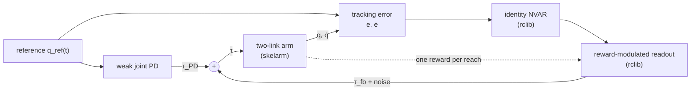

# arm-rmhl-test

Reward-modulated Hebbian learning (RMHL) on a simulated planar robot arm: a
preliminary study.

An RMHL model learns from a scalar reward alone. It perturbs its own outputs
with exploration noise, and correlates the perturbations with how good each
trial turned out to be. No target output and no gradient is given, so the model
can learn in a closed loop with a robot, toward goals for which there is
nothing to fit. This study explores what the RMHL of
[rclib](https://github.com/hrshtst/rclib) can learn on a planar arm simulated
with [skelarm](https://github.com/hrshtst/skelarm).

> **Status:** scaffold. The first experiment, feedback learned from scratch for
> one reach, is being prepared.

## Motivation

The sibling study arm-esn-ctrl trains echo state networks (ESNs) by ridge
regression on demonstrated motions. Supervised learning needs a target for every
output. In control, the target often is not known, only how well a motion went:
whether the hand followed its path, how much the motors worked, how quickly the
arm recovered from a push.

RMHL learns from exactly that kind of signal. Burms et al. (2015) let the body of
a compliant robot play the role of the reservoir, and learned feedback from its
sensors to its actuators from one reward per trial. Hoerzer et al. (2014) and
Miconi (2017) learned with rewards in the recurrent weights of a reservoir. This
study asks whether such rules learn useful control of an arm, with its coupled,
nonlinear dynamics, and how much tuning they need.

## Research questions

The study begins narrow, with one question:

1. **Feedback from scratch.** The arm reaches under a weak joint PD that lags
   far behind its reference. Starting from zero weights, can an RMHL readout
   learn feedback torques from the arm's tracking error that make the reach
   accurate, from one reward per reach? How close does it come to the best PD
   gains of a grid, scored by the same reward?

Later questions wait for its answer. Candidates are adapting to a change, such
as a force field at the hand or a payload; reward fine-tuning of an arm-esn-ctrl
ESN; and learning in the recurrent weights of a reservoir.

A negative answer is also a result, and the reports record it as one.

## Approach

### The body as the reservoir



- **The loop.** Every control period of 10 ms, the readout receives the
  tracking error and a constant 1, and outputs a feedback torque with
  exploration noise. The weak PD's torque and the feedback torque are held over
  the period, while skelarm integrates the arm every 2 ms.
- **The reward.** A trial is one reach from rest. At its end, the readout
  receives one reward: minus the hand's mean distance from where the reference
  puts it, beyond a dead zone. It then changes its weights by the trial rule of
  Burms et al. (2015), plain or decorrelated.
- **Reading the result.** The readout is linear in the error and its rate, so
  its weights are a 2×2 stiffness matrix, a 2×2 damping matrix, and a constant
  torque. They compare directly with PD gains.

## Guiding principles

- **Concept first.** Demonstrate the idea in a small, clear setup, such as a
  two-link arm and one reach, before scaling up. Explore the learning rate and
  the exploration by hand to build intuition; automated search waits until the
  concept is established.
- **Simple code.** Use plain functions on NumPy arrays and few layers of
  abstraction. Add a new abstraction only when a second real use appears. A
  researcher should be able to read any script from top to bottom.
- **Human-readable reports.** Each study is a short Markdown report written for
  people: a question, the setup, figures, observations, and next steps.
- **Everything in configuration files.** Every parameter that affects a result
  is set in a configuration file, not hidden in a script.
- **Claims are properties of a setup.** Arms that are compared share their seeds
  and their trial budgets, results are checked over several seeds, and each
  report says what it does not claim.
- **Libraries own their domain.** Learning numerics belong to rclib and arm
  simulation belongs to skelarm. Fix issues upstream first, then advance the
  submodule pin in a separate commit.

## Repository layout

```text
arm-rmhl-test/
├── src/arm_rmhl_test/  # small library: the arm, the reach, the learned feedback, run records
├── experiments/        # the runner scripts, and one directory per experiment: its README and configurations
├── reports/            # one directory per study (see Reports)
├── tests/              # sanity tests of the core pieces
└── third_party/        # rclib and skelarm (Git submodules)
```

## Experiments

Each experiment is a directory under [`experiments/`](experiments/README.md),
with a README that describes it and its configuration files; the runner scripts
that run them are shared. None has been added yet.

Every parameter that affects a result is in a TOML configuration file, and every
run records its configuration, the command, and the commit that produced it, so
that running the same configuration again on the same machine reproduces the same
result. Runs go into a storage root outside the repository, filed by experiment:
`<storage root>/results/<experiment>/<date>-<time>-<configuration name>/`.
[`experiments/README.md`](experiments/README.md) describes the configurations, the
run records, reproducibility, and the storage.

## Getting started

Prerequisites:

- Python 3.12 or newer and [uv](https://docs.astral.sh/uv/)
- A C++17 compiler, CMake 3.15 or newer, and OpenMP, all needed to
  build rclib (on Ubuntu: `sudo apt install libomp-dev`)

```bash
git clone --recursive <repository-url> arm-rmhl-test
cd arm-rmhl-test
uv sync        # builds rclib from the submodule and installs skelarm
uv run pytest  # quick sanity check

# Optional: keep results outside the repository
echo 'storage_root = "/path/to/storage"' > storage.toml
```

If you cloned without `--recursive`, run
`git submodule update --init --recursive`.

### Advancing a submodule pin

Fix issues in rclib or skelarm upstream first. Once the fix is on the
library's `main` branch, advance the pin here in a commit of its own
(rclib shown; skelarm is the same):

```bash
git -C third_party/rclib fetch origin
git -C third_party/rclib checkout <commit>                  # the new pin
git -C third_party/rclib submodule update --init --recursive  # the library's own submodules
git add third_party/rclib
uv sync --reinstall-package rclib
uv run pytest
```

Do not run `git submodule update` in this repository between checking
out the new commit and `git add`: it resets the submodule to the old pin.
uv installs the libraries from the submodules but does not notice when
their source changes, so reinstall them with `--reinstall-package`. After
committing the new pin, rerun the experiments whose results depend on
the library.

## Development

```bash
uv run pytest                                # tests
uv run ruff format . && uv run ruff check .  # formatting and linting
uv run basedpyright && uv run mypy           # type checking
```

Type annotations are encouraged but not required. The type checkers run
in their standard (non-strict) modes. Their settings in `pyproject.toml`
also apply when your editor runs its own pyright, basedpyright, or mypy,
so imports resolve against the project's `.venv`.

## Reports

`reports/` will hold one directory per study:

```text
reports/001-<slug>/
├── README.md   # the report
└── results/    # the runs behind its figures: configurations, outputs, figures
```

Each report has five parts:

1. **Question:** what we want to know, and why.
2. **Setup:** the arm, the reach, the command, the learning rule, and the
   arms compared, with links to the configuration files in `results/` and
   the command that regenerates the results.
3. **Results:** figures and a small table.
4. **Observations:** what the results show, including what did not work,
   and what is not claimed.
5. **Next steps.**

## Dependencies

The following libraries are pinned as Git submodules, so every result
can be traced to exact library versions:

| Library | Role | Path | License |
| --- | --- | --- | --- |
| [rclib](https://github.com/hrshtst/rclib) | reservoirs, readouts, and reward-modulated Hebbian learning (C++ core, Python bindings) | `third_party/rclib` | Apache-2.0 |
| [skelarm](https://github.com/hrshtst/skelarm) | Planar arm kinematics/dynamics simulation | `third_party/skelarm` | GPL-3.0-only |

## Key references

Reward-modulated Hebbian learning:

- R. Legenstein, S. M. Chase, A. B. Schwartz, and W. Maass, "A
  reward-modulated Hebbian learning rule can explain experimentally observed
  network reorganization in a brain control task," *The Journal of
  Neuroscience*, 30(25):8400–8410, 2010.
- G. M. Hoerzer, R. Legenstein, and W. Maass, "Emergence of complex
  computational structures from chaotic neural networks through
  reward-modulated Hebbian learning," *Cerebral Cortex*, 24(3):677–690, 2014.
- T. Miconi, "Biologically plausible learning in recurrent neural networks
  reproduces neural dynamics observed during cognitive tasks," *eLife*,
  6:e20899, 2017.
- J. Burms, K. Caluwaerts, and J. Dambre, "Reward-modulated Hebbian
  plasticity as leverage for partially embodied control in compliant
  robotics," *Frontiers in Neurorobotics*, 9:9, 2015.

## License

This project is licensed under the GNU General Public License v3.0 only
(GPL-3.0-only). See [LICENSE](LICENSE). The submodules keep their own
licenses, listed under [Dependencies](#dependencies).

## AI assistance

This project is developed with the assistance of AI coding agents. The
maintainer ([@hrshtst](https://github.com/hrshtst)) sets the research
direction, and reviews, tests, and revises every change. All
responsibility for the code and reports in this repository lies with
the maintainer.
