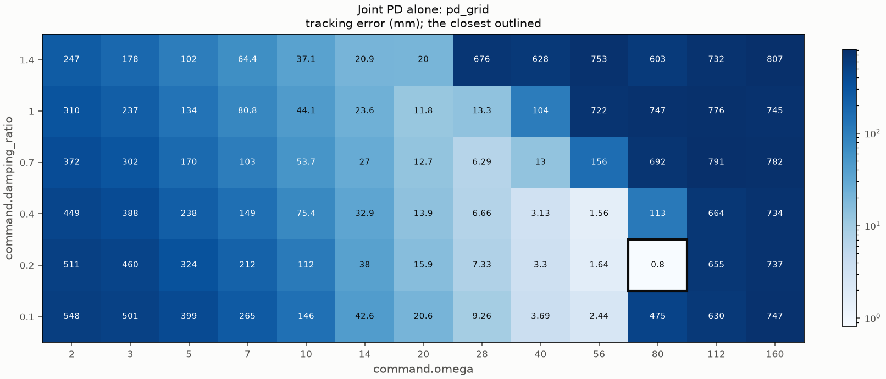
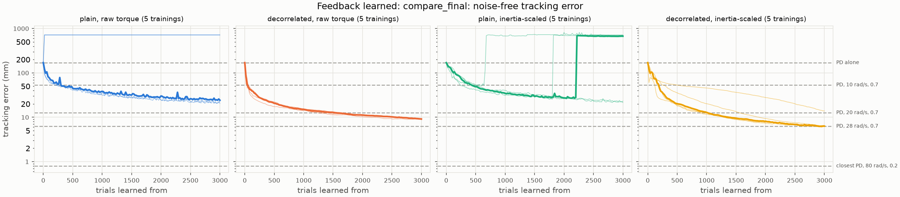
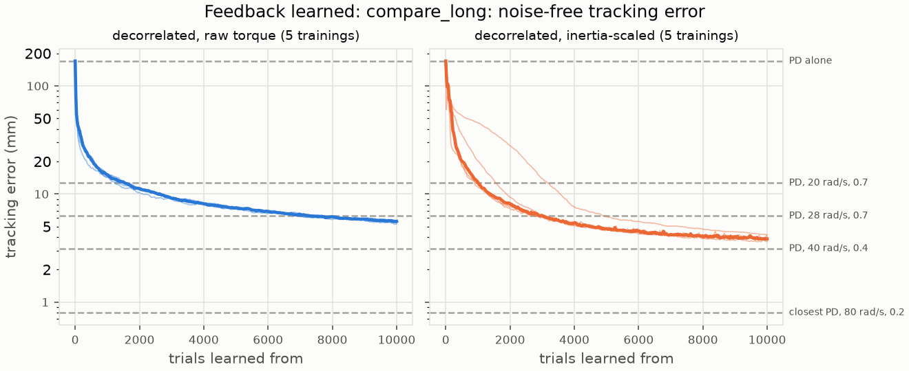

# 001 Feedback from scratch

**Summary.** A two-link arm reached under a weak joint PD that lags 170 mm
behind its reference. A reward-modulated Hebbian readout (rclib's `burms2015`
trial rule) learned feedback torques for it from zero weights, from one reward
per reach. With the decorrelated rule, it learned on every unseen seed. After
3,000 reaches, the noise-free tracking error was 9.1 mm with raw torque and
6.3 mm with each joint's output scaled by its inertia (medians of 5 seeds). A
PD of 28 rad/s with a damping ratio of 0.7 tracks to 6.3 mm, and the closest PD
of the grid tracks to 0.8 mm. The plain rule learned more slowly, and its gains
ran away on 2 and 3 of the 5 seeds. Continued to 10,000 reaches, the decorrelated
rule tracked to 5.6 mm with raw torque and 3.8 mm inertia-scaled, still improving
slowly. Inertia-scaled, its torque chattered from one control period to the next.

- **The yardstick is strong.** With a low damping ratio, a stiff PD stays stable
  under the 10-ms torque hold. The closest PD of the grid, 80 rad/s with a damping
  ratio of 0.2, tracks to 0.8 mm. It sits next to PDs that run away.
- **The decorrelated rule learns reliably.** All 10 of its final trainings
  improved, and none ran away. At 1,000 reaches, the tuning's budget, it was at
  15.1 mm with raw torque and 12.8 mm inertia-scaled, about the PD of 20 rad/s
  (12.7 mm). It was still improving at 3,000.
- **A longer budget pays slowly, and inertia-scaled, at a cost.** Between 3,000
  and 10,000 reaches, the error fell from 9.1 to 5.6 mm with raw torque, past the
  28-rad/s PD (6.3 mm). Inertia-scaled, it fell from 6.3 to 3.8 mm, short of a PD
  of 40 rad/s with a damping ratio of 0.4 (3.1 mm). Over the last 1,000 reaches,
  the medians still fell by 4 and 5%. The raw-torque feedback stayed smooth, with
  less effort than the PDs. The inertia-scaled one chattered for about the first
  0.4 s of the reach, on all five seeds: its torque varied six times as much as the PDs'
  from one period to the next, and peaked twice as high. The reward scores only the
  tracking error.
- **The plain rule's gains run away without warning.** Its tuned settings, each
  the closest on seed 0, ran away on new seeds: 2 of 5 within 20 reaches with raw
  torque, and 3 of 5 after 680 to 2,220 reaches inertia-scaled. Neither rclib nor
  skelarm raised an error. Under torques of 10^6 to 10^18 N m, the arm spent 74 to
  99% of the reach at a joint stop, about 700 mm off. Where the plain rule did not
  run away, it reached 21 to 24 mm.
- **The learned feedback is mostly damping.** For the decorrelated rule
  inertia-scaled, after 3,000 reaches, joint 1 is at about 14 rad/s with a damping
  ratio of about 6.
  The feedback matches the 28-rad/s PD's error with, on joint 1, a quarter of that
  PD's stiffness and four times its damping, and with no more effort or peak
  torque.
- **The decorrelated rule explores boldly.** Its tuned settings use exploration
  noise about as large as the control torque itself: 3.2 N m with raw torque, and
  8 rad/s^2 inertia-scaled, about 1.9 N m on joint 1, against peak torques of about
  2.2 N m.

## 1. Question

RQ1 of the [project README](../../README.md#research-questions): the arm reaches
under a weak joint PD that lags far behind its reference. Starting from zero
weights, can an RMHL readout learn feedback torques from the arm's tracking error
that make the reach accurate, from one reward per reach? How close does it come to
the best PD gains of a grid, scored by the same reward?

## 2. Setup

The [experiment's README](../../experiments/feedback_from_scratch/README.md) holds
the configurations and the protocol, fixed before each stage's runs.

- **The arm:** arm-esn-ctrl's v2 arm. It has two links (0.5 m and 0.4 m, 0.5 kg and
  0.4 kg) in the horizontal plane, without gravity, and skelarm integrates it every
  2 ms.
- **The reach:** from rest at (30, 30) deg, the reference moves the hand to
  (-0.6, 0.4) m by a minimum-jerk move of 1 s in joint space, then holds the goal
  for 1 s.
- **The weak PD:** 5 rad/s with a damping ratio of 0.7, scaled by each joint's
  inertia at the start (0.235 and 0.022 kg m^2). Every 10 ms its torque is
  computed and held.
- **The feedback:** an identity NVAR passes the tracking error
  `[q_ref - q, dq_ref - dq]` and a constant 1 to rclib's reward-modulated readout,
  every 10 ms. The readout starts at zero weights, and its output, with exploration
  noise while learning, adds to the PD's torque. The weights read directly as a
  stiffness matrix, a damping matrix, and a constant torque. There are two variants:
  - **raw torque:** the output is the torque (N m);
  - **inertia-scaled:** each joint's output is multiplied by its inertia at the
    start, as the PD's gains are. The output is in rad/s^2, and one learning rate
    moves both joints' gains alike.
- **The reward:** minus the reach's tracking error, the hand's mean distance from
  where the reference puts it over the 200 control periods (no dead zone). The
  same score ranks the PDs.
- **The rule:** `burms2015` of rclib v0.3.0. It adds Gaussian noise to the output
  every 10 ms, and makes one update per reach. The update uses the reward's
  difference from the mean of the last 50 rewards, times the correlation of the
  input with the noise over the reach. The plain rule turns the decorrelation off.
  The decorrelated rule multiplies the update by the inverse of the input's summed
  outer products over the reach, plus the identity.
- **The evaluation:** a noise-free reach every 20 reaches, which changes no learning
  state. A training's outcome is `improved` if its last noise-free reach beats the
  PD alone, and `worse` if not. It is `diverged` if rclib or skelarm raised, which
  never happened here.

The protocol has four steps:

1. **The yardstick.** The PD alone, over 13 natural frequencies (2 to 160 rad/s)
   and 6 damping ratios (0.1 to 1.4).
2. **Tuning.** For each rule and variant, the exploration amplitude and the learning
   rate were tuned by hand on seed 0, in rounds of 1,000 reaches. A round went to
   larger amplitudes while the closest setting lay at the largest amplitude tried,
   and the tuning stopped when larger amplitudes no longer paid off. The tuned
   setting is the one with the lowest noise-free error at 1,000 reaches over all
   rounds.
3. **The final runs.** Each tuned setting on seeds 1 to 5, which the tuning never
   saw, for 3,000 reaches. The error at 1,000 reaches compares at the tuning's
   budget.
4. **A longer budget.** Added after the final runs, because the decorrelated rule
   was still improving at 3,000 reaches. Its two final runs were repeated with the
   same settings and seeds for 10,000 reaches, from zero weights. Their first 3,000
   reaches reproduce the final runs exactly.

### Reproducing the results

All runs are in [`results/`](results), each with its configuration (`config.toml`),
its run record (`run.toml`), and its outputs. The configurations are in
[`feedback_from_scratch`](../../experiments/feedback_from_scratch/README.md).

| Runs | Command | Commit |
| --- | --- | --- |
| `pd_grid` | `uv run python experiments/pd_grid.py experiments/feedback_from_scratch/pd_grid.toml` | `bdf0c0b` |
| `tune_plain`, `tune_decorrelated` | `uv run python experiments/learn_feedback.py experiments/feedback_from_scratch/<name>.toml --workers 15` | `bdf0c0b` |
| `tune_plain_round2`, `tune_decorrelated_round2`, `tune_plain_inertia`, `tune_decorrelated_inertia` | as the second | `8ef75fc` |
| `tune_plain_round3`, `tune_decorrelated_round3`, `tune_plain_inertia_round2`, `tune_decorrelated_inertia_round2` | as the second | `b5383fd` |
| `final_plain_raw`, `final_decorrelated_raw`, `final_plain_inertia`, `final_decorrelated_inertia` | as the second | `bf7fe7d` |
| `long_decorrelated_raw`, `long_decorrelated_inertia` | as the second, with `--workers 5` | `4d6a35f` |
| `compare_final`, `compare_long` | `uv run python experiments/compare_learning.py experiments/feedback_from_scratch/<name>.toml` | `b734df5` |

The number of workers does not change a result, as a test checks. Every run record
shows no uncommitted changes. [`make_tables.py`](make_tables.py) prints the tables
of Section 3 from these copies. It replays without noise each final feedback and
each PD of the effort tables. It checks that each replay reproduces the run's last
noise-free error, or the PD's error in the grid, and every one does. A training of
3,000 reaches took 17 to 28 minutes, with 20 running at once on the workstation:
0.3 to 0.6 s per reach. One of 10,000 reaches took 47 to 58 minutes, with 10 at
once.

## 3. Results

### 3.1 The PD alone

| PD | Tracking error |
| --- | ---: |
| the weak PD, 5 rad/s, 0.7 | 170.0 mm |
| 10 rad/s, 0.7 | 53.7 mm |
| 20 rad/s, 0.7 | 12.7 mm |
| 28 rad/s, 0.7 | 6.3 mm |
| the closest, 80 rad/s, 0.2 | 0.8 mm |

Stiffer PDs track closer until the 10-ms hold makes them run away. Damping sets
where that happens: at a damping ratio of 0.7, the error is lowest at 28 rad/s; at
0.2, at 80 rad/s. The closest PD's neighbors, at damping ratios of 0.1 and 0.4 and
at 112 rad/s, run away to 113 to 655 mm.

### 3.2 Tuning

The closest setting of each round, at 1,000 reaches on seed 0, by rule and variant.
Each run's `learning.png` draws all its settings over the reaches.

| Run | Rule, feedback | Amplitudes | Learning rates | Improved / worse / diverged | Closest | Error |
| --- | --- | --- | --- | --- | --- | ---: |
| [`tune_decorrelated_inertia`](results/20261103-223958-tune_decorrelated_inertia/learning.png) | decorrelated, inertia-scaled | 0.5, 1, 2, 4 rad/s^2 | 10, 30, 100, 300, 1000, 3000 | 15 / 9 / 0 | 4 rad/s^2, 100 | 19.1 mm |
| [`tune_decorrelated_inertia_round2`](results/20261103-231146-tune_decorrelated_inertia_round2/learning.png) | decorrelated, inertia-scaled | 4, 8, 16 rad/s^2 | 12, 25, 50, 100 | 8 / 4 / 0 | **8 rad/s^2, 50** | 16.5 mm |
| [`tune_decorrelated`](results/20261103-210821-tune_decorrelated/learning.png) | decorrelated, raw torque | 0.05, 0.1, 0.2 N m | 10, 30, 100, 300, 1000 | 8 / 7 / 0 | 0.2 N m, 30 | 68.1 mm |
| [`tune_decorrelated_round2`](results/20261103-223958-tune_decorrelated_round2/learning.png) | decorrelated, raw torque | 0.2, 0.4, 0.8 N m | 5, 10, 20, 40, 80 | 11 / 4 / 0 | 0.8 N m, 20 | 19.5 mm |
| [`tune_decorrelated_round3`](results/20261103-231146-tune_decorrelated_round3/learning.png) | decorrelated, raw torque | 0.8, 1.6, 3.2 N m | 2.5, 5, 10, 20 | 8 / 4 / 0 | **3.2 N m, 2.5** | 18.0 mm |
| [`tune_plain_inertia`](results/20261103-223958-tune_plain_inertia/learning.png) | plain, inertia-scaled | 0.5, 1, 2, 4 rad/s^2 | 0.3, 1, 3, 10, 30, 100 | 6 / 18 / 0 | 2 rad/s^2, 0.3 | 46.4 mm |
| [`tune_plain_inertia_round2`](results/20261103-231146-tune_plain_inertia_round2/learning.png) | plain, inertia-scaled | 2, 4, 8 rad/s^2 | 0.04, 0.08, 0.15, 0.3 | 9 / 3 / 0 | **4 rad/s^2, 0.15** | 33.2 mm |
| [`tune_plain`](results/20261103-210821-tune_plain/learning.png) | plain, raw torque | 0.05, 0.1, 0.2 N m | 0.3, 1, 3, 10, 30 | 8 / 7 / 0 | 0.2 N m, 1 | 46.7 mm |
| [`tune_plain_round2`](results/20261103-223958-tune_plain_round2/learning.png) | plain, raw torque | 0.2, 0.4, 0.8 N m | 0.12, 0.25, 0.5, 1, 2 | 9 / 6 / 0 | **0.8 N m, 0.25** | 27.8 mm |
| [`tune_plain_round3`](results/20261103-231146-tune_plain_round3/learning.png) | plain, raw torque | 0.8, 1.6, 3.2 N m | 0.03, 0.06, 0.12, 0.25 | 5 / 7 / 0 | 0.8 N m, 0.25 | 27.8 mm |

The tuned settings are in bold.

- **Every `worse` setting lost control.** Within a few reaches to hundreds of
  reaches, its noise-free error jumped to 250 to 900 mm, mostly about 700 mm, and
  its gains grew by orders of magnitude, with no error raised. In the plain rule's
  run-aways, the arm spends most of the reach at a joint stop, under torques that
  skelarm's locked stops hold, of 10^6 to 10^35 N m in those replayed. In the
  decorrelated rule's, the arm swings under torques of hundreds of N m.
- **A larger amplitude helped as long as the learning rate kept below a line.** In
  each round, the learning rate at which the gains ran away fell as the amplitude
  rose. For the plain rule with raw torque, it was where their product reached 0.4
  in round 2. Every tuned setting is within a factor of 2 of a learning rate that ran
  away or ended farther off.
- **The plain rule runs away abruptly.** In `tune_plain_inertia`, joint 1's damping
  over its inertia went from about 20 to about 80,000 per second between two
  evaluations, 20 reaches apart.

### 3.3 The final runs

Each training thin, their median thick. The dashed lines are PDs of the grid.

| Rule, feedback | Reaches | seed 1 | seed 2 | seed 3 | seed 4 | seed 5 | Median |
| --- | ---: | ---: | ---: | ---: | ---: | ---: | ---: |
| decorrelated, inertia-scaled | 1,000 | 11.6 mm | 45.6 mm | 12.3 mm | 20.2 mm | 12.8 mm | 12.8 mm |
| decorrelated, inertia-scaled | 3,000 | 6.2 mm | 13.9 mm | 6.3 mm | 6.3 mm | 6.2 mm | **6.3 mm** |
| decorrelated, raw torque | 1,000 | 15.4 mm | 15.3 mm | 14.3 mm | 15.1 mm | 14.5 mm | 15.1 mm |
| decorrelated, raw torque | 3,000 | 9.2 mm | 9.1 mm | 9.2 mm | 9.1 mm | 9.0 mm | **9.1 mm** |
| plain, inertia-scaled | 1,000 | 34.6 mm | 31.0 mm | 679.4 mm | 33.3 mm | 40.5 mm | 34.6 mm |
| plain, inertia-scaled | 3,000 | 21.5 mm | 23.1 mm | 711.0 mm | 672.0 mm | 713.3 mm | 672.0 mm |
| plain, raw torque | 1,000 | 38.3 mm | 721.4 mm | 31.4 mm | 714.2 mm | 36.1 mm | 38.3 mm |
| plain, raw torque | 3,000 | 24.2 mm | 721.4 mm | 20.6 mm | 714.2 mm | 22.9 mm | 24.2 mm |

- **The decorrelated rule:** 10 of 10 improved, still falling at 3,000 reaches.
  With raw torque, the five seeds end within 0.2 mm of each other. Inertia-scaled,
  four end at 6.2 to 6.3 mm, and seed 2, slow from the start, at 13.9 mm.
- **The plain rule:** with raw torque, seeds 2 and 4 ran away within the first 20
  reaches. Inertia-scaled, seeds 3, 4, and 5 ran away after 680, 1,820, and 2,220
  reaches, having reached 51, 25, and 26 mm.
- **The exploring reaches:** over the last 100 reaches, they tracked to 19 to 20 mm
  for the decorrelated rule with raw torque (3.2 N m of noise), against 9.1 mm
  noise-free. Inertia-scaled, they tracked to 7 to 8 mm (15 mm for seed 2).

### 3.4 The learned feedback as gains, and its effort

Each joint's PD-equivalent natural frequency and damping ratio, from the diagonal
of the final stiffness and damping, the weak PD's and the feedback's together.
These are medians over the five seeds, with the gains that ran away included.
The cross-joint gains are the largest off-diagonal gain over the largest diagonal
one.

| Rule, feedback | omega 1 (rad/s) | zeta 1 | omega 2 (rad/s) | zeta 2 | Cross gains |
| --- | ---: | ---: | ---: | ---: | --- |
| decorrelated, inertia-scaled | 14.3 | 5.92 | 15.9 | 1.88 | stiffness 28%, damping 36% |
| decorrelated, raw torque | 9.3 | 1.71 | 27.6 | 1.61 | stiffness 98%, damping 73% |
| plain, inertia-scaled | 5.0 | 1.35 | 5.0 | 2.05 | stiffness 23%, damping 89% |
| plain, raw torque | 5.1 | 1.67 | 6.9 | 6.74 | stiffness 19%, damping 74% |

The weak PD alone is 5 rad/s at 0.7, and the 28-rad/s PD that tracks as closely as
the decorrelated rule inertia-scaled has a damping ratio of 0.7.

The final feedback of each seed that improved, replayed without noise, against the
PDs, replayed likewise. The effort is the squared torque integrated over the reach.
The torque variation is how much the torque changes from one control period to the
next, summed over the reach and the joints. It is large when the torque chatters.

| Controller | Tracking error | Effort (N^2 m^2 s) | Peak torque (N m) | Torque variation (N m) |
| --- | ---: | ---: | ---: | ---: |
| PD, 5 rad/s, 0.7 | 170.0 mm | 3.03 | 2.56 | 11.5 |
| PD, 10 rad/s, 0.7 | 53.7 mm | 3.85 | 2.81 | 14.4 |
| PD, 20 rad/s, 0.7 | 12.7 mm | 2.90 | 2.67 | 12.6 |
| PD, 28 rad/s, 0.7 | 6.3 mm | 2.62 | 2.53 | 11.8 |
| decorrelated, inertia-scaled, median of 5 | 6.3 mm | 2.34 | 2.20 | 10.8 |
| decorrelated, raw torque, median of 5 | 9.1 mm | 2.45 | 2.25 | 10.9 |
| plain, inertia-scaled, median of 2 | 22.3 mm | 3.96 | 3.86 | 30.0 |
| plain, raw torque, median of 3 | 22.9 mm | 2.18 | 2.15 | 10.8 |

The medians hide one exception. Seed 2 of the decorrelated rule inertia-scaled, the
slow one at 13.9 mm, has a torque variation of 53 N m. For the first 0.48 s of the
reach, its torque jumps by more than 0.5 N m from one period to the next. Section
3.5 shows the same in all five seeds at 10,000 reaches.

### 3.5 A longer budget

The decorrelated rule's final runs, repeated for 10,000 reaches. Each training
thin, their median thick. The dashed lines are PDs of the grid.

| Rule, feedback | Reaches | seed 1 | seed 2 | seed 3 | seed 4 | seed 5 | Median |
| --- | ---: | ---: | ---: | ---: | ---: | ---: | ---: |
| decorrelated, inertia-scaled | 1,000 | 11.6 mm | 45.6 mm | 12.3 mm | 20.2 mm | 12.8 mm | 12.8 mm |
| decorrelated, inertia-scaled | 3,000 | 6.2 mm | 13.9 mm | 6.3 mm | 6.3 mm | 6.2 mm | 6.3 mm |
| decorrelated, inertia-scaled | 5,000 | 4.7 mm | 6.2 mm | 4.8 mm | 4.8 mm | 4.7 mm | 4.8 mm |
| decorrelated, inertia-scaled | 10,000 | 3.7 mm | 4.2 mm | 3.8 mm | 3.6 mm | 4.0 mm | **3.8 mm** |
| decorrelated, raw torque | 1,000 | 15.4 mm | 15.3 mm | 14.3 mm | 15.1 mm | 14.5 mm | 15.1 mm |
| decorrelated, raw torque | 3,000 | 9.2 mm | 9.1 mm | 9.2 mm | 9.1 mm | 9.0 mm | 9.1 mm |
| decorrelated, raw torque | 5,000 | 7.5 mm | 7.5 mm | 7.5 mm | 7.3 mm | 7.2 mm | 7.5 mm |
| decorrelated, raw torque | 10,000 | 5.6 mm | 5.7 mm | 5.6 mm | 5.3 mm | 5.5 mm | **5.6 mm** |

- **Still improving, slowly.** All 10 trainings improved, and none ran away. From
  3,000 to 10,000 reaches, both medians fell by about 40%, and over the last 1,000
  reaches, by 4% with raw torque and 5% inertia-scaled. With raw torque, the five
  seeds end within 0.4 mm of each other. Inertia-scaled, seed 2 caught up: 4.2 mm,
  against 3.6 to 4.0 mm for the others.
- **Against the PDs.** The median stayed below the 28-rad/s PD's 6.3 mm from 7,280
  reaches with raw torque, and from 3,020 reaches inertia-scaled. Neither reached
  the PD of 40 rad/s with a damping ratio of 0.4 (3.1 mm), the closest PD of that
  frequency, nor the closest PD of the grid (0.8 mm).

The learned feedback as gains, read as in Section 3.4:

| Rule, feedback | omega 1 (rad/s) | zeta 1 | omega 2 (rad/s) | zeta 2 | Cross gains |
| --- | ---: | ---: | ---: | ---: | --- |
| decorrelated, inertia-scaled | 13.8 | 8.41 | 19.9 | 1.84 | stiffness 57%, damping 38% |
| decorrelated, raw torque | 10.6 | 2.26 | 33.4 | 2.37 | stiffness 111%, damping 85% |

Between 3,000 and 10,000 reaches, the gains moved further the way they had gone.
Inertia-scaled, joint 1's damping ratio rose from 5.9 to 8.4, and joint 2's
frequency from 15.9 to 19.9 rad/s. With raw torque, joint 2's frequency rose from
27.6 to 33.4 rad/s, and the largest cross-joint stiffness outgrew the largest
diagonal one. A reading as joint PD gains then fits less well.

The final feedback of each seed, replayed without noise, against the PDs it
approaches:

| Controller | Tracking error | Effort (N^2 m^2 s) | Peak torque (N m) | Torque variation (N m) |
| --- | ---: | ---: | ---: | ---: |
| PD, 5 rad/s, 0.7 | 170.0 mm | 3.03 | 2.56 | 11.5 |
| PD, 28 rad/s, 0.7 | 6.3 mm | 2.62 | 2.53 | 11.8 |
| PD, 40 rad/s, 0.4 | 3.1 mm | 2.49 | 2.44 | 11.9 |
| decorrelated, inertia-scaled, median of 5 | 3.8 mm | 3.24 | 4.98 | 71.6 |
| decorrelated, raw torque, median of 5 | 5.6 mm | 2.38 | 2.22 | 10.7 |

- **With raw torque, the feedback stays smooth.** It tracks closer than the
  28-rad/s PD, with less effort (2.38 against 2.62 N^2 m^2 s) and a lower peak
  torque (2.22 against 2.53 N m).
- **Inertia-scaled, it chatters.** On all five seeds, its torque jumps by more than
  0.5 N m from one period to the next, on both joints, through the first 0.40 to
  0.46 s of the reach. That stretch holds about 90% of the torque variation, which
  is 45 to 101 N m, against about 12 N m for the PDs. The peak torque is 4.2 to
  6.3 N m, about twice the PDs'. The effort is 2.85 to 4.47 N^2 m^2 s, more than
  the 40-rad/s PD's 2.49, which tracks closer. At 3,000 reaches, only seed 2
  chattered.

## 4. Observations

- **RQ1, yes for the decorrelated rule, at this setup's cost.** From zero weights
  and one reward per reach, it took the weak PD's 170 mm to 6 to 9 mm on every
  unseen seed, matching PDs of 20 to 28 rad/s at no more effort. It needed
  hundreds to thousands of reaches, and exploration noise as large as the control
  torque. Within 10,000 reaches, it came to 3.8 to 5.6 mm, still improving by a few
  percent per 1,000 reaches, and it did not approach the closest PD of the grid,
  0.8 mm.
- **The decorrelated rule is the robust one.** Its tuned settings carried over from
  seed 0 to five new seeds; the plain rule's did not. One reading, not tested here:
  the plain rule's update grows with the input, so a reach whose error grows makes a
  larger update, which can make the next error larger still. The decorrelated rule
  divides the update by the input's covariance over the reach, which grows with the
  input too.
- **Inertia scaling helped the decorrelated rule (6.3 against 9.1 mm), not the plain
  one.** The plain rule ran away on 3 of 5 seeds inertia-scaled, against 2 of 5 with
  raw torque. The scaling also changed what was learned. With raw torque, the
  decorrelated rule made joint 2 stiff (27.6 rad/s) and joint 1 soft (9.3 rad/s),
  with cross gains nearly as large as the diagonal ones. Inertia-scaled, it made both
  joints about 15 rad/s. At 10,000 reaches, the inertia-scaled feedback was the
  closer one (3.8 against 5.6 mm), but only by a torque that chatters.
- **The learned feedback damps rather than stiffens.** At 3,000 reaches, it tracks
  as closely as the 28-rad/s PD with a quarter to a third of its stiffness and
  damping ratios of 2 to 6. One reading, not tested here: a large gain on the velocity error `dq_ref - dq` pushes
  the arm along the reference's velocity during the move, much as a velocity
  feedforward would.
- **Nothing in the reward keeps the torque smooth.** The reward scores the tracking
  error alone, and the inertia-scaled feedback's error kept falling as its torque
  began to chatter. One reading, not tested here: its damping grew to where the
  10-ms hold makes it oscillate, as the hold makes the stiffer PDs of the grid run
  away.
- **A run-away raises nothing.** The arm went to a joint stop and stayed there, its
  error finite, so the outcome had to be read from the noise-free error. rclib and
  skelarm raised in none of the 186 trainings.
- **The tuning on one seed hid the plain rule's risk.** On seed 0 its tuned settings
  improved throughout 1,000 reaches; on new seeds, half ran away. Each tuned setting
  lies within a factor of 2 of a learning rate that ran away.

What is not claimed:

- **Other reaches, starts, or arms.** There is one reach on one arm, and the
  feedback is learned for that reach alone. Whether it carries to another reach is
  not tested.
- **The best each rule can do.** The tuning was by hand, on one seed, at 1,000
  reaches, over the exploration amplitude and the learning rate alone. rclib's
  `max_update`, learning-rate decay, other baselines, and the `heaviside` modulator
  were not tried. A clip on the update might keep the plain rule from running away.
- **A better feedback than the PD's.** The yardstick is a diagonal joint PD scaled
  by the inertia at the start. The learned feedback adds to the weak PD, and has
  cross-joint gains.
- **Where the learning levels off.** At 10,000 reaches it was still improving.
- **Statistics.** Five seeds per arm give medians and ranges, without tests.
- **The mechanisms.** The readings of the run-aways, of the damping, and of the
  chatter are hypotheses.

## 5. Next steps

1. **Keep the torque smooth.** A reward that also scores the torque's variation or
   effort, or a limit on the damping gains: does the inertia-scaled feedback keep
   its lead without chattering? Where the error levels off is still open.
2. **Guard the plain rule:** a clip on the update (`max_update`) or learning-rate
   decay, on several seeds from the start of the tuning.
3. **Tune on several seeds.** Seed 0 alone hid the plain rule's run-aways.
4. **Test the readings:** the feedback's response to the velocity error alone, the
   size of the plain rule's update just before a run-away, and the chatter with a
   shorter hold.
5. **Beyond one reach:** feedback learned on several reaches, tried on new ones, or
   adapting to a change such as a load at the hand, as in the project README's
   candidates.
