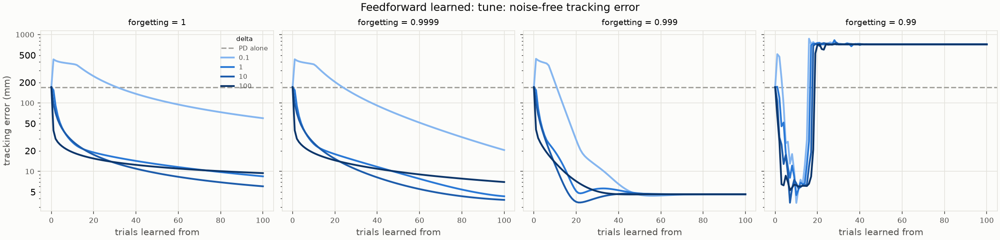
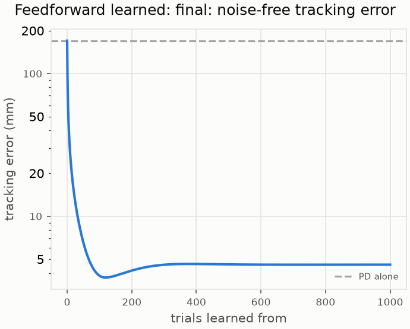
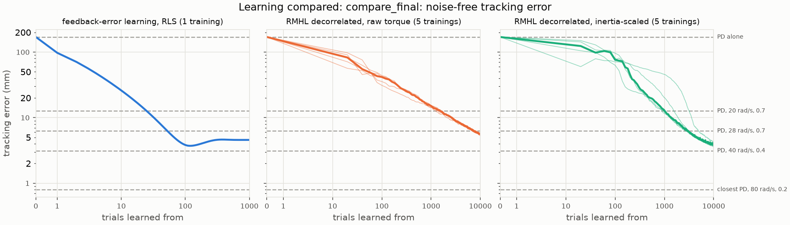

# 002 Feedback-error learning

**Summary.** The arm reached under report 001's weak joint PD, which lags 170 mm
behind its reference. Feedback-error learning with rclib's RLS readout, given a
target torque every control period, learned a feedforward from the reference. From
zero weights, it brought the error to 3.8 mm in 100 reaches. It then settled at
4.6 mm and stayed there through 1,000 reaches. It passed PDs of 20 and 28 rad/s
after 25 and 53 reaches. Report 001's decorrelated reward-modulated rule took 1,020
to 7,280. With the least effort of every controller compared, and a smooth torque,
it left the weak PD about a twentieth of its torque. It ended between the
reward-modulated feedback's two variants after 10,000 reaches (5.6 mm with raw
torque, 3.8 mm inertia-scaled), and no learner reached the PD of 40 rad/s
(3.1 mm). Its form limits it: a linear map of the reference, fitted to the
torque the reach needs, tracks to 4.2 mm.

- **Tens of reaches, not thousands.** At 100 reaches, feedback-error learning was
  at 3.8 mm, against 42 and 76 mm for the reward-modulated rule (medians of 5
  seeds). That rule took about 10,000 reaches to come to 5.6 mm with raw torque
  and 3.8 mm inertia-scaled.
- **It settles above its best.** It passed 3.7 mm at 119 reaches, then rose to
  4.6 mm by 300 and stayed. The tuning picked it by its error at 100 reaches, near
  that dip. The 4.6 mm is where every tuning setting with a forgetting factor of
  0.999 settled too. Feedback-error learning stops where the PD's remaining torque
  no longer correlates with the reference, and that is not where the tracking
  error is lowest.
- **The least effort, and a smooth torque.** Its effort is 2.32 N^2 m^2 s and its
  peak torque 2.08 N m, below every PD of the grid that tracks within 100 mm (at
  least 2.37 for each). Its torque varies from one period to the next no more than
  the PDs'. The reward-modulated feedback that came closer, inertia-scaled,
  chattered.
- **Its form limits it.** With the weak PD, the torque the reference needs, from
  the arm's inverse dynamics at each period's start, tracks to 2.7 mm, and its
  least-squares fit by the readout's form, linear in the reference, to 4.2 mm.
  Feedback-error learning settled near the fit.
- **Its failures are silent too.** With a forgetting factor of 0.99, every setting
  ran away within 20 reaches. The arm sat at a joint stop through the whole reach,
  with no error raised, like report 001's plain rule.

**Note, 2026-11-06: past 1,000 reaches, the final run's feedforward winds up.**
Continued for 10,000 reaches in `combined_learning`'s run `final_feedforward_alone`,
within 2.4e-16 m of this report's final run over its 1,000 reaches, it held near
4.6 mm through 1,360 reaches. Then it swung out, and from 1,580 reaches it ran away
for good, silently, its weights growing to 1e17. Along the reach both joints follow
one minimum-jerk profile, so the readout's seven inputs span only four dimensions.
Below a forgetting factor of 1, RLS's covariance grows without bound in the other
three. In every run of that experiment whose feedforward keeps learning, the
reaches before it runs away scale with 1/(1 - λ): 12 to 20 at 0.99, 160 to 180 at
0.999 (the reward-modulated feedback learning beside it), and 1,380 to 1,580 at
0.9999. This supports reading the run-aways at 0.99 (Section 3.1) as wind-up, in
the directions the reach never excites rather than the ones its hold leaves out.
The settings at 0.999, too, settled only within this report's 100 reaches, and "it
settles, and stays" holds only through about 1,360 reaches. The results below,
all within 1,000 reaches, are unchanged; see
[`combined_learning`](../../experiments/combined_learning/README.md#the-feedforwards-wind-up).

## 1. Question

A supervised baseline for report [001](../001-feedback-from-scratch/README.md),
within RQ1 of the [project README](../../README.md#research-questions). The arm
reaches under the same weak joint PD, which lags 170 mm behind its reference. Given
a target torque every control period instead of one reward per reach, how fast and
how close does an online learner bring the reach to its reference? How do its
result, its effort, and its torque compare with report 001's reward-modulated
feedback and with joint PDs of a grid?

## 2. Setup

The [experiment's README](../../experiments/feedback_error_learning/README.md)
holds the configurations and the protocol, fixed before the runs.

- **The arm, the reach, and the weak PD** are report 001's: arm-esn-ctrl's v2 arm,
  one reach from rest at (30, 30) deg to the hand at (-0.6, 0.4) m by a 1-s
  minimum-jerk move and a 1-s hold, and a joint PD of 5 rad/s with a damping ratio
  of 0.7 whose torque is computed and held every 10 ms. A test checks that the
  configurations' tables are the same.
- **The feedforward:** an identity NVAR passes the reference
  `[q_ref, dq_ref, ddq_ref]` at the start of each control period, and a constant 1,
  to rclib's recursive least squares (RLS) readout. Its output is a torque added to
  the PD's and held with it. It starts at zero weights. Its weights read as a torque
  per reference angle, velocity, and acceleration, and a constant torque.
- **The learning:** feedback-error learning (Kawato et al., 1987). Every control
  period of a reach, the readout fits, as its target, its own output plus the weak
  PD's torque, and the next period's output comes from the updated weights. As the
  feedforward comes to give the torque the reach needs, the PD's share shrinks.
  There is no noise and no reward.
- **The readout's settings:** RLS's forgetting factor, and `delta`, its initial
  regularization: the covariance starts at the identity over `delta`.
- **The evaluation:** after every trial, a reach with the weights as they stand,
  which learns nothing, scored by report 001's tracking error: the hand's mean
  distance from where the reference puts it over the 200 control periods. The
  outcome is `improved` if the last evaluation beats the PD alone, `worse` if not,
  and `diverged` if rclib or skelarm raised, which never happened here.

How this differs from report 001, besides the learning signal:

- **A target every 10 ms against one reward per reach:** 400 numbers per reach
  against one.
- **Feedforward against feedback.** The readout sees the reference, not the
  tracking error. It learns a torque schedule for this reach, and leaves any
  reaction to the arm's actual state to the weak PD. Report 001's readout learned
  feedback gains on the tracking error.
- **Within the reach against between reaches.** RLS updates every control period;
  the reward-modulated rule once per reach.
- **No seeds.** Nothing here is random, so each setting is one deterministic
  training, and there is no held-out check like report 001's seeds 1 to 5: the
  tuning and the final run are the same task.

The protocol has three steps:

1. **Tuning.** Forgetting factors of 1, 0.9999, 0.999, and 0.99 by `delta` of 0.1,
   1, 10, and 100, for 100 trials each. The tuned setting is the one with the lowest
   error at 100 trials.
2. **The final run.** The tuned setting for 1,000 trials, to show whether it stays
   there.
3. **The comparison** with the decorrelated rule's runs of 10,000 trials in report
   001 (5 seeds each), the PD alone, and PDs of report 001's grid, in tracking
   error over the trials, effort, peak torque, and torque variation.

### Reproducing the results

This report's runs are in [`results/`](results), each with its configuration
(`config.toml`), its run record (`run.toml`), and its outputs. It reads report
001's copies of the PD grid and of the decorrelated rule's runs of 10,000 trials.

| Runs | Command | Commit |
| --- | --- | --- |
| `tune` | `uv run python experiments/learn_feedforward.py experiments/feedback_error_learning/tune.toml --workers 16` | `f1fe9af` |
| `final` | `uv run python experiments/learn_feedforward.py experiments/feedback_error_learning/final.toml` | `99a688f` |
| `compare_final` | `uv run python experiments/compare_learning.py experiments/feedback_error_learning/compare_final.toml` | `adda457` |

Every run record shows no uncommitted changes. [`make_tables.py`](make_tables.py)
prints the tables of Section 3 from these copies and report 001's. It replays every
learner and PD of the effort table without noise, and checks that each replay
reproduces the run's last evaluation, or the PD's error in the grid, and every one
does. A tuning training of 100 trials took 2.5 to 3 minutes with 16 running at
once, about 0.85 s per trial with its evaluation. The final training of 1,000
trials took 18 minutes alone, about 0.55 s per trial with its evaluation.

## 3. Results

### 3.1 Tuning

| Forgetting factor | delta | 10 trials | 100 trials | Best (after trials) | Outcome |
| ---: | ---: | ---: | ---: | ---: | --- |
| 1 | 0.1 | 371.8 mm | 59.9 mm | 59.9 mm (100) | improved |
| 1 | 1 | 26.7 mm | 8.5 mm | 8.5 mm (100) | improved |
| 1 | 10 | 27.7 mm | 6.0 mm | 6.0 mm (100) | improved |
| 1 | 100 | 19.0 mm | 9.4 mm | 9.4 mm (100) | improved |
| 0.9999 | 0.1 | 367.4 mm | 20.5 mm | 20.5 mm (100) | improved |
| 0.9999 | 1 | 25.2 mm | 4.3 mm | 4.3 mm (100) | improved |
| **0.9999** | **10** | 26.0 mm | **3.8 mm** | 3.8 mm (100) | improved |
| 0.9999 | 100 | 18.5 mm | 7.0 mm | 7.0 mm (100) | improved |
| 0.999 | 0.1 | 197.6 mm | 4.6 mm | 4.4 mm (56) | improved |
| 0.999 | 1 | 19.4 mm | 4.6 mm | 4.6 mm (63) | improved |
| 0.999 | 10 | 12.5 mm | 4.6 mm | 3.5 mm (22) | improved |
| 0.999 | 100 | 13.5 mm | 4.6 mm | 4.6 mm (46) | improved |
| 0.99 | 0.1 | 3.5 mm | 718.9 mm | 3.5 mm (10) | worse |
| 0.99 | 1 | 4.5 mm | 718.9 mm | 4.5 mm (10) | worse |
| 0.99 | 10 | 6.7 mm | 718.9 mm | 3.5 mm (7) | worse |
| 0.99 | 100 | 6.3 mm | 718.9 mm | 5.3 mm (7) | worse |

The tuned setting is in bold.

- **Tens of trials suffice.** With a forgetting factor of 0.999 or more and a
  `delta` of 1 or more, the error never rises above the PD alone's. It stays below the 20-rad/s PD's 12.7 mm from trial 10 to
  51, and below the 28-rad/s PD's 6.3 mm from trial 15 to 94 where it gets there at
  all; the tuned setting does so from trials 25 and 53.
- **A small `delta` starts badly.** With a `delta` of 0.1, the first fits throw the
  arm farther off, to about 440 mm, before the error falls, and without much
  forgetting it is still at 20 to 60 mm after 100 trials.
- **With a forgetting factor of 0.999, every `delta` settles at the same 4.6 mm,**
  some after passing lower, to 3.5 mm. The forgetting erases the initial
  regularization within a few reaches, and the learning stops where the PD's
  remaining torque no longer correlates with the reference. That point is not the
  lowest error the feedforward can give.
- **With 0.99, every `delta` runs away.** Each reaches 3.5 to 5.3 mm within 10
  trials; then, between trials 15 and 20, its weights grow to 10^33 to 10^77, and
  the arm spends the whole reach at a joint stop, 719 mm off, with no error raised:
  the silent failure of report 001's plain rule. The reference holds still for the
  last second of each reach, and a forgetting factor of 0.99 forgets in about 1 s,
  which can wind up the RLS covariance in the directions the hold does not excite.
  This reading was not tested.
- **Without forgetting, learning slows down** as the covariance shrinks, to 6.0 to
  59.9 mm at 100 trials.

### 3.2 The final run

| Trials | 1 | 3 | 10 | 30 | 100 | 300 | 1,000 | Best (after trials) |
| --- | ---: | ---: | ---: | ---: | ---: | ---: | ---: | ---: |
| Tracking error | 97.5 mm | 56.7 mm | 26.0 mm | 10.7 mm | 3.8 mm | 4.6 mm | 4.6 mm | 3.7 mm (119) |

- **One reach takes it from 170 to 97.5 mm.** The readout learns within the reach,
  so the first evaluation, after one trial, already shows it.
- **It settles, and stays.** After its best, 3.7 mm at 119 trials, the error rises
  to 4.6 mm by trial 300. Over the last 100 trials it stays within 4.57 to 4.58 mm.
  Nothing ran away in 1,000 trials.
- **Where it settles.** The fit's target is the readout's output plus the PD's
  torque. So when the weights stop moving, the PD's torque, weighted by the
  forgetting, is uncorrelated with the reference over the recent reaches. With a
  forgetting factor of 0.9999, those are about the last 50. That point does not
  depend on `delta` once the forgetting has erased it. That fits the 4.6 mm that
  every tuning setting with 0.999 settled at, and the final run at 0.9999 too.

### 3.3 Against report 001 and the PDs

The trials are on a log axis. Feedback-error learning was evaluated after every
trial, report 001's runs after every 20, so their curves are straight between 0
and 20. The dashed lines are PDs of report 001's grid.

| Learner | 20 trials | 100 trials | 1,000 trials | 3,000 trials | 10,000 trials |
| --- | ---: | ---: | ---: | ---: | ---: |
| feedback-error learning, RLS | 15.2 mm | 3.8 mm | 4.6 mm | | |
| RMHL decorrelated, raw torque, median of 5 | 82.7 mm | 41.7 mm | 15.1 mm | 9.1 mm | 5.6 mm |
| RMHL decorrelated, inertia-scaled, median of 5 | 123.9 mm | 76.3 mm | 12.8 mm | 6.3 mm | 3.8 mm |

The trials from which each stays closer than a PD:

| Learner | PD, 20 rad/s, 0.7 (12.7 mm) | PD, 28 rad/s, 0.7 (6.3 mm) | PD, 40 rad/s, 0.4 (3.1 mm) |
| --- | ---: | ---: | ---: |
| feedback-error learning, RLS | 25 | 53 | never |
| RMHL decorrelated, raw torque, median of 5 | 1,540 | 7,280 | never |
| RMHL decorrelated, inertia-scaled, median of 5 | 1,020 | 3,020 | never |

- **A per-step target and the reference as input: 40 to 140 times fewer trials.**
  Feedback-error learning passed the 20-rad/s PD 41 to 62 times sooner than the
  reward-modulated rule, and the 28-rad/s PD 57 to 137 times sooner.
- **Where they end differs less.** At 1,000 trials, feedback-error learning was at
  4.6 mm and the reward-modulated rule at 13 to 15 mm. After 10,000 trials, still
  improving, the reward-modulated rule was at 5.6 mm with raw torque and 3.8 mm
  inertia-scaled.
- **The PDs of the grid.** None of the learners reached the PD of 40 rad/s with a
  damping ratio of 0.4 (3.1 mm), or the closest PD (0.8 mm). Finding those took 78
  evaluated reaches of the grid, choosing two numbers with the arm's inertia known.

### 3.4 Effort, torque, and what was learned

Every controller replayed without noise. For the reward-modulated feedback, the
medians over the five seeds at 10,000 trials. The effort is the squared torque
integrated over the reach. The torque variation is how much the torque changes from
one control period to the next, summed over the reach and the joints; it is large
when the torque chatters. The last column is the root mean square of the PD's own
torque: for the PDs of the grid, all of their torque; for the learners and the two
reference feedforwards, the weak PD's part.

| Controller | Tracking error | Effort (N^2 m^2 s) | Peak torque (N m) | Torque variation (N m) | PD's torque, RMS (N m) |
| --- | ---: | ---: | ---: | ---: | ---: |
| PD, 5 rad/s, 0.7 (the weak PD alone) | 170.0 mm | 3.03 | 2.56 | 11.5 | 0.870 |
| PD, 20 rad/s, 0.7 | 12.7 mm | 2.90 | 2.67 | 12.6 | 0.851 |
| PD, 28 rad/s, 0.7 | 6.3 mm | 2.62 | 2.53 | 11.8 | 0.809 |
| PD, 40 rad/s, 0.4 | 3.1 mm | 2.49 | 2.44 | 11.9 | 0.788 |
| PD, 80 rad/s, 0.2 (the closest) | 0.8 mm | 2.37 | 2.44 | 18.2 | 0.769 |
| RMHL decorrelated, raw torque, median of 5 | 5.6 mm | 2.38 | 2.22 | 10.7 | 0.091 |
| RMHL decorrelated, inertia-scaled, median of 5 | 3.8 mm | 3.24 | 4.98 | 71.6 | 0.098 |
| **feedback-error learning, RLS** | **4.6 mm** | **2.32** | **2.08** | **10.0** | **0.049** |
| weak PD + the needed torque | 2.7 mm | 2.37 | 2.22 | 10.4 | 0.019 |
| weak PD + its fit by the readout's form | 4.2 mm | 2.37 | 2.10 | 10.2 | 0.050 |

The needed torque is the arm's inverse dynamics along the reference at each control
period's start. Its fit is its least-squares fit by a linear map of
`[q_ref, dq_ref, ddq_ref, 1]`, the readout's form.

- **The lowest effort and peak torque in the table.** Feedback-error learning's
  feedforward tracks to 4.6 mm with less effort and a lower peak torque than every
  PD of the grid that tracks within 100 mm, and with a torque as smooth as theirs.
  Only the grid's weakest PDs, of 2 and 3 rad/s, use less, lagging 178 mm or more.
- **The weak PD is nearly relieved.** Its torque falls from 0.870 N m RMS alone to
  0.049 N m. The reward-modulated feedback also leaves it little (0.09 to 0.10 N m),
  but there the feedback is itself a stiffer PD on the tracking error.
- **Close to the fit by its form.** Feedback-error learning settled at 4.6 mm,
  against 4.2 mm for the least-squares fit of the needed torque. Its passing best,
  3.7 mm, was below that fit, so the fit is not the closest feedforward of this form.
  Even the needed torque itself tracks only to 2.7 mm: it is computed at each
  period's start and held for 10 ms.

The feedforward's torque per reference acceleration, against the arm's mass matrix:

| Matrix (kg m^2) | 11 | 12 | 21 | 22 |
| --- | ---: | ---: | ---: | ---: |
| the feedforward's torque per reference acceleration | 0.1743 | 0.0913 | 0.0411 | 0.0215 |
| the mass matrix at the start | 0.2354 | 0.0570 | 0.0570 | 0.0224 |
| the mass matrix at the goal | 0.1881 | 0.0334 | 0.0334 | 0.0224 |

Its diagonal resembles the mass matrix's: joint 2's matches, and joint 1's is
somewhat below its values along the move. Its cross terms do not, and are not
symmetric. Along one reach, the reference's angles, velocities, and accelerations
move together, so the weights that fit the needed torque are not unique; reading
them one by one as physics would claim too much.

## 4. Observations

- **RQ1's baseline: a target every control period learns this reach 40 to 140
  times faster.** Feedback-error learning passed the PDs of 20 and 28 rad/s after
  25 and 53 reaches, against 1,020 to 7,280 for the decorrelated reward-modulated
  rule. It gets 400 target values per reach against one reward, and it sees the
  reference, so the speed cannot be put down to the learning signal alone.
- **The reward-modulated rule is slower but scores what matters.** Feedback-error
  learning minimizes the PD's torque, not the tracking error, and stopped 0.9 mm
  above its own best. The reward-modulated rule follows the score itself, and was
  still improving after 10,000 reaches. With raw torque it ended at 5.6 mm, smooth;
  inertia-scaled at 3.8 mm, chattering.
- **The two limits differ.** Feedback-error learning's is the form of its
  feedforward, linear in the reference: about 4 mm here. The reward-modulated
  feedback's is that of feedback through a 10-ms hold, which also bounds the PD
  grid. Neither reached the 3.1 mm of the PD of 40 rad/s.
- **Feedforward and feedback do different jobs.** The feedforward replays a torque
  schedule for the reference and leaves the weak PD almost nothing to do. If the
  arm is pushed, only the weak PD responds. The reward-modulated feedback stiffened
  and damped the loop itself. This report tests neither against a disturbance.
- **Forgetting is RLS's run-away.** Without forgetting, learning slowed. With a
  forgetting factor of 0.99, every setting ran away within 20 reaches, silently.
  With 0.999, every setting settled within 100 reaches, and the final run at 0.9999
  settled and stayed through 1,000.

What is not claimed:

- **That the learning signal alone explains the speed.** The methods differ in
  their signal, in what the readout sees (the reference against the tracking
  error), and in when they update (every period against once per reach).
- **The best each method can do.** Feedback-error learning was tuned over the
  forgetting factor and `delta` alone, with linear inputs from the reference. A
  readout with nonlinear features, or the arm's state as well, was not tried.
  Report 001 lists what its rules did not try.
- **A held-out result.** Feedback-error learning is deterministic, so its tuning and
  its final run are the same task. Its 3.8 mm at 100 reaches was chosen by the
  tuning, and was passing.
- **Other reaches, or disturbances.** As in report 001, there is one reach, and
  the arm is never pushed or loaded.
- **Statistics.** One training against five seeds per arm of report 001.
- **The mechanisms.** The reading of the run-aways at 0.99 as a covariance wound up
  by the hold is a hypothesis. Where feedback-error learning settles follows from
  its fit, as in Section 3.2.

## 5. Next steps

1. **Combine them.** Start the reward-modulated rule from feedback-error learning's
   feedforward, or add its feedback to it: does the reward then push past the
   4.6 mm at which feedback-error learning stops?
2. **A richer feedforward:** nonlinear features of the reference, such as the
   NVAR's polynomial terms or a random reservoir, against the needed torque's
   2.7 mm.
3. **Beyond one reach, and disturbances:** a feedforward of the reference may carry
   to new reaches. A push or a load at the hand should separate feedforward from
   feedback.
4. **rclib:** a `getWeights` binding for the RLS readout. Done: rclib has it since
   `6aee1a9`, and the code reads the weights with it since then. This report's runs
   read them from the readout's predictions instead, which rounds them by up to
   about 1e-16 of their size. On the final setting, after 1, 3, 10, and 30 trials,
   the two give tracking errors within 1.4e-17 m of each other. `make_tables.py`
   replays the weights the runs stored, so its tables are unchanged.
