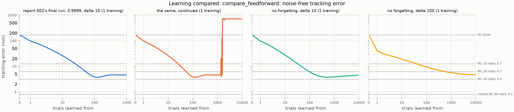
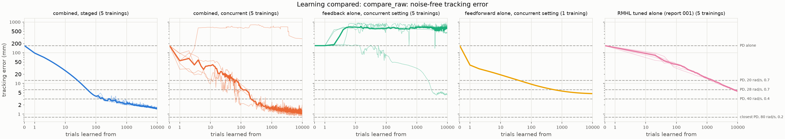
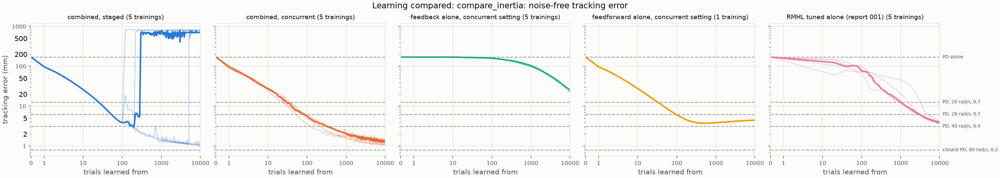

# 003 Combined learning

**Summary.** The arm reached under report 001's weak joint PD, which lags 170 mm
behind its reference. Report 002's feedforward, learned by feedback-error
learning, and report 001's reward-modulated feedback learned together, each tuned
inside the combination on one seed. In three of the four variants, the combination
tracked to a median of 1.1 to 1.5 mm after 10,000 reaches, improving on 4 or 5 of
5 held-out seeds. Neither learner alone came that close: the feedforward settled
at 4.5 to 4.7 mm, and the feedback tuned alone reached 3.8 to 5.6 mm. The
combination passed the 40-rad/s PD (3.1 mm), which no learner alone reached, after
220 to 320 reaches. It used less effort and a lower peak torque than every PD of
the grid that tracks within 100 mm, but did not reach the closest PD's 0.8 mm. Two
things failed. Report 002's feedforward, which forgets, winds up alone or
combined, after 1,260 to 1,580 reaches at report 002's forgetting factor, so it
was tuned and run again without forgetting. And settings chosen on one seed ran
away on others: on 4 of 5 seeds for the inertia-scaled staged schedule, and on 1
of 5 for the raw-torque concurrent one.

- **Closer than either alone, from 1,000 reaches on.** At 1,000 reaches, the three
  variants that work were at 1.6 to 2.1 mm (medians of 5 seeds), against 3.9 to
  5.6 mm for the feedforward alone and 12.8 to 15.1 mm for report 001's feedback.
  At 10,000, they were at 1.1 to 1.5 mm, against 4.5 to 4.7 and 3.8 to 5.6 mm, and
  still falling slowly.
- **Each schedule splits the work its own way.** Staged, the feedforward learns
  the first 100 reaches, exactly report 002's run, to 3.8 mm. The feedback, with
  small gains, then refines that to 1.5 mm. Concurrent with raw torque, the
  feedback grows gains like those of report 001's feedback, and the feedforward
  learns around them. Without its feedback, that controller lags 78 mm, and
  without its feedforward 8.4 mm.
- **Little effort, a smooth torque.** The effort is 2.29 to 2.30 N^2 m^2 s and the
  peak torque 2.13 to 2.20 N m. Every PD of the grid that tracks within 100 mm
  needs at least 2.37 of each. The torque varies from one period to the next
  about as much as the PDs' torque does.
- **The feedforward winds up when it forgets.** Over the reach, its seven inputs
  span four dimensions. Below a forgetting factor of 1, the RLS covariance grows
  in the other three, and the reach at which the feedforward runs away scales with
  1/(1 - λ): 16 to 19 at 0.99, 160 to 180 at 0.999, and 1,260 to 1,580 at 0.9999.
  Report 002's 1,000 reaches ended too soon to show it. Without forgetting, the
  feedforward did not run away in 10,000 reaches.
- **Tuned on one seed, fragile on others.** The inertia-scaled staged schedule's
  feedback, at a learning rate of 5,000, ran away within 200 reaches of the
  handover on three held-out seeds and from reach 5,120 on a fourth. The
  raw-torque concurrent schedule ran away at reach 4 on one seed; the feedback
  alone at its setting did so on four. Every run-away of the final runs was
  silent: nothing raised, and the arm lay against its stops.

## 1. Question

Within RQ1 of the [project README](../../README.md#research-questions), reports
[001](../001-feedback-from-scratch/README.md) and
[002](../002-feedback-error-learning/README.md) each learned alone on the same
reach. Report 001's decorrelated reward-modulated feedback reached 5.6 mm (raw
torque) or 3.8 mm (inertia-scaled, chattering) in 10,000 reaches. Report 002's
feedback-error learning reached 3.8 mm in 100 reaches and settled at 4.6 mm.
Neither came within the 40-rad/s PD's 3.1 mm. Learned together, do they track
more closely than either alone, for the same number of reaches? What does each
contribute, measured by leaving it out, and against the weak PD alone? Does
learning both at once interfere, compared with handing over from one to the other?

## 2. Setup

The [experiment's README](../../experiments/combined_learning/README.md) holds the
configurations and the protocol, fixed before the runs, apart from a step added
after the first final runs (below).

- **The arm, the reach, and the weak PD** are report 001's: arm-esn-ctrl's v2 arm,
  one reach from rest at (30, 30) deg to the hand at (-0.6, 0.4) m by a 1-s
  minimum-jerk move and a 1-s hold, and a joint PD of 5 rad/s with a damping ratio
  of 0.7. A test checks that the configurations' tables are the same.
- **The torque**, computed and held every 10 ms, is the weak PD's plus a
  feedforward from the reference plus a feedback from the tracking error.
- **The feedforward** is report 002's: an RLS readout of `[q_ref, dq_ref, ddq_ref,
  1]` at the start of each period, learned by feedback-error learning (Kawato et
  al., 1987). Every period of a reach it learns from, it fits its own output plus
  the weak PD's torque. The feedback's torque, its noise included, is not in that
  target: for the feedforward, it is part of the plant, as the arm is.
- **The feedback** is report 001's: a readout of `[e_q, e_dq, 1]`, learned by the
  decorrelated reward-modulated rule (the `burms2015` preset; Burms et al., 2015)
  from one reward per reach, the negative of its tracking error. During a reach it
  learns from, noise explores its output. Its output is the torque (raw torque) or
  is scaled by each joint's inertia (inertia-scaled).
- **The schedule** says which reaches each learner learns from. Both learn from
  every reach (`concurrent`), or the feedforward from the first 100 and the
  feedback from the rest (`staged`). A learner that does not learn from a reach
  adds its torque, with its weights as they stand, without noise. The feedback
  starts at zero weights, so for its first 100 reaches the staged schedule is
  report 002's run.
- **The ablations** leave one learner out: the feedback alone, or the feedforward
  alone, at the concurrent schedule's tuned settings. Alone, each trains exactly as
  in its own experiment, which tests check bit for bit.
- **The evaluation:** after each trial, a reach without noise that learns nothing,
  with the weights as they stand, scored by report 001's tracking error: the
  hand's mean distance from where the reference puts it over the 200 control
  periods. Evaluations come after each of the first 100 trials, then after every
  20th. The outcome is `improved` if the last evaluation beats the PD alone,
  `worse` if not, and `diverged` if rclib or skelarm raised.

How this differs from reports 001 and 002:

- **Two learners and two signals at once:** a target every 10 ms for the
  feedforward, one reward per reach for the feedback. Each changes the plant the
  other learns on.
- **Feedback-error learning takes over the weak PD's torque only.** Its target
  leaves out the feedback's torque, so whatever the feedback does, the feedforward
  learns around it rather than taking it over.
- **Seeds.** The feedback's noise makes each training random: the tuning used
  seed 0, the final runs seeds 1 to 5. The feedforward alone has no noise, so it is
  one training.

The protocol:

1. **Tuning**, on seed 0 for 1,000 reaches, by the lowest noise-free error at
   1,000 reaches over all rounds, for each schedule and feedback scale. The
   rounds alternate between the learners:
   1. the feedback's learning rate by its exploration amplitude, with the
      feedforward at report 002's setting, again past the grid's edge until no
      best lies on an edge;
   2. the feedforward's forgetting factor by its `delta`, report 002's grid, with
      each variant's best feedback setting;
   3. if the feedforward's best setting moved, the feedback's again, around its
      best;
   4. added after the first final runs, which showed the feedforward winding up
      (Section 3.2): for the concurrent schedule, no forgetting, with the `delta`
      best for a forgetting factor of 1 in the feedforward's round, and the
      feedback's settings again around their best. The staged schedule's
      feedforward stops learning at reach 100, long before it could wind up, so
      it kept its settings.
2. **The final runs:** each schedule and scale at its tuned setting on seeds 1 to
   5, which the tuning never saw, for 10,000 reaches; the feedback alone at the
   concurrent schedule's settings on the same seeds, and the feedforward alone
   once.
3. **The comparison** against the weak PD alone, PDs of report 001's grid, and
   reports 001's and 002's runs, each learner tuned alone, in tracking error over
   the reaches, effort, peak torque, and torque variation. **Lesions** of the
   combined controllers, without their feedback or their feedforward, show how the
   two parts depend on each other.

### Reproducing the results

This report's runs are in [`results/`](results), each with its configuration
(`config.toml`), its run record (`run.toml`), and its outputs, the superseded runs
included. It reads report 001's copies of the PD grid and of the decorrelated
rule's runs of 10,000 trials, and report 002's copy of its final run.

```bash
uv run python experiments/learn_combined.py experiments/combined_learning/<configuration>.toml --workers <n>
uv run python experiments/compare_learning.py experiments/combined_learning/compare_<name>.toml
```

| Runs | Commit |
| --- | --- |
| `tune_raw`, `tune_inertia` | `748476c` |
| `tune_concurrent_raw_round2`, `tune_staged_inertia_round2`, `tune_readout_staged_raw`, `tune_readout_concurrent_inertia` | `8c4cf01` |
| `tune_readout_concurrent_raw`, `tune_readout_staged_inertia`, `tune_staged_inertia_round3` | `9b0b078` |
| `tune_concurrent_raw_round4`, `final_staged_raw`, `final_staged_inertia`, and the superseded `final_concurrent_inertia`, `final_feedback_alone_inertia`, `final_feedforward_alone` | `8122dc0` |
| `tune_concurrent_raw_round5`, `tune_concurrent_inertia_round5` | `03d2a63` |
| `tune_concurrent_raw_round6`, `tune_concurrent_inertia_round6` | `3b7d828` |
| `windup_feedforward_alone` | `0701c70` |
| `tune_concurrent_inertia_round7`, `final_concurrent_raw`, `final_feedback_alone_raw`, `final_feedforward_alone_raw` | `b4756e7` |
| `final_concurrent_inertia`, `final_feedback_alone_inertia`, `final_feedforward_alone_inertia` | `a22a149` |
| `compare_raw`, `compare_feedforward` | `26f6e16` |
| `compare_inertia` | `f6bce55` |

The superseded runs used configuration files since replaced under the same names;
each run's `config.toml` holds its own. The number of worker processes does not
change a result. Every run record shows no uncommitted changes.
[`make_tables.py`](make_tables.py) prints the tables of Section 3 from these
copies and reports 001's and 002's. It checks that every combined final run's
setting is the one its tuning chose. It replays every controller of the effort and
lesion tables without noise, and checks that each replay reproduces its run's last
evaluation, or the PD's error in the grid; every one does. A tuning training of
1,000 trials took 1.4 to 12.5 minutes, and a final training of 10,000 trials 58 to
102 minutes, about 0.35 to 0.6 s per trial with its evaluation, with up to 40
running at once beside an unrelated job.

## 3. Results

### 3.1 Tuning

| Variant | Feedback: learning rate, amplitude | Feedforward: forgetting, delta | Error at 1,000 trials |
| --- | ---: | ---: | ---: |
| concurrent, inertia-scaled | 16, 2.5 rad/s^2 | 1, 10 | 2.59 mm |
| concurrent, raw torque | 80, 1 N m | 1, 100 | 2.04 mm |
| staged, inertia-scaled | 5,000, 0.25 rad/s^2 | 0.9999, 10 | 1.44 mm |
| staged, raw torque | 8, 0.32 N m | 0.9999, 10 | 2.29 mm |

Fifteen tuning runs, 203 trainings, each of 1,000 trials on seed 0. The
[experiment's README](../../experiments/combined_learning/README.md#runs) gives
each run's result.

- **The feedforward kept report 002's setting where it still forgets.** In the
  feedforward's rounds, a forgetting factor of 0.9999 with a `delta` of 10 stayed
  the best for both staged variants and for the inertia-scaled concurrent one.
  For the raw-torque concurrent one, a `delta` of 100 was better, and the
  feedback's round after it found a learning rate of 250 with 0.32 N m at
  1.00 mm, on the grid's edge.
- **Without forgetting, the concurrent schedule tunes to larger errors.** Step 1.4
  took the concurrent schedule's best at 1,000 reaches from 1.00 to 2.04 mm with
  raw torque, and from 1.38 to 2.59 mm inertia-scaled: the feedforward learns more
  slowly without forgetting. It took the inertia-scaled feedback's learning rate
  from 160 down to 16, after three more rounds.
- **The staged schedule wants a strong feedback inertia-scaled.** Its best,
  5,000 with 0.25 rad/s^2, lies beside settings that run away: 16,000 with
  0.25 rad/s^2, and 5,000 with 0.8 rad/s^2.
- **Many settings run away within a few reaches.** Of the 203 trainings, 76
  ended worse than the PD alone: 39 ran away within 5 reaches, and 12 of the
  staged schedule's at reach 120, 20 reaches after the handover.
- **Near-ties.** The raw-torque concurrent best, 80 with 1 N m, is ahead of 25
  with 1 N m by 0.016 mm, and the inertia-scaled one, 16 with 2.5 rad/s^2, ahead
  of 5 with 8 rad/s^2 by 1.4e-6 m. The error swings more than that from one
  evaluation to the next, so seed 0's choice between them is partly chance.
- **Repeats agree.** Every setting run in more than one round came out bit for bit
  the same.

### 3.2 The feedforward's wind-up



The trials are on a log axis. The dashed lines are PDs of report 001's grid.
Report 002's final run ended at 1,000 reaches. Continued to 10,000 at the same
setting, a forgetting factor of 0.9999 with a `delta` of 10, the feedforward held
near 4.6 mm through 1,360 reaches, swung out to 20 and 122 mm at 1,380 and 1,500,
and from 1,580 reaches lay against the arm's stops, 719 mm off, raising nothing.
Its weights grew to 1e17. Without forgetting, at either `delta`, it did not run
away.

The feedforward alone over report 002's grid for 3,000 trials (the
`windup_feedforward_alone` run):

| Forgetting factor | delta | 100 trials | 1,000 trials | 3,000 trials | Worse than the PD alone from trial | Times (1 - forgetting) |
| ---: | ---: | ---: | ---: | ---: | ---: | ---: |
| 1 | 0.1 | 59.9 mm | 11.6 mm | 9.2 mm | never |  |
| 1 | 1 | 8.5 mm | 4.5 mm | 5.0 mm | never |  |
| 1 | 10 | 6.0 mm | 3.9 mm | 4.2 mm | never |  |
| 1 | 100 | 9.4 mm | 5.6 mm | 5.0 mm | never |  |
| 0.9999 | 0.1 | 20.5 mm | 4.6 mm | 718.9 mm | 1,260 | 0.126 |
| 0.9999 | 1 | 4.3 mm | 4.6 mm | 718.9 mm | 1,380 | 0.138 |
| 0.9999 | 10 | 3.8 mm | 4.6 mm | 718.9 mm | 1,580 | 0.158 |
| 0.9999 | 100 | 7.0 mm | 4.6 mm | 718.9 mm | 1,580 | 0.158 |
| 0.999 | 0.1 | 4.6 mm | 718.9 mm | not finite | 160 | 0.16 |
| 0.999 | 1 | 4.6 mm | 718.9 mm | not finite | 160 | 0.16 |
| 0.999 | 10 | 4.6 mm | 718.9 mm | not finite | 180 | 0.18 |
| 0.999 | 100 | 4.6 mm | 718.9 mm | not finite | 180 | 0.18 |
| 0.99 | 0.1 | 718.9 mm | not finite | not finite | 16 | 0.16 |
| 0.99 | 1 | 718.9 mm | not finite | not finite | 17 | 0.17 |
| 0.99 | 10 | 718.9 mm | not finite | not finite | 18 | 0.18 |
| 0.99 | 100 | 718.9 mm | not finite | not finite | 19 | 0.19 |

Over one reach, the feedforward's inputs, `[q_ref, dq_ref, ddq_ref, 1]` at the
start of each of the 200 control periods, have the singular values 68.9, 33.4,
16.4, 2.01, 4.32e-14, 1.04e-14, and 5.77e-15.

- **Four of seven input directions are excited.** Both joints follow one
  minimum-jerk profile, so the two reference angles and the constant are affinely
  dependent, and so are the two velocities and the two accelerations.
- **The run-aways scale as wind-up does.** Below a forgetting factor of 1, RLS's
  covariance grows by 1/λ every period in the directions no input excites. The
  reach from which the feedforward stays worse than the PD alone, times 1 - λ, is
  0.13 to 0.19 at all three factors: the covariance has then grown 1e11- to
  1e16-fold in those directions, by 1/λ^200 per reach.
- **The failure is silent at first.** At 0.9999, the arm lies against its stops
  through 10,000 reaches, raising nothing. At 0.999 and 0.99, the weights grow on
  until the error is no longer finite, and with a `delta` of 10 an
  `OverflowError` ends the training.
- **The feedback beside it changes nothing.** Where the feedback does not run away
  first, the combined feedforward runs away at the same reaches: from 180 at 0.999
  (the concurrent schedule's feedforward rounds), and from 1,560 to 1,580 at
  0.9999. That is where seeds 1 to 3 of the first inertia-scaled concurrent final
  runs, at report 002's setting, ran away after tracking at 1 to 11 mm. Hence
  the protocol's step 1.4.
- **Without forgetting, the error rises slowly** after its best on some settings:
  with a `delta` of 10, from 3.74 mm at 500 reaches to 4.47 mm at 10,000. With a
  `delta` of 100, it was still falling at 10,000, at 4.65 mm.

### 3.3 The final runs





Each panel shows each training thin and their median thick. The trials are on a
log axis; the combined runs were evaluated after every trial up to 100, report
001's after every 20th. "Alone" means at the concurrent schedule's tuned setting:
the feedforward alone with a `delta` of 100 is raw torque's, with 10 the
inertia-scaled one's. Reports 001's and 002's runs were each tuned alone.

| Learner | Seeds improved | 10 trials | 100 trials | 1,000 trials | 3,000 trials | 10,000 trials |
| --- | ---: | ---: | ---: | ---: | ---: | ---: |
| combined, concurrent, raw torque | 4 of 5 | 37.7 mm | 7.0 mm | 1.6 mm | 1.3 mm | 1.1 mm |
| combined, staged, raw torque | 5 of 5 | 26.0 mm | 3.8 mm | 2.1 mm | 1.8 mm | 1.5 mm |
| combined, concurrent, inertia-scaled | 5 of 5 | 27.3 mm | 5.7 mm | 2.0 mm | 1.5 mm | 1.3 mm |
| combined, staged, inertia-scaled | 1 of 5 | 26.0 mm | 3.8 mm | 741.1 mm | 406.7 mm | 703.8 mm |
| feedback alone, raw torque | 1 of 5 | 683.1 mm | 615.5 mm | 662.0 mm | 663.4 mm | 669.2 mm |
| feedback alone, inertia-scaled | 5 of 5 | 169.7 mm | 158.8 mm | 103.5 mm | 58.8 mm | 24.6 mm |
| feedforward alone, no forgetting, delta 100 | 1 of 1 | 19.0 mm | 9.4 mm | 5.6 mm | 5.0 mm | 4.7 mm |
| feedforward alone, no forgetting, delta 10 | 1 of 1 | 27.7 mm | 6.0 mm | 3.9 mm | 4.2 mm | 4.5 mm |
| feedforward alone, report 002's setting | 0 of 1 | 26.0 mm | 3.8 mm | 4.6 mm | 718.9 mm | 718.9 mm |
| RMHL decorrelated alone, raw torque, report 001 | 5 of 5 |  | 41.7 mm | 15.1 mm | 9.1 mm | 5.6 mm |
| RMHL decorrelated alone, inertia-scaled, report 001 | 5 of 5 |  | 76.3 mm | 12.8 mm | 6.3 mm | 3.8 mm |
| feedback-error learning alone, report 002 | 1 of 1 | 26.0 mm | 3.8 mm | 4.6 mm |  |  |

The errors are medians over the seeds, a run-away included. The error of each
seed at the end of its run:

| Learner | Seed 1 | Seed 2 | Seed 3 | Seed 4 | Seed 5 |
| --- | ---: | ---: | ---: | ---: | ---: |
| combined, concurrent, raw torque | 1.3 mm | 285.7 mm | 1.0 mm | 1.1 mm | 1.0 mm |
| combined, staged, raw torque | 1.5 mm | 1.6 mm | 1.5 mm | 1.6 mm | 1.5 mm |
| combined, concurrent, inertia-scaled | 1.3 mm | 1.2 mm | 1.1 mm | 1.3 mm | 1.4 mm |
| combined, staged, inertia-scaled | 1.0 mm | 702.4 mm | 784.4 mm | 778.0 mm | 703.8 mm |
| feedback alone, raw torque | 669.2 mm | 4.2 mm | 440.4 mm | 689.1 mm | 690.6 mm |
| feedback alone, inertia-scaled | 24.6 mm | 25.0 mm | 21.8 mm | 24.6 mm | 26.0 mm |
| RMHL decorrelated alone, raw torque, report 001 | 5.6 mm | 5.7 mm | 5.6 mm | 5.3 mm | 5.5 mm |
| RMHL decorrelated alone, inertia-scaled, report 001 | 3.7 mm | 4.2 mm | 3.8 mm | 3.6 mm | 4.0 mm |

The trials from which the median stays closer than a PD:

| Learner | PD, 20 rad/s, 0.7 (12.7 mm) | PD, 28 rad/s, 0.7 (6.3 mm) | PD, 40 rad/s, 0.4 (3.1 mm) |
| --- | ---: | ---: | ---: |
| combined, concurrent, raw torque | 72 | 120 | 220 |
| combined, staged, raw torque | 25 | 53 | 300 |
| combined, concurrent, inertia-scaled | 31 | 82 | 320 |
| combined, staged, inertia-scaled | never | never | never |
| feedback alone, raw torque | never | never | never |
| feedback alone, inertia-scaled | never | never | never |
| feedforward alone, no forgetting, delta 100 | 38 | 540 | never |
| feedforward alone, no forgetting, delta 10 | 33 | 94 | never |
| feedforward alone, report 002's setting | never | never | never |
| RMHL decorrelated alone, raw torque, report 001 | 1,540 | 7,280 | never |
| RMHL decorrelated alone, inertia-scaled, report 001 | 1,020 | 3,020 | never |
| feedback-error learning alone, report 002 | 25 | 53 | never |

- **The combination tracks more closely than either learner alone,** for three of
  the four variants, at every budget from 1,000 reaches. At 10,000 reaches, its
  medians of 1.1 to 1.5 mm are a third or less of the feedforward alone's 4.5 to
  4.7 mm, and of report 001's 3.8 to 5.6 mm. Its seeds that improve were still
  falling slowly, all but one: their medians over reaches 5,000 to 6,000 were 0.96
  to 1.72 mm, and over 9,000 to 10,000, 1.00 to 1.58 mm. The exception, the
  raw-torque concurrent seed 3, held at about 1 mm.
- **It passes the 40-rad/s PD,** after 220 to 320 reaches, which no learner alone
  did in 10,000. It never reached the closest PD, 0.8 mm; its closest evaluation
  was 0.85 mm (concurrent, raw torque, seed 3).
- **Early on, the feedforward leads.** The staged schedule is report 002's run for
  100 reaches, and passes the 20- and 28-rad/s PDs as soon, at 25 and 53. The
  concurrent schedules pass them later, at 31 to 120. With raw torque it starts
  slower than its feedforward alone (37.7 against 19.0 mm at 10 reaches);
  inertia-scaled it does not (27.3 against 27.7 mm).
- **The raw-torque concurrent schedule is the closest, and the least steady.** Over
  its last 1,000 reaches, its seeds that improve swing between 0.85 and 2.46 mm,
  against 1.46 to 1.71 mm for the staged schedule with raw torque and 1.05 to
  1.54 mm for the concurrent one inertia-scaled. Its seed 2
  ran away at reach 4, before the feedforward had learned much, and ended at
  286 mm.
- **The inertia-scaled staged schedule fails on 4 of 5 seeds.** Its seeds 2 to 4
  stay worse than the PD alone from reaches 120 to 300, within 200 reaches of the
  handover, and seed 5 from reach 5,120, with the feedforward frozen since the
  handover. Seed 1 ended at 1.0 mm.
- **The feedback alone at the concurrent settings is a poor learner.** Raw torque,
  at a learning rate 32 times report 001's, it ran away within 5 reaches on 4 of
  5 seeds; seed 2 reached 4.2 mm. Inertia-scaled, at a learning rate a third of
  report 001's (16 against 50), it learned slowly, to 21.8 to 26.0 mm at 10,000
  reaches. Beside the feedforward, the same settings track to about 1 mm.

### 3.4 Effort and torque

Every controller replayed without noise, with its weights at its last
evaluation, as medians over the seeds that improved; how many is in parentheses.
A run-away's torque says nothing of a learned controller. The effort is the
squared torque integrated over the reach. The torque variation is how much the
torque changes from one control period to the next, summed over the reach and the
joints. The last three columns are the root mean square of each part's torque:
the weak PD's (for the PDs of the grid, all of their torque), the
feedforward's, and the feedback's.

| Controller | Tracking error | Effort (N^2 m^2 s) | Peak torque (N m) | Torque variation (N m) | PD's torque, RMS (N m) | Feedforward's, RMS (N m) | Feedback's, RMS (N m) |
| --- | ---: | ---: | ---: | ---: | ---: | ---: | ---: |
| PD, 5 rad/s, 0.7 | 170.0 mm | 3.03 | 2.56 | 11.5 | 0.870 | 0.000 | 0.000 |
| PD, 20 rad/s, 0.7 | 12.7 mm | 2.90 | 2.67 | 12.6 | 0.851 | 0.000 | 0.000 |
| PD, 28 rad/s, 0.7 | 6.3 mm | 2.62 | 2.53 | 11.8 | 0.809 | 0.000 | 0.000 |
| PD, 40 rad/s, 0.4 | 3.1 mm | 2.49 | 2.44 | 11.9 | 0.788 | 0.000 | 0.000 |
| PD, 80 rad/s, 0.2 | 0.8 mm | 2.37 | 2.44 | 18.2 | 0.769 | 0.000 | 0.000 |
| combined, concurrent, raw torque (4 of 5) | 1.1 mm | 2.30 | 2.20 | 12.7 | 0.011 | 0.841 | 0.315 |
| combined, staged, raw torque (5 of 5) | 1.5 mm | 2.30 | 2.13 | 9.9 | 0.030 | 0.751 | 0.027 |
| combined, concurrent, inertia-scaled (5 of 5) | 1.3 mm | 2.29 | 2.17 | 9.8 | 0.012 | 0.750 | 0.063 |
| combined, staged, inertia-scaled (1 of 5) | 1.0 mm | 2.30 | 2.18 | 9.9 | 0.011 | 0.751 | 0.050 |
| feedback alone, raw torque (1 of 5) | 4.2 mm | 2.40 | 2.25 | 22.6 | 0.063 | 0.000 | 0.720 |
| feedback alone, inertia-scaled (5 of 5) | 24.6 mm | 2.68 | 2.30 | 11.5 | 0.111 | 0.000 | 0.879 |
| feedforward alone, no forgetting, delta 100 (1 of 1) | 4.7 mm | 2.32 | 2.08 | 10.0 | 0.049 | 0.761 | 0.000 |
| feedforward alone, no forgetting, delta 10 (1 of 1) | 4.5 mm | 2.33 | 2.09 | 10.1 | 0.049 | 0.761 | 0.000 |
| RMHL decorrelated alone, raw torque, report 001 (5 of 5) | 5.6 mm | 2.38 | 2.22 | 10.7 | 0.091 | 0.000 | 0.690 |
| RMHL decorrelated alone, inertia-scaled, report 001 (5 of 5) | 3.8 mm | 3.24 | 4.98 | 71.6 | 0.098 | 0.000 | 0.921 |
| feedback-error learning alone, report 002 (1 of 1) | 4.6 mm | 2.32 | 2.08 | 10.0 | 0.049 | 0.761 | 0.000 |

- **The lowest effort in the table,** 2.29 to 2.30 N^2 m^2 s for every combined
  controller, below every PD of the grid that tracks within 100 mm (at least
  2.37) and below each learner alone. Their peak torques, 2.13 to 2.20 N m, are
  below those PDs' (at least 2.37 N m) and above the feedforward's alone (2.08 to
  2.09 N m).
- **A smooth torque, mostly.** Three combined controllers vary their torque by 9.8
  to 9.9 N m, about as much as the feedforward alone. The raw-torque concurrent
  one varies by 12.7 N m, just above the PDs' 11.5 to 12.6 N m and below the
  closest PD's 18.2, and nowhere near the chattering 71.6 N m of report 001's
  inertia-scaled feedback.
- **The weak PD is relieved further.** Its torque falls to 0.011 to 0.030 N m RMS,
  from 0.049 N m beside the feedforward alone and 0.870 N m alone.

### 3.5 What each part does

Each combined controller replayed as learned, without its feedback, and without
its feedforward, as medians over the seeds that improved:

| Combined controller | As learned | Without its feedback | Without its feedforward |
| --- | ---: | ---: | ---: |
| combined, concurrent, raw torque (4 of 5) | 1.1 mm | 78.4 mm | 8.4 mm |
| combined, staged, raw torque (5 of 5) | 1.5 mm | 3.8 mm | 34.9 mm |
| combined, concurrent, inertia-scaled (5 of 5) | 1.3 mm | 7.6 mm | 36.9 mm |
| combined, staged, inertia-scaled (1 of 5) | 1.0 mm | 3.8 mm | 48.8 mm |

The feedback's gains, in torque per tracking error, as medians over the seeds
that improved:

| Feedback | Stiffness (N m/rad): joint 1 | joint 2 | Damping (N m s/rad): joint 1 | joint 2 | Constant (N m): joint 1 | joint 2 |
| --- | ---: | ---: | ---: | ---: | ---: | ---: |
| combined, concurrent, raw torque (4 of 5) | 10.8 | 29.5 | 18.7 | 5.37 | 0.00111 | -0.0841 |
| combined, staged, raw torque (5 of 5) | 0.177 | 1.99 | 2 | 1.57 | 0.00957 | 0.00143 |
| combined, concurrent, inertia-scaled (5 of 5) | 1.51 | 0.148 | 8.44 | 0.394 | 0.0597 | -0.00464 |
| combined, staged, inertia-scaled (1 of 5) | -0.358 | 0.102 | 9.25 | 0.35 | 0.00975 | 0.000593 |
| feedback alone, raw torque (1 of 5) | 58.1 | 30.2 | 19.8 | 4.68 | -0.281 | 0.0111 |
| feedback alone, inertia-scaled (5 of 5) | 3.32 | 1.19 | 10.8 | 0.292 | -0.102 | -0.0179 |
| RMHL decorrelated alone, raw torque, report 001 (5 of 5) | 20.7 | 24.4 | 10 | 3.36 | -0.176 | 0.0893 |
| RMHL decorrelated alone, inertia-scaled, report 001 (5 of 5) | 38.8 | 8.28 | 49.8 | 1.5 | -0.145 | -0.0104 |

- **Staged: the feedforward does the work, the feedback corrects.** Without its
  feedback, the staged controller is its feedforward as frozen at reach 100,
  3.8 mm. Its feedback's stiffness, 0.18 and 2.0 N m/rad with raw torque, is a
  hundredth and a twelfth of report 001's, and its torque 0.027 N m RMS. That
  correction takes the error from 3.8 to 1.5 mm.
- **Concurrent with raw torque: the feedback is a stiff PD, and the feedforward
  learns around it.** Its gains are of the order of report 001's, and its torque
  is 0.315 N m RMS. Alone, that feedback tracks to 8.4 mm. Without it, the
  feedforward lags 78.4 mm, far worse than the feedforward learned alone
  (4.7 mm). Feedback-error learning takes over only the weak PD's torque, so the
  feedforward learned the torque the reach needs minus the feedback's.
- **Concurrent inertia-scaled lies in between.** Its feedback is softer, mainly
  damping on joint 1, with 0.063 N m RMS; without it, the feedforward tracks to
  7.6 mm, again worse than learned alone (4.5 mm).
- **Neither part alone is the controller.** In every combined controller, leaving
  out the feedback multiplies the median tracking error by at least 2.4, and
  leaving out the feedforward by at least 7.9.

## 4. Observations

- **RQ1: the reward-modulated feedback does push past where feedback-error
  learning stops.** Report 002's feedforward settled at 4.6 mm, near the best
  linear fit of the needed torque. With the feedback beside it, three of four
  variants came to 1.1 to 1.5 mm, through the 40-rad/s PD's 3.1 mm. This answers
  report 002's first next step, on one reach.
- **The two learners have complementary speeds.** The feedforward, fitted every
  10 ms, does most of the learning in the first 100 reaches. The reward-modulated
  feedback, one reward per reach, keeps improving the score itself through
  10,000. Combined, the result keeps the feedforward's start and goes beyond both
  ends.
- **Concurrent and staged reach similar errors by different splits.** With raw
  torque, the concurrent schedule's feedback became a stiff PD that the
  feedforward learned around; the staged schedule's stayed a small correction of
  a frozen feedforward. The concurrent one ended 0.4 mm closer in median, with a
  less steady torque and one run-away seed of five.
- **The feedforward's target shapes the split.** Because the target leaves out the
  feedback's torque, a concurrent feedforward depends on its feedback: removing
  the feedback costs far more than the feedforward alone would. Including the
  feedback's torque in the target, the second option of the plan, was not tried.
- **Forgetting is unsafe for a reach that excites few input directions.** The
  feedforward's wind-up is a property of RLS with forgetting on inputs of low
  rank, not of the combination: it happens alone at the same reaches. Report
  002's budget was too short to see it at 0.9999. Without forgetting, the
  feedforward stays bounded but learns more slowly and drifts up slightly after
  its best.
- **Failures are silent.** Every run-away of the final runs ended with the arm
  against its stops and nothing raised, as in reports 001 and 002. Only the
  wind-up sweep's fastest run-aways raised, after the error was no longer finite.

What is not claimed:

- **A robust tuning.** Each variant was tuned on seed 0 alone. The final runs on
  seeds 1 to 5 show the choice held for two variants, held on 4 of 5 seeds for the
  raw-torque concurrent one, and failed for the inertia-scaled staged one, whose
  learning rate lies beside settings that run away. As decided, it is reported as
  a negative result and not tuned again. Settings within a fraction of a
  millimeter of each other at 1,000 reaches were chosen partly by chance.
- **That one schedule is better.** With raw torque, the schedules' medians at
  10,000 reaches differ by 0.4 mm over 5 seeds, while one concurrent seed spans
  1.4 mm over its last 1,000 reaches. Inertia-scaled, the staged schedule failed
  at a setting chosen on one seed.
- **That each learner alone could not do better.** The ablations run each learner
  at the combination's settings, which suit it there and not alone. Reports 001's
  and 002's runs, each tuned alone, are the fair comparison.
- **Why the run-away seeds ran away.** The raw-torque concurrent seed 2 and the
  inertia-scaled staged seeds were not analyzed. Large learning rates run away
  within a few reaches in the tuning too.
- **The wind-up's mechanism beyond its signature.** It is read from the scaling
  with 1/(1 - λ) and from the rank of the inputs, not from the covariance itself,
  which was not inspected.
- **Other reaches, or disturbances.** As in reports 001 and 002, there is one
  reach, and the arm is never pushed or loaded.

## 5. Next steps

1. **A wind-up guard in rclib's RLS**, upstream first: for instance, a bound on
   the covariance or forgetting only in the directions the inputs excite. Then
   advance the pin, and try forgetting again.
2. **The feedforward's target with the feedback's torque**, the plan's second
   option: does the feedforward then take over the feedback's systematic part,
   leaving a lighter feedback and a more robust split?
3. **A tuning that judges robustness:** several tuning seeds, choosing by the
   median or the worst seed, and margins from settings that run away.
4. **Several reaches.** Reaches to other goals excite more of the feedforward's
   input directions, which bears on the wind-up, and test whether the learned
   parts carry over.
5. **Disturbances:** a push or a load at the hand, to separate what the
   feedforward and the feedback each do.
