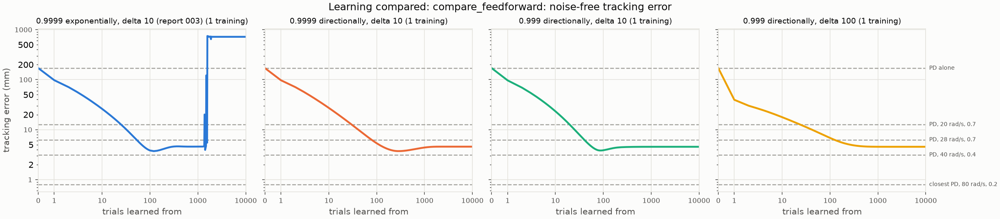
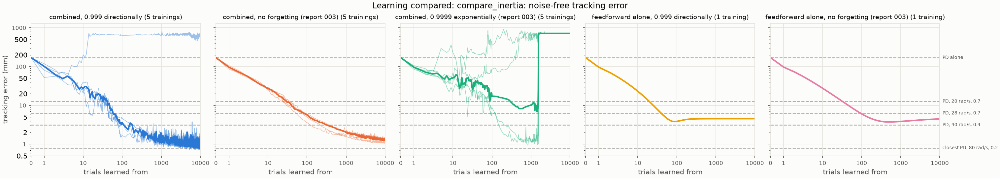
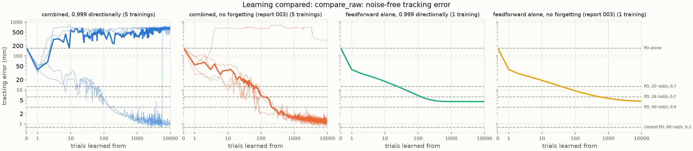

# 004 Directional forgetting

**Summary.** Report 003's feedforward, learned by feedback-error learning with an
RLS readout, wound up whenever it forgot. Here it forgets directionally, only
along each control period's input. Alone, it no longer winds up: at every
forgetting factor and `delta` of report 002's grid, it stayed closer than the weak
PD through 3,000 reaches. Forgetting exponentially, every one of those settings had
run away, after 16 to 1,580 reaches. At report 002's setting it held 4.6 mm for
10,000 reaches. Combined with report 003's reward-modulated feedback on the
concurrent schedule, and tuned again on seed 0, the results split by feedback
scale. Inertia-scaled, 4 of 5 held-out seeds improved, to a median of 0.8 mm at
10,000 reaches, against 1.3 mm on 5 of 5 without forgetting. That is the
closest PD's 0.8 mm, at less effort, though over the last 1,000 reaches the
median is 0.9 mm. Raw torque improved on only 1 of 5 seeds.
Three of its run-aways come at the same reaches without forgetting, so they come
with the feedback's setting. And forgetting changed how the two parts split the
torque: the feedback's constant and the feedforward's bias drift apart, and the
feedforward no longer works without the feedback.

- **The wind-up is gone, alone.** Over 3,000 reaches, no setting of the grid ever
  stayed worse than the weak PD. Below a forgetting factor of 1, every setting
  ended at 4.5 to 4.7 mm. Report 003's exponential forgetting stayed worse from
  16 to 19 reaches at 0.99, 160 to 180 at 0.999, and 1,260 to 1,580 at 0.9999.
  The settings without forgetting repeat report 003's runs bit for bit.
- **Inertia-scaled, closer and sooner, on 4 of 5 seeds.** The median was 3.5 mm
  at 100 reaches, 1.1 mm at 1,000, and 0.8 mm at 10,000. Without forgetting, it
  was 5.7, 2.0, and 1.3 mm. It passed the 40-rad/s PD for good after 180 reaches
  instead of 320. Its noise-free error scatters more from one evaluation to the
  next: over the last 1,000 reaches, 0.77 to 1.31 mm (10th to 90th percentile,
  medians over seeds), against 1.25 to 1.40 mm. Seed 5 ran away by reach 10,
  silently. Without forgetting, at the same feedback setting, it survived its
  first 100 reaches.
- **Raw torque, 1 of 5.** Seeds 1, 3, and 4 ran away from reach 2 or 3. Without
  forgetting, at the same feedback setting, they did so at the same reaches. That
  setting, a learning rate of 250 with 0.32 N m, was tuned on seed 0. Seed 2
  reached 0.80 mm, then ran away from reach 5,740. The one survivor tracks to
  1.1 mm, but its feedback's torque swings: 117 N m of variation over the reach,
  6 to 10 times the PDs'.
- **The split drifts.** Both learners have a constant input, and only the sum of
  their constant torques matters to the reach. Forgetting, the feedforward keeps
  adapting. Inertia-scaled, over 10,000 reaches, the feedback's constant torque
  on joint 1 grew to a median of 1.19 N m and the feedforward's bias fell to
  -0.47 N m, while their sum stayed at 0.6 to 0.9 N m. Without forgetting, they
  held near 0.06 and 0.49 N m. The controller without its feedback lags 159 mm,
  against 7.6 mm without forgetting.

## 1. Question

Within RQ1 of the [project README](../../README.md#research-questions), report
[003](../003-combined-learning/README.md) learned a feedforward and a
reward-modulated feedback together on one reach. The feedforward is learned by
feedback-error learning with an RLS readout. It wound up whenever it forgot. Over
the reach, the readout's seven inputs span four dimensions. Forgetting
exponentially discounts the readout's information in every direction, and nothing
adds it back in the three directions the reach never excites. So the covariance
grows there every control period. Below a forgetting factor λ of 1, the
feedforward alone stayed worse than the weak PD from 0.13 to 0.19 / (1 - λ)
reaches on. Report 003's concurrent final runs therefore did without forgetting.
Yet at 1,000 reaches, the concurrent schedule had tuned to closer tracking with
it: 1.00 mm against 2.04 mm with raw torque, 1.38 mm against 2.59 mm
inertia-scaled.

rclib's RLS readout now also forgets directionally (Kulhavý, 1987; Bittanti et
al., 1990): only along each period's input, so the directions the reach never
excites keep their information. Does that remove the wind-up? And with forgetting
safe, does the concurrent schedule track more closely than without it, on the same
held-out seeds and budget?

## 2. Setup

The [experiment's README](../../experiments/directional_forgetting/README.md)
holds the configurations and the protocol. The protocol was fixed before the runs,
apart from a check added after the final runs (below).

- **Everything but the forgetting method** is report 003's concurrent schedule:
  - report 001's arm, reach, and weak PD (5 rad/s, damping ratio 0.7);
  - report 002's feedforward of `[q_ref, dq_ref, ddq_ref, 1]`, learned by
    feedback-error learning (Kawato et al., 1987) from its own output plus the weak
    PD's torque;
  - report 001's feedback of `[e_q, e_dq, 1]`, learned by the decorrelated
    reward-modulated rule (`burms2015`; Burms et al., 2015) from one reward per
    reach, in raw torque or inertia-scaled;
  - both learning from every reach;
  - the noise-free evaluations and the outcomes.

  A test checks that the configurations are report 003's except for the
  forgetting method and the tuned settings.
- **The feedforward forgets directionally:** `forgetting_method = "directional"`
  in `[readout]`, in rclib's `readouts.Rls` from rclib `b2fe32b`. Each control
  period, the readout's information matrix `R = P⁻¹` loses the share 1 - λ of what
  it holds along that period's input `x`, `(1 - λ) xxᵀ / (xᵀPx)`. It then gains the
  period's sample, `xxᵀ`. The gain and the weight update keep their formulas. At a
  forgetting factor of 1 nothing is forgotten, and the update is exactly
  exponential forgetting's, bit for bit.
- **The staged schedule is not run again:** its feedforward stops learning at
  reach 100, long before it could wind up.

The protocol:

1. **The wind-up**, the feedforward alone, without the feedback:
   - report 002's grid, forgetting factors 1, 0.9999, 0.999, and 0.99 by `delta`
     0.1, 1, 10, and 100, for 3,000 reaches, against report 003's sweep of the same
     grid forgetting exponentially;
   - report 002's setting, 0.9999 with a `delta` of 10, for 10,000 reaches,
     against report 003's run of it, which wound up.
2. **Tuning**, on seed 0 for 1,000 reaches. For each feedback scale, the best
   setting is the one with the lowest noise-free error at 1,000 reaches over all
   rounds:
   1. the feedforward's forgetting factor by its `delta`, report 002's grid. The
      feedback stays at its best from before report 003 gave up forgetting: with
      raw torque, a learning rate of 250 with 0.32 N m; inertia-scaled, 160 with
      2.5 rad/s^2;
   2. since the feedforward's best moved, the feedback's learning rate by its
      amplitude, around their best, and again past the grid's edge until no best
      lies on it.
3. **The final runs**, for 10,000 reaches:
   - each scale at its tuned setting, on seeds 1 to 5, which the tuning never saw;
   - the feedforward alone at each tuned feedforward setting, once, since it has
     no noise.
4. **The comparison** against:
   - report 003's concurrent final runs without forgetting;
   - its superseded inertia-scaled runs, forgetting exponentially at report 002's
     setting;
   - the weak PD alone, and PDs of report 001's grid.

   It covers the tracking error over the reaches, effort, peak torque, torque
   variation, and lesions.
5. **Added after the final runs, not in the protocol.** Four final runs ran away
   within their first 10 reaches, and in each, the feedback's weights grew before
   the feedforward's. So the same final runs ran again for their first 100
   reaches without forgetting: a forgetting factor of 1, with the same `delta`
   and the same feedback setting.

### Reproducing the results

This report's runs are in [`results/`](results). Each has its configuration
(`config.toml`), its run record (`run.toml`), and its outputs. The report also
reads:

- report 003's copies of `combined_learning`'s wind-up sweep, tuning runs, and
  final runs;
- report 001's copy of the PD grid.

```bash
uv run python experiments/learn_combined.py experiments/directional_forgetting/<configuration>.toml --workers <n>
uv run python experiments/compare_learning.py experiments/directional_forgetting/compare_<name>.toml
```

| Runs | Commit |
| --- | --- |
| `windup_feedforward_alone`, `continued_feedforward_alone`, `tune_readout_concurrent_raw`, `tune_readout_concurrent_inertia` | `06a2c61` |
| `tune_concurrent_raw_round2`, `tune_concurrent_inertia_round2` | `b2696be` |
| `tune_concurrent_inertia_round3` | `aa0e214` |
| `final_concurrent_raw`, `final_feedforward_alone_raw` | `27ad963` |
| `final_concurrent_inertia`, `final_feedforward_alone_inertia` | `06bdfe8` |
| `early_without_forgetting_raw`, `early_without_forgetting_inertia` | `27bef11` |
| `compare_raw`, `compare_inertia`, `compare_feedforward` | `f46a82c` |

- **Run records.** Every run record shows no uncommitted changes. The number of
  worker processes does not change a result.
- **[`make_tables.py`](make_tables.py)** prints the tables of Section 3 from these
  copies and from reports 001's and 003's. It also checks:
  - that the rows without forgetting repeat report 003's runs bit for bit;
  - that every setting run in more than one tuning round came out the same;
  - that each final run's setting is the one its tuning chose;
  - that each replay of the effort and lesion tables, run without noise,
    reproduces its run's last evaluation, or the PD's error in the grid. Every one
    does.
- **Run times.** The machine also carried an unrelated job. A tuning training of
  1,000 trials took 18 to 55 minutes. A final training of 10,000 trials took 3.5
  to 4.8 hours, about 1.3 to 1.7 s per trial with its evaluation.

## 3. Results

### 3.1 The wind-up, alone



| Forgetting factor | delta | 100 trials | 1,000 trials | 3,000 trials | Worse than the PD alone from trial | The same, forgetting exponentially (report 003) |
| ---: | ---: | ---: | ---: | ---: | ---: | ---: |
| 1 | 0.1 | 59.9 mm | 11.6 mm | 9.2 mm | never | never |
| 1 | 1 | 8.5 mm | 4.5 mm | 5.0 mm | never | never |
| 1 | 10 | 6.0 mm | 3.9 mm | 4.2 mm | never | never |
| 1 | 100 | 9.4 mm | 5.6 mm | 5.0 mm | never | never |
| 0.9999 | 0.1 | 42.4 mm | 7.1 mm | 4.7 mm | never | 1,260 |
| 0.9999 | 1 | 7.3 mm | 5.0 mm | 4.6 mm | never | 1,380 |
| 0.9999 | 10 | 5.3 mm | 4.4 mm | 4.6 mm | never | 1,580 |
| 0.9999 | 100 | 8.9 mm | 4.8 mm | 4.6 mm | never | 1,580 |
| 0.999 | 0.1 | 10.0 mm | 4.5 mm | 4.5 mm | never | 160 |
| 0.999 | 1 | 3.8 mm | 4.5 mm | 4.5 mm | never | 160 |
| 0.999 | 10 | 3.9 mm | 4.5 mm | 4.5 mm | never | 180 |
| 0.999 | 100 | 6.8 mm | 4.5 mm | 4.5 mm | never | 180 |
| 0.99 | 0.1 | 4.5 mm | 4.6 mm | 4.6 mm | never | 16 |
| 0.99 | 1 | 4.5 mm | 4.6 mm | 4.6 mm | never | 17 |
| 0.99 | 10 | 4.5 mm | 4.6 mm | 4.6 mm | never | 18 |
| 0.99 | 100 | 4.9 mm | 4.5 mm | 4.5 mm | never | 19 |

Report 002's setting, 0.9999 with a `delta` of 10, for 10,000 trials:

| Feedforward alone | 100 trials | 1,000 trials | 1,500 trials | 3,000 trials | 10,000 trials | Worse than the PD alone from trial |
| --- | ---: | ---: | ---: | ---: | ---: | ---: |
| 0.9999 directionally | 5.3 mm | 4.4 mm | 4.5 mm | 4.6 mm | 4.6 mm | never |
| 0.9999 exponentially (report 003) | 3.8 mm | 4.6 mm | 121.7 mm | 718.9 mm | 718.9 mm | 1,580 |

The singular values of the feedforward's inputs over the reach's 200 control
periods are 68.9, 33.4, 16.4, 2.01, then 4.3e-14 and below.

- **Nowhere a wind-up.** Forgetting directionally, all 16 settings stayed closer
  than the weak PD from their first evaluation to their last. So did report 002's
  setting through 10,000 reaches. Where exponential forgetting ran away, the
  error at 3,000 reaches is 4.5 to 4.7 mm. At a forgetting factor of 1, the rows
  repeat report 003's bit for bit, as the update is the same there.
- **Below 1, every setting ends at nearly the same error.** At 0.999 and 0.99, the
  feedforward settles at 4.5 to 4.6 mm by 1,000 reaches, whatever its `delta`.
  Without forgetting, the end depends on `delta`: 4.2 to 9.2 mm at 3,000 reaches,
  the smallest `delta` still falling.
- **At the same factor, forgetting directionally learns more slowly at first.**
  At 0.9999 and 100 reaches, before any wind-up, the error is 5.3 to 42.4 mm
  forgetting directionally, against 3.8 to 20.5 mm forgetting exponentially. A
  likely reading, not tested: exponential forgetting discounts all of the
  readout's information every period, directional forgetting only the part along
  that period's input, so at the same factor it forgets less and keeps a smaller
  gain.

### 3.2 Tuning

| Feedback scale | Round | Feedback: learning rate, amplitude | Feedforward: forgetting, delta | Error at 1,000 trials |
| --- | --- | ---: | ---: | ---: |
| raw torque | `tune_readout_concurrent_raw` | 250, 0.32 N m | 0.999, 100 | 1.07 mm |
| raw torque | `tune_concurrent_raw_round2` | 250, 0.32 N m | 0.999, 100 | 1.07 mm |
| raw torque | **over all** | 250, 0.32 N m | 0.999, 100 | 1.07 mm |
| inertia-scaled | `tune_readout_concurrent_inertia` | 160, 2.5 rad/s^2 | 0.999, 10 | 1.61 mm |
| inertia-scaled | `tune_concurrent_inertia_round2` | 50, 8 rad/s^2 | 0.999, 10 | 1.52 mm |
| inertia-scaled | `tune_concurrent_inertia_round3` | 50, 8 rad/s^2 | 0.999, 10 | 1.52 mm |
| inertia-scaled | **over all** | 50, 8 rad/s^2 | 0.999, 10 | 1.52 mm |

Report 003's concurrent tuning on the same seed and budget, for comparison:

| Feedback scale | Forgetting | Feedback: learning rate, amplitude | Feedforward: forgetting, delta | Error at 1,000 trials |
| --- | --- | ---: | ---: | ---: |
| raw torque | exponentially | 250, 0.32 N m | 0.9999, 100 | 1.00 mm |
| raw torque | none | 80, 1 N m | 1, 100 | 2.04 mm |
| inertia-scaled | exponentially | 160, 2.5 rad/s^2 | 0.9999, 10 | 1.38 mm |
| inertia-scaled | none | 16, 2.5 rad/s^2 | 1, 10 | 2.59 mm |

Five tuning runs, 56 trainings. The
[experiment's README](../../experiments/directional_forgetting/README.md#runs)
gives each run's result.

- **The feedforward's best moved to 0.999.** Forgetting directionally, both scales
  tuned best at a forgetting factor of 0.999. At 0.9999 they reached only 1.89 mm
  (raw torque) and 2.36 mm (inertia-scaled), against 1.07 and 1.61 mm at 0.999.
  With raw torque, the setting at 0.999 is on the grid's edge in `delta` (100).
  As in report 003, the grid was not extended.
- **About where exponential forgetting had tuned, and ahead of none.** At 1,000
  reaches the tuned settings came within 0.07 to 0.14 mm of report 003's
  exponential forgetting. They were 0.97 to 1.07 mm closer than its settings
  without forgetting.
- **Raw torque kept its feedback; inertia-scaled moved.** The raw feedback's round
  kept 250 with 0.32 N m inside its grid. The inertia-scaled one moved to 50 with
  8 rad/s^2, and a third round kept it there. That setting lies beside run-aways:
  50 with 25 rad/s^2 and 160 with 8 rad/s^2 ran away. So does the raw torque best:
  250 with 1 N m ran away.
- **Many settings run away within a few reaches, raising nothing.** 34 of the 56
  trainings ended worse than the PD alone. In the feedforward's rounds, every
  setting with raw torque and a `delta` of 10 or less ran away, at every
  forgetting factor, 1 included.
- **Repeats agree.** Every setting run in more than one round came out bit for bit
  the same.

### 3.3 The final runs





Medians over the seeds; a run-away's error counts as it is.

| Learner | Seeds improved | 10 trials | 100 trials | 1,000 trials | 3,000 trials | 10,000 trials |
| --- | ---: | ---: | ---: | ---: | ---: | ---: |
| combined, directionally, raw torque | 1 of 5 | 578.2 mm | 461.9 mm | 383.6 mm | 444.3 mm | 641.6 mm |
| combined, no forgetting, raw torque (report 003) | 4 of 5 | 37.7 mm | 7.0 mm | 1.6 mm | 1.3 mm | 1.1 mm |
| combined, directionally, inertia-scaled | 4 of 5 | 26.7 mm | 3.5 mm | 1.1 mm | 1.0 mm | 0.8 mm |
| combined, no forgetting, inertia-scaled (report 003) | 5 of 5 | 27.3 mm | 5.7 mm | 2.0 mm | 1.5 mm | 1.3 mm |
| combined, exponentially, inertia-scaled (report 003, superseded) | 0 of 5 | 51.1 mm | 17.3 mm | 10.2 mm | 718.9 mm | not finite |
| feedforward alone, 0.999 directionally, delta 100 | 1 of 1 | 17.8 mm | 6.8 mm | 4.5 mm | 4.5 mm | 4.5 mm |
| feedforward alone, no forgetting, delta 100 (report 003) | 1 of 1 | 19.0 mm | 9.4 mm | 5.6 mm | 5.0 mm | 4.7 mm |
| feedforward alone, 0.999 directionally, delta 10 | 1 of 1 | 23.2 mm | 3.9 mm | 4.5 mm | 4.5 mm | 4.5 mm |
| feedforward alone, no forgetting, delta 10 (report 003) | 1 of 1 | 27.7 mm | 6.0 mm | 3.9 mm | 4.2 mm | 4.5 mm |

The error of each seed at 10,000 trials:

| Learner | Seed 1 | Seed 2 | Seed 3 | Seed 4 | Seed 5 |
| --- | ---: | ---: | ---: | ---: | ---: |
| combined, directionally, raw torque | 641.6 mm | 722.7 mm | 603.5 mm | 690.4 mm | 1.1 mm |
| combined, no forgetting, raw torque (report 003) | 1.3 mm | 285.7 mm | 1.0 mm | 1.1 mm | 1.0 mm |
| combined, directionally, inertia-scaled | 0.8 mm | 0.8 mm | 1.2 mm | 0.7 mm | 670.1 mm |
| combined, no forgetting, inertia-scaled (report 003) | 1.3 mm | 1.2 mm | 1.1 mm | 1.3 mm | 1.4 mm |
| combined, exponentially, inertia-scaled (report 003, superseded) | 718.9 mm | 718.9 mm | 718.9 mm | not finite | 718.9 mm |

Over the last 1,000 trials, the 50 evaluations after trials 9,020 to 10,000, of
each seed that improved: their median, 10th and 90th percentile, and largest, each
a median over those seeds:

| Learner | Seeds | Median | 10th percentile | 90th percentile | Largest |
| --- | ---: | ---: | ---: | ---: | ---: |
| combined, directionally, raw torque | 1 | 1.00 mm | 0.93 mm | 1.12 mm | 1.28 mm |
| combined, no forgetting, raw torque (report 003) | 4 | 1.07 mm | 1.00 mm | 1.27 mm | 1.67 mm |
| combined, directionally, inertia-scaled | 4 | 0.90 mm | 0.77 mm | 1.31 mm | 1.73 mm |
| combined, no forgetting, inertia-scaled (report 003) | 5 | 1.28 mm | 1.25 mm | 1.40 mm | 1.44 mm |

The trials from which the median stays closer than a PD:

| Learner | PD, 20 rad/s, 0.7 (12.7 mm) | PD, 28 rad/s, 0.7 (6.3 mm) | PD, 40 rad/s, 0.4 (3.1 mm) |
| --- | ---: | ---: | ---: |
| combined, directionally, raw torque | never | never | never |
| combined, no forgetting, raw torque (report 003) | 72 | 120 | 220 |
| combined, directionally, inertia-scaled | 42 | 59 | 180 |
| combined, no forgetting, inertia-scaled (report 003) | 31 | 82 | 320 |
| feedforward alone, 0.999 directionally, delta 100 | 24 | 140 | never |
| feedforward alone, no forgetting, delta 100 (report 003) | 38 | 540 | never |
| feedforward alone, 0.999 directionally, delta 10 | 20 | 40 | never |
| feedforward alone, no forgetting, delta 10 (report 003) | 33 | 94 | never |

The first 100 trials of each final run, forgetting directionally, and again
without forgetting (protocol step 5):

| Feedback scale | Seed | Directionally: worse than the PD alone from trial | Error at 100 trials | Without forgetting: worse from trial | Error at 100 trials |
| --- | ---: | ---: | ---: | ---: | ---: |
| raw torque | 1 | 2 | 524.7 mm | 2 | 629.9 mm |
| raw torque | 2 | never | 5.7 mm | never | 166.7 mm |
| raw torque | 3 | 3 | 461.9 mm | 3 | 734.9 mm |
| raw torque | 4 | 3 | 598.8 mm | 3 | 488.6 mm |
| raw torque | 5 | never | 5.2 mm | never | 7.7 mm |
| inertia-scaled | 1 | never | 1.7 mm | never | 2.6 mm |
| inertia-scaled | 2 | never | 4.6 mm | never | 7.3 mm |
| inertia-scaled | 3 | never | 3.2 mm | never | 4.4 mm |
| inertia-scaled | 4 | never | 3.5 mm | never | 5.4 mm |
| inertia-scaled | 5 | 10 | 639.8 mm | never | 25.9 mm |

- **Inertia-scaled, forgetting directionally tracks more closely on the seeds that
  hold.** On 4 of 5 seeds, it came to 0.74 to 1.16 mm at 10,000 reaches, against
  1.08 to 1.36 mm without forgetting. At every matched budget from 100 reaches
  on, its median is lower: 3.5 against 5.7 mm at 100, 1.1 against 2.0 mm at
  1,000. It passed the 28- and 40-rad/s PDs for good after 59 and 180 reaches,
  against 82 and 320.
- **It also scatters more.** Over the last 1,000 reaches, between the 10th and
  90th percentile, the noise-free error moves within 1.25 to 1.40 mm without
  forgetting, and within 0.77 to 1.31 mm forgetting directionally. The median of
  the last evaluations, 0.79 mm, lies below the median over the last 1,000
  reaches, 0.90 mm, which is the fairer figure. That is still 0.38 mm below the
  1.28 mm without forgetting. A likely source of the scatter, not isolated: the
  forgetting feedforward keeps adapting from one reach to the next, to the
  feedback's exploration among the rest.
- **The inertia-scaled seed 5 ran away by reach 10,** its feedback's weights
  growing from reach 2 while the feedforward's stayed below 1.1.
  Without forgetting, at the same feedback setting, it rose to 106 mm by reach 6
  as well, but came back, to 25.9 mm at reach 100. Its first evaluations nearly
  coincide either way: 119, 80.5, 46.4 mm forgetting directionally, against
  120, 83, 47 mm without.
- **Raw torque, the feedback's setting fails on new seeds.** Seeds 1, 3, and 4
  ran away from reaches 2 and 3, and do so at the same reaches without
  forgetting. The feedback's weights jump first. This is report 003's fragility
  again: a learning rate of 250 with 0.32 N m worked on seed 0. Report 003's
  final setting without forgetting, 80 with 1 N m, held on 4 of 5 seeds.
- **Raw torque seed 2 ran away late.** It reached 0.80 mm at reach 5,400 and held
  under 1.6 mm until reach 5,680. It was at 20 mm at reach 5,720 and 692 mm at
  5,760. Between those two evaluations both parts' weights grew, the feedback's
  from 15 to 63 and the feedforward's from 0.43 to 4.6. The feedforward's went on
  to 200 by reach 6,200. The evaluations, 40 reaches apart, cannot tell which
  part went first. Whether it would run away without forgetting was not checked.
- **The feedforward alone settles faster forgetting directionally.** At the
  inertia-scaled tuned setting, 0.999 with a `delta` of 10, it passed the
  28-rad/s PD after 40 reaches, against 94 without forgetting, and settled at
  4.5 mm. It does not reach the 40-rad/s PD with any setting.

### 3.4 Effort and torque

Replayed without noise with the weights at the last evaluation, medians over the
seeds that improved:

| Controller | Tracking error | Effort (N^2 m^2 s) | Peak torque (N m) | Torque variation (N m) | PD's torque, RMS (N m) | Feedforward's, RMS (N m) | Feedback's, RMS (N m) |
| --- | ---: | ---: | ---: | ---: | ---: | ---: | ---: |
| PD, 5 rad/s, 0.7 | 170.0 mm | 3.03 | 2.56 | 11.5 | 0.870 | 0.000 | 0.000 |
| PD, 20 rad/s, 0.7 | 12.7 mm | 2.90 | 2.67 | 12.6 | 0.851 | 0.000 | 0.000 |
| PD, 28 rad/s, 0.7 | 6.3 mm | 2.62 | 2.53 | 11.8 | 0.809 | 0.000 | 0.000 |
| PD, 40 rad/s, 0.4 | 3.1 mm | 2.49 | 2.44 | 11.9 | 0.788 | 0.000 | 0.000 |
| PD, 80 rad/s, 0.2 | 0.8 mm | 2.37 | 2.44 | 18.2 | 0.769 | 0.000 | 0.000 |
| combined, directionally, raw torque (1 of 5) | 1.1 mm | 2.85 | 3.36 | 117.1 | 0.049 | 0.949 | 0.701 |
| combined, no forgetting, raw torque (report 003) (4 of 5) | 1.1 mm | 2.30 | 2.20 | 12.7 | 0.011 | 0.841 | 0.315 |
| combined, directionally, inertia-scaled (4 of 5) | 0.8 mm | 2.29 | 2.24 | 13.7 | 0.007 | 1.156 | 0.860 |
| combined, no forgetting, inertia-scaled (report 003) (5 of 5) | 1.3 mm | 2.29 | 2.17 | 9.8 | 0.012 | 0.750 | 0.063 |
| feedforward alone, 0.999 directionally, delta 100 (1 of 1) | 4.5 mm | 2.32 | 2.08 | 10.0 | 0.048 | 0.761 | 0.000 |
| feedforward alone, no forgetting, delta 100 (report 003) (1 of 1) | 4.7 mm | 2.32 | 2.08 | 10.0 | 0.049 | 0.761 | 0.000 |
| feedforward alone, 0.999 directionally, delta 10 (1 of 1) | 4.5 mm | 2.32 | 2.08 | 10.0 | 0.048 | 0.761 | 0.000 |
| feedforward alone, no forgetting, delta 10 (report 003) (1 of 1) | 4.5 mm | 2.33 | 2.09 | 10.1 | 0.049 | 0.761 | 0.000 |

- **Inertia-scaled: the closest PD's tracking, with less effort.** On its 4
  improved seeds, the controller's last evaluation had a median of 0.79 mm,
  against the 80-rad/s PD's 0.80 mm. It did so with less effort (2.29 against
  2.37), a lower peak torque (2.24 against 2.44 N m), and less torque variation
  (13.7 against 18.2 N m). Its effort is that of report 003's controller without
  forgetting.
- **The two learned parts push against each other.** Inertia-scaled, the
  feedforward's torque (RMS 1.16 N m) and the feedback's (0.86 N m) are each
  larger than without forgetting (0.75 and 0.06 N m). Yet the total effort is the
  same, so much of the two cancels (Section 3.5).
- **The raw torque survivor's feedback swings.** Its torque varies by 117 N m over
  the reach, against 9.8 to 18.2 N m for every other controller. Splitting the
  variation by part, 117.0 N m of it is the feedback's, and nearly all of that
  falls in the first half of the reach, the move. Its peak torque, 3.36 N m, is
  the largest of the table.

### 3.5 What each part does

Each combined final controller replayed as learned, without its feedback, and
without its feedforward, medians over the seeds that improved:

| Combined controller | As learned | Without its feedback | Without its feedforward |
| --- | ---: | ---: | ---: |
| combined, directionally, raw torque (1 of 5) | 1.1 mm | 70.4 mm | 31.8 mm |
| combined, no forgetting, raw torque (report 003) (4 of 5) | 1.1 mm | 78.4 mm | 8.4 mm |
| combined, directionally, inertia-scaled (4 of 5) | 0.8 mm | 159.3 mm | 24.3 mm |
| combined, no forgetting, inertia-scaled (report 003) (5 of 5) | 1.3 mm | 7.6 mm | 36.9 mm |

The constant torque on joint 1 (N m), the feedback's / the feedforward's bias /
their sum, medians over the seeds that improved:

| Combined controller | 100 trials | 1,000 trials | 3,000 trials | 10,000 trials |
| --- | ---: | ---: | ---: | ---: |
| combined, directionally, raw torque (1 of 5) | -0.13 / +0.33 / +0.20 | -0.01 / +0.42 / +0.42 | +0.16 / +0.43 / +0.59 | +0.82 / -0.16 / +0.65 |
| combined, no forgetting, raw torque (report 003) (4 of 5) | +0.12 / +0.14 / +0.26 | +0.00 / +0.23 / +0.32 | +0.03 / +0.27 / +0.34 | +0.00 / +0.30 / +0.37 |
| combined, directionally, inertia-scaled (4 of 5) | +0.59 / +0.42 / +0.88 | +0.63 / +0.03 / +0.66 | +0.68 / -0.09 / +0.60 | +1.19 / -0.47 / +0.74 |
| combined, no forgetting, inertia-scaled (report 003) (5 of 5) | +0.06 / +0.58 / +0.64 | +0.05 / +0.52 / +0.58 | +0.05 / +0.50 / +0.56 | +0.06 / +0.49 / +0.56 |

The feedback's gains, medians over the seeds that improved:

| Feedback | Stiffness (N m/rad): joint 1 | joint 2 | Damping (N m s/rad): joint 1 | joint 2 | Constant (N m): joint 1 | joint 2 |
| --- | ---: | ---: | ---: | ---: | ---: | ---: |
| combined, directionally, raw torque (1 of 5) | 2.3 | 10.3 | 12.7 | 2 | 0.818 | -0.0472 |
| combined, no forgetting, raw torque (report 003) (4 of 5) | 10.8 | 29.5 | 18.7 | 5.37 | 0.00111 | -0.0841 |
| combined, directionally, inertia-scaled (4 of 5) | 12.9 | 2.23 | 31.5 | 1.5 | 1.19 | -0.0682 |
| combined, no forgetting, inertia-scaled (report 003) (5 of 5) | 1.51 | 0.148 | 8.44 | 0.394 | 0.0597 | -0.00464 |

- **Forgetting, the inertia-scaled feedforward no longer works alone.** Without
  its feedback, the controller lags 159 mm, nearly the weak PD's 170 mm. Without
  forgetting it lagged 7.6 mm. Without its feedforward, it lags 24.3 mm, against
  36.9 mm. So the feedback carries more of the work, and the feedforward is
  fitted around it.
- **The constant torque drifts from one part to the other.** Both readouts have a
  constant input, so only the sum of their constant torques reaches the arm.
  Inertia-scaled, that sum stays between 0.56 and 0.88 N m on joint 1, with or
  without forgetting. Without forgetting, the
  feedforward's bias carries it and the feedback's constant stays near zero.
  Forgetting directionally, the feedback's constant grows, by 0.6 N m between
  reaches 1,000 and 10,000 in median, and the feedforward's bias falls by about as
  much. On seeds 1 and 2 the feedback's constant reached 1.75 and 2.55 N m, and
  the feedforward's bias -1.05 and -1.75 N m. The drift had not stopped at
  10,000 reaches.
- **The feedback grows stiffer and more damped on joint 1.** Inertia-scaled, its
  stiffness on joint 1 is 12.9 against 1.5 N m/rad without forgetting, and its
  damping 31.5 against 8.4 N m s/rad.

**Note, 2026-11-08: without the feedback's constant, the split no longer drifts.**
Report [005](../005-feedback-without-constant/README.md) repeats this report's final
runs with only the feedback's constant removed. Inertia-scaled, the feedforward's
bias rises to about the sum of the two constants without forgetting, 0.56 N m on
joint 1, and stays near it. Without its feedback, the controller lags 10.0 mm, and
all 5 seeds improve, to 0.69 to 0.77 mm. Raw torque still improves on 1 of 5 seeds.

## 4. Observations

- **Directional forgetting removes the wind-up of a feedforward on low-rank
  inputs.** On the reach's inputs, which span four of seven dimensions, every
  forgetting factor down to 0.99 ran for 3,000 reaches without running away, and
  0.9999 for 10,000. Report 003's exponential forgetting ran away after
  0.13 to 0.19 / (1 - λ) reaches at every one of them. This answers report 003's
  first next step for one reach.
- **With forgetting safe, the combination tracks more closely where it holds.**
  Inertia-scaled, the concurrent schedule came to a median of 0.90 mm over its
  last 1,000 reaches on 4 seeds, against 1.28 mm without forgetting on 5. At its
  last evaluation, its median was the closest PD's 0.8 mm, with less effort and a
  lower peak torque: the first learned controller in this study to match that
  PD. It passed the 40-rad/s PD 140 reaches sooner.
- **But forgetting lets the split between the two parts drift.** The feedback and
  the feedforward share a direction, the constant torque, that the reward and the
  feedforward's target both see only as a sum. Without forgetting, the
  feedforward's gain shrinks as its information grows, so it settles and holds the
  constant. Forgetting, it keeps a gain and follows whatever the feedback does
  there. The feedback's exploration then moves the constant between the two at no
  cost to the reward. This reading fits the weights; it was not tested by a run
  that removes the shared constant. The consequence is a combined controller
  whose feedforward no longer works without its feedback (159 mm), and two torques
  that partly cancel.
- **Robustness to seeds, not forgetting, decides the raw torque result.** Three of
  the raw torque run-aways recur without forgetting at the same reaches. The
  tuning on seed 0 chose a learning rate that runs away on new seeds within 3
  reaches. Report 003 found the same fragility at other settings. The raw torque
  survivor's swinging feedback suggests, untested, that the setting may also be
  near what the 10-ms hold allows.
- **Failures are silent.** Every run-away ended with the arm against its stops
  and nothing raised, as in reports 001 to 003.

What is not claimed:

- **That directional forgetting suits every readout.** It does not discount
  information along directions the inputs stop exciting. Here the reach repeats,
  so the excited directions never change. With several reaches, or a change in
  the reference, information about directions no longer visited would never be
  discounted. The covariance itself was not recorded. That it stays bounded is
  read from the error and from rclib's tests, not inspected here.
- **That forgetting caused the inertia-scaled seed 5's run-away.** Without
  forgetting, the same seed came close to running away by reach 6 and recovered.
  It is one seed. The check ran only 100 reaches, and only once per seed.
- **That the raw torque run-aways are all the feedback's.** Three of four recur
  without forgetting. Seed 2's, at reach 5,740, was not checked: a check would need
  6,000 reaches, and its evaluations do not show which part went first.
- **That the drift is the cause of anything worse.** The drifting constant
  coexists with the closest tracking of the study. Whether it would keep growing,
  and what it costs, was not tested.
- **A comparison of tunings on equal terms.** Both scales were tuned on seed 0
  alone. The raw torque feedback setting kept from report 003's earlier round fails
  on new seeds. Report 003's settings without forgetting were tuned on the same
  seed, but in more rounds. The exponential forgetting runs were not repeated with
  the new feedback settings.
- **Other reaches, or disturbances.** There is one reach, and the arm is never
  pushed or loaded.

## 5. Next steps

1. **Remove the shared constant.** Drop the feedback's constant input when it
   learns beside a feedforward, or anchor the split some other way. Then check
   whether the lesions recover and the scatter shrinks, at the same tracking.
2. **A tuning that judges robustness**, now the main failure: several tuning
   seeds, choosing by the median or the worst seed, and margins from settings that
   run away. Report 003's next step 3.
3. **A smoother raw torque feedback**, for instance a cost on the torque's
   variation in the reward, or a bound on the damping for the 10-ms hold.
4. **Several reaches.** Reaches to other goals excite more of the feedforward's
   input directions, and test directional forgetting where the excited directions
   change.
5. **The feedforward's target with the feedback's torque**, report 003's next
   step 2. It bears on the drift: the feedforward would then take over the
   feedback's constant instead of following it.
