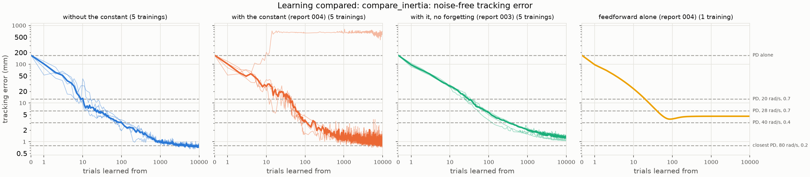
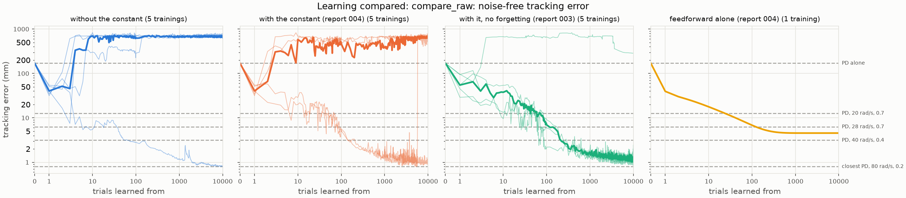

# 005 Feedback without its constant

**Summary.** In report 004, the feedforward and the reward-modulated feedback both
had a constant input, so only the sum of their constant torques reached the arm.
With the feedforward forgetting directionally, the split between them drifted, and
the controller no longer worked without its feedback. Here the feedback has no
constant, and nothing else changes: the same tuned settings, seeds, and budget.
Inertia-scaled, the drift is gone. The feedforward's bias rose to about the sum of
the two constants without forgetting, and stayed near it. Without its feedback,
the controller lags 10.0 mm, against 159 mm with the constant and 7.6 mm without
forgetting. All 5 seeds improved, to 0.69 to 0.77 mm at 10,000 reaches, and the
scatter between evaluations shrank: 0.72 to 0.78 mm over the last 1,000 reaches
(10th to 90th percentile), against 0.77 to 1.31 mm with the constant. That is the
closest median tracking of the study, below the closest PD's 0.80 mm on every seed
at the last evaluation. Raw torque still improved on only 1 of 5 seeds: its early
run-aways happen with the constant or without it.

- **The feedforward holds the constant.** Inertia-scaled, its bias on joint 1 rose
  to a median of 0.44 N m by reach 1,000 and 0.56 N m by 10,000. From reach 5,000
  on, each seed's bias stayed within a range of 0.05 to 0.08 N m. Report 003's
  controller, without forgetting, carried the same sum, 0.56 N m. With the
  constant, report 004's feedforward bias had fallen to -0.47 N m while the
  feedback's constant grew to 1.19 N m.
- **Each part works alone again.** Without its feedback, each inertia-scaled
  controller lags 8.8 to 12.4 mm, against 159 mm with the constant. Without its
  feedforward, the median is 9.0 mm, against 24.3 mm. The feedforward's torque is
  0.73 N m RMS, against 1.16 N m with the constant, and the feedback's 0.08 against
  0.86 N m: the two no longer partly cancel.
- **Closer, steadier, and sooner, on 5 of 5 seeds.** Inertia-scaled, the median
  was 3.1 mm at 100 reaches, 1.0 mm at 1,000, and 0.7 mm at 10,000. Over the last
  1,000 reaches, the median is 0.75 mm, and the 10th to 90th percentile band is
  0.06 mm wide, against 0.54 mm with the constant. The controller passed the
  40-rad/s PD for good after 99 reaches, against 180 with the constant and 320
  without forgetting. Seed 5, which ran away by reach 10 with the constant,
  improved too.
- **Raw torque, 1 of 5 again.** Seeds 1, 3, and 4 ran away from reaches 3 to 7,
  as they had from reaches 2 and 3 with the constant. Seed 5, the survivor with the
  constant, ran away from reach 4. Seed 2, which ran away late with the constant,
  improved, to 0.80 mm. The fragility is the feedback setting's, as report 004
  found.

## 1. Question

Within RQ1 of the [project README](../../README.md#research-questions), report
[004](../004-directional-forgetting/README.md) combined a feedforward and a
reward-modulated feedback on one reach, with the feedforward forgetting
directionally. The feedforward is learned by feedback-error learning with an RLS
readout of `[q_ref, dq_ref, ddq_ref, 1]`. The feedback is learned from one reward
per reach, as `K_p e_q + K_d e_dq + c`. Inertia-scaled, it tracked closest of the
study's learners, but the split between the two parts drifted. The feedback's
constant `c` on joint 1 grew to a median of 1.19 N m over 10,000 reaches, and the
feedforward's bias fell to -0.47 N m, while their sum stayed at 0.6 to 0.9 N m.
Without its feedback, the controller lagged 159 mm, nearly the weak PD's 170 mm.
Its error also scattered more between evaluations than without forgetting.

Report 004 read this as the shared constant's. Neither learner sees how the
constant torque is split: the reward sees only the reach's error, and the
feedforward's target, its own output plus the weak PD's torque, sees only what
the PD must still add. Without forgetting, the feedforward settles and holds the
constant. Forgetting, it keeps adapting to whatever the feedback does there. That
reading was not tested. Without the feedback's constant, does the feedforward hold
the constant torque, and work alone again? And is the tracking as close?

## 2. Setup

The [experiment's README](../../experiments/feedback_without_constant/README.md)
holds the configurations and the protocol, which was fixed before the runs.

- **Everything but the feedback's constant** is report 004's concurrent final
  runs:
  - report 001's arm, reach, and weak PD (5 rad/s, damping ratio 0.7);
  - the feedforward of `[q_ref, dq_ref, ddq_ref, 1]`, learned by feedback-error
    learning (Kawato et al., 1987), forgetting directionally, at report 004's
    tuned settings: a forgetting factor of 0.999, with a `delta` of 100 for raw
    torque and 10 inertia-scaled;
  - the feedback, learned by the decorrelated reward-modulated rule
    (`burms2015`; Burms et al., 2015) from one reward per reach, at report 004's
    tuned settings: a learning rate of 250 with 0.32 N m for raw torque, 50 with
    8 rad/s^2 inertia-scaled;
  - both learning from every reach, on seeds 1 to 5, for 10,000 reaches;
  - the noise-free evaluations and the outcomes.

  A test checks that the configurations are report 004's but for one line.
- **The feedback has no constant:** `constant = false` in `[feedback]`. Its readout
  has no bias, so its torque is `K_p e_q + K_d e_dq`, times the scale. It can give
  a constant torque only through a steady error, which the reward sees. The
  recorded weights keep their shape, with a zero bias row. rclib draws the
  exploration noise per output, so a seed draws the same noise with the constant
  or without.
- **Why the feedback's constant, not the feedforward's.** Both joints' reference
  angles follow the same minimum-jerk profile `s(t)`, as
  `q_ref_i = q0_i + (q1_i - q0_i) s(t)`, so a combination of the two is constant.
  The feedforward's six reference inputs fit a constant by least squares to within
  7e-15. Without its bias, the feedforward would still give a constant torque, and
  the shared direction would remain.
- **A matched ablation, not tuned again.** The settings were tuned with the
  constant, on seed 0, in report 004. Keeping them changes one thing against
  report 004's final runs. A setting that suits the feedback without its constant
  better may exist.
- **The feedforward alone is not run again**: without a feedback, nothing changes.
  Report 004's runs of it serve.

The protocol:

1. **The final runs**: report 004's two concurrent final runs, raw torque and
   inertia-scaled, without the feedback's constant, on seeds 1 to 5, for 10,000
   reaches.
2. **The comparison**, on the same seeds and budget, against report 004's final
   runs with the constant, report 003's with it but without forgetting, the weak PD
   alone, and PDs of report 001's grid:
   1. the seeds improved, and the median error over the reaches;
   2. the scatter over the last 1,000 reaches;
   3. the lesions: each controller replayed as learned, without its feedback, and
      without its feedforward;
   4. the constant torques on each joint over the reaches;
   5. the feedback's gains, the effort, the peak torque, and the torque variation.

   The inertia-scaled runs answer the question. Report 004's reading predicts that
   the feedforward's bias holds still, and that the controller without its feedback
   comes back toward the 7.6 mm without forgetting. The reading is not supported if
   that lesion stays near the weak PD's, or if the bias still drifts. The raw
   torque runs are reported beside them: three of their seeds ran away within 3
   reaches with the constant, and again without forgetting.

### Reproducing the results

This report's runs are in [`results/`](results). Each has its configuration
(`config.toml`), its run record (`run.toml`), and its outputs. The report also
reads report 004's copies of its final runs and of the feedforward alone, report
003's copies of its final runs, and report 001's copy of the PD grid.

```bash
uv run python experiments/learn_combined.py experiments/feedback_without_constant/<configuration>.toml --workers <n>
uv run python experiments/compare_learning.py experiments/feedback_without_constant/compare_<scale>.toml
```

| Runs | Commit |
| --- | --- |
| `final_concurrent_raw`, `final_concurrent_inertia` | `546456a` |
| `compare_raw`, `compare_inertia` | `6229c40` |

- **Run records.** Every run record shows no uncommitted changes. The number of
  worker processes does not change a result.
- **The default.** With the constant, the code reproduces the first 20 reaches of
  report 004's inertia-scaled final run on seed 1 bit for bit.
- **[`make_tables.py`](make_tables.py)** prints the tables of Section 3 from these
  copies and from reports 001's, 003's, and 004's. It also checks:
  - that each final run is report 004's but for the feedback's constant, evaluated
    at the same reaches;
  - that each replay of the effort and lesion tables, run without noise,
    reproduces its run's last evaluation, or the PD's error in the grid. Every one
    does.
- **Run times.** A final training of 10,000 trials took 48 to 59 minutes, about
  0.3 s per trial with its evaluation, on a machine without other load.

## 3. Results

### 3.1 The final runs





Medians over the seeds; a run-away's error counts as it is.

| Learner | Seeds improved | 10 trials | 100 trials | 1,000 trials | 3,000 trials | 10,000 trials |
| --- | ---: | ---: | ---: | ---: | ---: | ---: |
| without the constant, raw torque | 1 of 5 | 696.4 mm | 622.3 mm | 684.1 mm | 683.8 mm | 670.1 mm |
| with the constant, raw torque (report 004) | 1 of 5 | 578.2 mm | 461.9 mm | 383.6 mm | 444.3 mm | 641.6 mm |
| with the constant, no forgetting, raw torque (report 003) | 4 of 5 | 37.7 mm | 7.0 mm | 1.6 mm | 1.3 mm | 1.1 mm |
| without the constant, inertia-scaled | 5 of 5 | 13.1 mm | 3.1 mm | 1.0 mm | 0.8 mm | 0.7 mm |
| with the constant, inertia-scaled (report 004) | 4 of 5 | 26.7 mm | 3.5 mm | 1.1 mm | 1.0 mm | 0.8 mm |
| with the constant, no forgetting, inertia-scaled (report 003) | 5 of 5 | 27.3 mm | 5.7 mm | 2.0 mm | 1.5 mm | 1.3 mm |
| feedforward alone, delta 100 (report 004) | 1 of 1 | 17.8 mm | 6.8 mm | 4.5 mm | 4.5 mm | 4.5 mm |
| feedforward alone, delta 10 (report 004) | 1 of 1 | 23.2 mm | 3.9 mm | 4.5 mm | 4.5 mm | 4.5 mm |

Over the last 1,000 trials, the 50 evaluations after trials 9,020 to 10,000, of
each seed that improved: their median, 10th and 90th percentile, and largest, each
a median over those seeds:

| Learner | Seeds | Median | 10th percentile | 90th percentile | Largest |
| --- | ---: | ---: | ---: | ---: | ---: |
| without the constant, raw torque | 1 | 0.82 mm | 0.80 mm | 0.84 mm | 0.84 mm |
| with the constant, raw torque (report 004) | 1 | 1.00 mm | 0.93 mm | 1.12 mm | 1.28 mm |
| with the constant, no forgetting, raw torque (report 003) | 4 | 1.07 mm | 1.00 mm | 1.27 mm | 1.67 mm |
| without the constant, inertia-scaled | 5 | 0.75 mm | 0.72 mm | 0.78 mm | 0.84 mm |
| with the constant, inertia-scaled (report 004) | 4 | 0.90 mm | 0.77 mm | 1.31 mm | 1.73 mm |
| with the constant, no forgetting, inertia-scaled (report 003) | 5 | 1.28 mm | 1.25 mm | 1.40 mm | 1.44 mm |

The trials from which the median stays closer than a PD:

| Learner | PD, 20 rad/s, 0.7 (12.7 mm) | PD, 28 rad/s, 0.7 (6.3 mm) | PD, 40 rad/s, 0.4 (3.1 mm) |
| --- | ---: | ---: | ---: |
| without the constant, raw torque | never | never | never |
| with the constant, raw torque (report 004) | never | never | never |
| with the constant, no forgetting, raw torque (report 003) | 72 | 120 | 220 |
| without the constant, inertia-scaled | 11 | 25 | 99 |
| with the constant, inertia-scaled (report 004) | 42 | 59 | 180 |
| with the constant, no forgetting, inertia-scaled (report 003) | 31 | 82 | 320 |
| feedforward alone, delta 100 (report 004) | 24 | 140 | never |
| feedforward alone, delta 10 (report 004) | 20 | 40 | never |

Each seed of the final runs, with the feedback's constant (report 004) and
without:

| Feedback scale | Seed | With the constant: worse than the PD alone from trial | 100 trials | 10,000 trials | Without: worse from trial | 100 trials | 10,000 trials |
| --- | ---: | ---: | ---: | ---: | ---: | ---: | ---: |
| raw torque | 1 | 2 | 524.7 mm | 641.6 mm | 3 | 719.2 mm | 670.1 mm |
| raw torque | 2 | 5,740 | 5.7 mm | 722.7 mm | never | 2.8 mm | 0.8 mm |
| raw torque | 3 | 3 | 461.9 mm | 603.5 mm | 4 | 687.4 mm | 677.3 mm |
| raw torque | 4 | 3 | 598.8 mm | 690.4 mm | 7 | 622.3 mm | 642.1 mm |
| raw torque | 5 | never | 5.2 mm | 1.1 mm | 4 | 286.3 mm | 705.4 mm |
| inertia-scaled | 1 | never | 1.7 mm | 0.8 mm | never | 1.9 mm | 0.7 mm |
| inertia-scaled | 2 | never | 4.6 mm | 0.8 mm | never | 3.7 mm | 0.7 mm |
| inertia-scaled | 3 | never | 3.2 mm | 1.2 mm | never | 3.4 mm | 0.7 mm |
| inertia-scaled | 4 | never | 3.5 mm | 0.7 mm | never | 3.0 mm | 0.8 mm |
| inertia-scaled | 5 | 10 | 639.8 mm | 670.1 mm | never | 3.1 mm | 0.7 mm |

- **Inertia-scaled, every seed improves, and closer.** All 5 ended at 0.69 to
  0.77 mm, below the closest PD's 0.80 mm (80 rad/s, damping ratio 0.2). With the
  constant, 4 of 5 ended at 0.74 to 1.16 mm. At every matched budget, the median
  is the lowest of the three: 13.1 mm at 10 reaches, against 26.7 and 27.3 mm.
- **The scatter shrinks.** Over the last 1,000 reaches, each seed's evaluations
  lie within 0.72 and 0.78 mm, between the 10th and 90th percentile, in median. With
  the constant they lay within 0.77 and 1.31 mm. The largest of the 50 is 0.84 mm
  in median, against 1.73 mm; per seed, it is 0.78 to 0.91 mm.
- **Raw torque, the same count on other seeds.** Seeds 1, 3, and 4 ran away in
  both, within 7 reaches. Seed 5 ran away without the constant, from reach 4, where
  it held with it. Seed 2 held without the constant, to 0.80 mm, where it ran away
  from reach 5,740 with it.

### 3.2 What each part does

Each combined final controller replayed as learned, without its feedback, and
without its feedforward, medians over the seeds that improved:

| Combined controller | As learned | Without its feedback | Without its feedforward |
| --- | ---: | ---: | ---: |
| without the constant, raw torque (1 of 5) | 0.8 mm | 16.3 mm | 8.9 mm |
| with the constant, raw torque (report 004) (1 of 5) | 1.1 mm | 70.4 mm | 31.8 mm |
| with the constant, no forgetting, raw torque (report 003) (4 of 5) | 1.1 mm | 78.4 mm | 8.4 mm |
| without the constant, inertia-scaled (5 of 5) | 0.7 mm | 10.0 mm | 9.0 mm |
| with the constant, inertia-scaled (report 004) (4 of 5) | 0.8 mm | 159.3 mm | 24.3 mm |
| with the constant, no forgetting, inertia-scaled (report 003) (5 of 5) | 1.3 mm | 7.6 mm | 36.9 mm |

The constant torque on joint 1 (N m), the feedback's / the feedforward's bias /
their sum, medians over the seeds that improved:

| Combined controller | 100 trials | 1,000 trials | 3,000 trials | 10,000 trials |
| --- | ---: | ---: | ---: | ---: |
| without the constant, raw torque (1 of 5) | +0.00 / +0.24 / +0.24 | +0.00 / +0.44 / +0.44 | +0.00 / +0.50 / +0.50 | +0.00 / +0.54 / +0.54 |
| with the constant, raw torque (report 004) (1 of 5) | -0.13 / +0.33 / +0.20 | -0.01 / +0.42 / +0.42 | +0.16 / +0.43 / +0.59 | +0.82 / -0.16 / +0.65 |
| with the constant, no forgetting, raw torque (report 003) (4 of 5) | +0.12 / +0.14 / +0.26 | +0.00 / +0.23 / +0.32 | +0.03 / +0.27 / +0.34 | +0.00 / +0.30 / +0.37 |
| without the constant, inertia-scaled (5 of 5) | +0.00 / +0.16 / +0.16 | +0.00 / +0.44 / +0.44 | +0.00 / +0.50 / +0.50 | +0.00 / +0.56 / +0.56 |
| with the constant, inertia-scaled (report 004) (4 of 5) | +0.59 / +0.42 / +0.88 | +0.63 / +0.03 / +0.66 | +0.68 / -0.09 / +0.60 | +1.19 / -0.47 / +0.74 |
| with the constant, no forgetting, inertia-scaled (report 003) (5 of 5) | +0.06 / +0.58 / +0.64 | +0.05 / +0.52 / +0.58 | +0.05 / +0.50 / +0.56 | +0.06 / +0.49 / +0.56 |

The same on joint 2:

| Combined controller | 100 trials | 1,000 trials | 3,000 trials | 10,000 trials |
| --- | ---: | ---: | ---: | ---: |
| without the constant, raw torque (1 of 5) | +0.00 / -0.08 / -0.08 | +0.00 / -0.02 / -0.02 | +0.00 / +0.04 / +0.04 | +0.00 / +0.07 / +0.07 |
| with the constant, raw torque (report 004) (1 of 5) | -0.18 / -0.03 / -0.21 | -0.05 / +0.14 / +0.10 | -0.08 / +0.16 / +0.09 | -0.05 / +0.15 / +0.10 |
| with the constant, no forgetting, raw torque (report 003) (4 of 5) | -0.24 / +0.05 / -0.18 | -0.01 / +0.07 / +0.02 | -0.09 / +0.08 / -0.02 | -0.08 / +0.07 / -0.05 |
| without the constant, inertia-scaled (5 of 5) | +0.00 / +0.11 / +0.11 | +0.00 / +0.11 / +0.11 | +0.00 / +0.11 / +0.11 | +0.00 / +0.11 / +0.11 |
| with the constant, inertia-scaled (report 004) (4 of 5) | -0.07 / +0.15 / +0.11 | -0.07 / +0.19 / +0.12 | -0.07 / +0.18 / +0.11 | -0.07 / +0.18 / +0.12 |
| with the constant, no forgetting, inertia-scaled (report 003) (5 of 5) | -0.01 / +0.13 / +0.13 | -0.00 / +0.12 / +0.12 | -0.00 / +0.11 / +0.11 | -0.00 / +0.11 / +0.11 |

- **The lesion recovers.** Inertia-scaled, without its feedback, each seed's
  controller lags 8.8 to 12.4 mm, a median of 10.0 mm. That is near the 7.6 mm
  without forgetting, and far from the 159 mm with the constant and the weak PD's
  170 mm. Without its feedforward, it lags 9.0 mm, against 24.3 mm with the
  constant and 36.9 mm without forgetting.
- **The feedforward's bias settles where report 003's sum did.** Inertia-scaled,
  on joint 1, it rose from 0.16 N m at 100 reaches to 0.44 N m at 1,000 and
  0.56 N m at 10,000. Without forgetting, report 003's constant torques summed to
  0.56 N m at 10,000 reaches. Per seed, from reach 5,000 on, the bias stayed
  within a range of 0.05 to 0.08 N m, and it ended at 0.54 to 0.61 N m. On joint 2
  it held at 0.11 N m throughout, as the sums did in both other runs, at 0.11 to
  0.13 N m.

### 3.3 Effort and gains

Every controller replayed without noise with its last weights, medians over the
seeds that improved:

| Controller | Tracking error | Effort (N^2 m^2 s) | Peak torque (N m) | Torque variation (N m) | PD's torque, RMS (N m) | Feedforward's, RMS (N m) | Feedback's, RMS (N m) |
| --- | ---: | ---: | ---: | ---: | ---: | ---: | ---: |
| PD, 5 rad/s, 0.7 | 170.0 mm | 3.03 | 2.56 | 11.5 | 0.870 | 0.000 | 0.000 |
| PD, 20 rad/s, 0.7 | 12.7 mm | 2.90 | 2.67 | 12.6 | 0.851 | 0.000 | 0.000 |
| PD, 28 rad/s, 0.7 | 6.3 mm | 2.62 | 2.53 | 11.8 | 0.809 | 0.000 | 0.000 |
| PD, 40 rad/s, 0.4 | 3.1 mm | 2.49 | 2.44 | 11.9 | 0.788 | 0.000 | 0.000 |
| PD, 80 rad/s, 0.2 | 0.8 mm | 2.37 | 2.44 | 18.2 | 0.769 | 0.000 | 0.000 |
| without the constant, raw torque (1 of 5) | 0.8 mm | 2.29 | 2.18 | 10.2 | 0.010 | 0.739 | 0.061 |
| with the constant, raw torque (report 004) (1 of 5) | 1.1 mm | 2.85 | 3.36 | 117.1 | 0.049 | 0.949 | 0.701 |
| with the constant, no forgetting, raw torque (report 003) (4 of 5) | 1.1 mm | 2.30 | 2.20 | 12.7 | 0.011 | 0.841 | 0.315 |
| without the constant, inertia-scaled (5 of 5) | 0.7 mm | 2.29 | 2.24 | 12.7 | 0.006 | 0.731 | 0.080 |
| with the constant, inertia-scaled (report 004) (4 of 5) | 0.8 mm | 2.29 | 2.24 | 13.7 | 0.007 | 1.156 | 0.860 |
| with the constant, no forgetting, inertia-scaled (report 003) (5 of 5) | 1.3 mm | 2.29 | 2.17 | 9.8 | 0.012 | 0.750 | 0.063 |
| feedforward alone, delta 100 (report 004) (1 of 1) | 4.5 mm | 2.32 | 2.08 | 10.0 | 0.048 | 0.761 | 0.000 |
| feedforward alone, delta 10 (report 004) (1 of 1) | 4.5 mm | 2.32 | 2.08 | 10.0 | 0.048 | 0.761 | 0.000 |

The feedback's gains, medians over the seeds that improved:

| Feedback | Stiffness (N m/rad): joint 1 | joint 2 | Damping (N m s/rad): joint 1 | joint 2 | Constant (N m): joint 1 | joint 2 |
| --- | ---: | ---: | ---: | ---: | ---: | ---: |
| without the constant, raw torque (1 of 5) | 3.69 | 13.5 | 14 | 3.79 | 0 | 0 |
| with the constant, raw torque (report 004) (1 of 5) | 2.3 | 10.3 | 12.7 | 2 | 0.818 | -0.0472 |
| with the constant, no forgetting, raw torque (report 003) (4 of 5) | 10.8 | 29.5 | 18.7 | 5.37 | 0.00111 | -0.0841 |
| without the constant, inertia-scaled (5 of 5) | 32.4 | 3.05 | 35 | 1.57 | 0 | 0 |
| with the constant, inertia-scaled (report 004) (4 of 5) | 12.9 | 2.23 | 31.5 | 1.5 | 1.19 | -0.0682 |
| with the constant, no forgetting, inertia-scaled (report 003) (5 of 5) | 1.51 | 0.148 | 8.44 | 0.394 | 0.0597 | -0.00464 |

- **The two parts no longer partly cancel.** Inertia-scaled, the feedforward's
  torque is 0.73 N m RMS, against 1.16 N m with the constant, and the feedback's
  0.08 against 0.86 N m. Both are back near report 003's 0.75 and 0.06 N m. The
  effort, 2.29 N^2 m^2 s, and the peak torque, 2.24 N m, are unchanged, and both
  are below the closest PD's 2.37 and 2.44.
- **The feedback is stiffer on joint 1.** Inertia-scaled, its stiffness there is
  32.4 N m/rad, against 12.9 with the constant and 1.5 without forgetting. Its
  damping, 35 N m s/rad, is near the 31.5 with the constant.
- **The raw torque survivor's torque is smooth,** 10.2 N m of variation against
  report 004's survivor's 117.1. They are different seeds, 2 and 5, so this does
  not compare the constant's presence.

## 4. Observations

- **The shared constant caused the drift.** Report 004's reading is supported, on
  the inertia-scaled runs that answer the protocol's question. With only the
  feedback's constant removed, the feedforward's bias rose to about the sum of the
  two constants in report 003's controller without forgetting, then stayed near
  it. The controller without its feedback came back to 10.0 mm from 159 mm. The
  reading here: when two learners share an input that neither's signal can split,
  a learner that keeps adapting lets the split wander, and giving the constant to
  one learner only removes that freedom.
- **Forgetting directionally and a feedback without a constant give the closest
  median tracking of the study.** Inertia-scaled, on 5 of 5 seeds, the error ended at
  0.69 to 0.77 mm, steadily: over the last 1,000 reaches, a band of 0.72 to
  0.78 mm. Every seed ended below the closest PD's 0.80 mm, which needs a natural
  frequency of 80 rad/s, at less effort and a lower peak torque. Report 004's
  scatter came with the constant, not with forgetting alone.
- **The feedback's job narrows to correcting errors.** Without a constant, its
  torque is zero when the arm follows the reference, and the feedforward carries
  everything the reference predicts. The feedback's torque fell to 0.08 N m RMS,
  about a tenth of the feedforward's.
- **The raw torque setting stays fragile.** The count of seeds that improve did
  not change. Four of five seeds ran away within 7 reaches, three of them the same
  as with the constant. Which seeds survive changed. A reading, untested: at this
  setting, whether a seed runs away turns on small differences in its first
  updates, and the constant is one of them. The setting was tuned on one seed.
- **Failures are silent.** Every run-away ended with the arm against its stops and
  nothing raised, as in reports 001 to 004.

What is not claimed:

- **That these are the best settings without the constant.** The settings were
  tuned with it. The matched ablation answers whether the constant caused the
  drift. It does not say how well a feedback without a constant can do.
- **That inertia-scaled seed 5 survives because of the constant's removal in
  general.** It is one seed. With the constant, it ran away by reach 10, and
  without forgetting it nearly did (report 004, protocol step 5).
- **That the feedback needs no constant anywhere.** The arm moves in the
  horizontal plane without gravity, along one reach, and is never loaded. There,
  the constant torque the reach needs follows from the reference, so the
  feedforward can carry it. Against a constant disturbance that the reference does
  not predict, such as gravity on a tilted arm, the feedback without a constant
  could answer only through a steady error. Whether the feedforward would take the
  disturbance up from the PD's torque was not tested.
- **That the bias would hold beyond 10,000 reaches.** Over the last 5,000
  reaches, each seed's bias still moved within a range of 0.05 to 0.08 N m.
- **A comparison of the raw torque survivors.** They are different seeds.
- **Runs without forgetting and without the constant.** They were not run. Report
  003's feedback constant stayed near zero without forgetting, so little change is
  expected, untested.

## 5. Next steps

1. **A tuning that judges robustness**, now the main failure of raw torque:
   several tuning seeds, choosing by the median or the worst seed, and margins from
   settings that run away. Report 003's next step 3 and report 004's next step 2.
2. **Several reaches.** Reaches to other goals excite more of the feedforward's
   input directions. They test directional forgetting where the excited directions
   change, and whether the feedforward still carries each reach's constant torque.
   Report 004's next step 4.
3. **A constant disturbance the reference does not predict**, such as gravity on
   a tilted arm or a constant external force. It tests what a feedback without a
   constant leaves as steady error, and whether the feedforward, which learns from
   the PD's torque, takes it up.
4. **Tuning without the constant**, to see how close the inertia-scaled
   combination gets at its own best setting, and whether raw torque recovers on more
   seeds.
