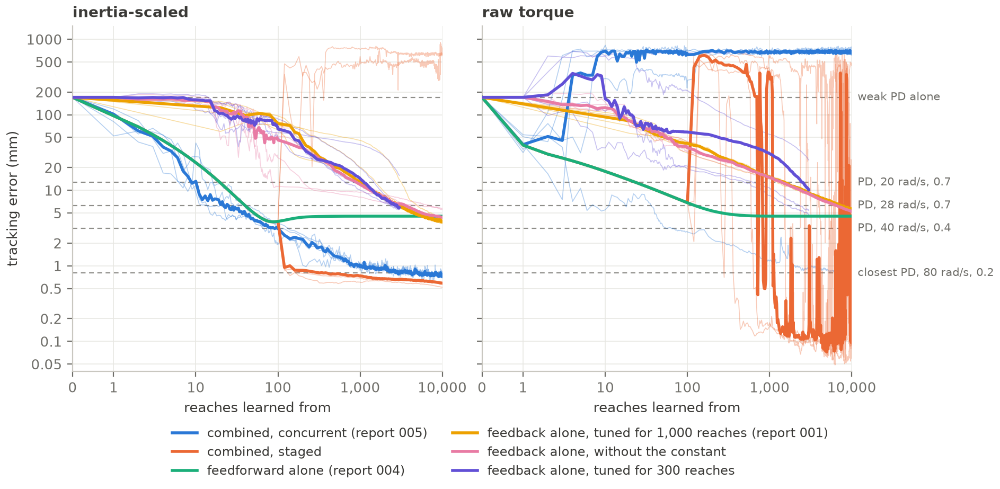
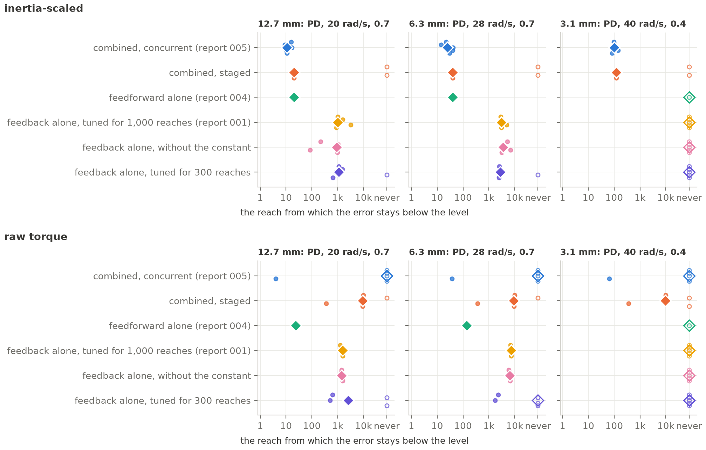

# 006 Learning speed

**Summary.** Reports 001 to 005 asked how closely each controller tracks at the
end. This one asks how soon. Inertia-scaled, the combined controller of report 005
reached the errors of three PDs (12.7, 6.3, and 3.1 mm) in 11, 25, and 99 reaches,
medians over 5 seeds. The fastest arm of the feedback alone needed 920 and 2,820
reaches for the first two, and did not reach the third in 10,000. That is 84 and
113 times fewer reaches, and every seed of the combined controller passed before
any seed of the feedback alone. The question's criterion, fixed before the runs, is met. Tuning the
feedback alone for speed did not close the gap. The feedforward alone passed the
first two levels in 20 and 40 reaches, so most of the early speed is the
feedforward's. The combination's own gain is the third level, and below: neither
part alone passed 3.1 mm in 10,000 reaches. The staged schedule, the feedforward
first and the feedback after it, was no faster and ran away on 2 of 5 seeds. With
raw torque, neither combined schedule was steady.

- **About 100 times fewer reaches, inertia-scaled, at report 005's settings.**
  The combined controller passed the 20-, 28-, and 40-rad/s PDs for good after 11,
  25, and 99 reaches. At 2 s per reach, that is 22 s, 50 s, and 3.3 min of
  reaching. The feedback alone without the constant, the same controller without
  its feedforward and on the same seeds, needed 920 and 3,540 reaches, and never
  passed 3.1 mm.
- **The feedback tuned for speed is no faster.** Tuned for its error at 300 reaches
  instead of 1,000, the feedback alone passed 12.7 mm after 1,120 reaches and
  6.3 mm after 2,820, against 1,020 and 3,020 at report 001's setting.
- **The feedforward does the early work, and the feedback the rest.** The
  feedforward alone passed 12.7 and 6.3 mm after 20 and 40 reaches, then settled at
  4.5 mm. Combined, the controller passed them sooner, after 11 and 25, and went on
  to 3.1 mm after 99 and to 0.7 mm at 10,000.
- **The staged schedule: closest when it holds, but 2 of 5 seeds ran away.**
  Inertia-scaled, its tuned exploration is 4 times the concurrent schedule's. Within
  20 reaches of the feedback joining, 3 seeds dropped from 3.9 to 0.9 mm and ended
  at 0.52 to 0.59 mm, the closest of the study. Seeds 2 and 5 ran away at once.
- **Raw torque: no steady combined arm.** The concurrent schedule ran away on 4 of
  5 seeds, as in report 005. Every seed of the staged schedule ran away within 200
  reaches of the feedback joining, and its median stayed below the PDs only after
  9,240 reaches or more.

## 1. Question

Within RQ1 of the [project README](../../README.md#research-questions), the
combined controller of report [005](../005-feedback-without-constant/README.md)
tracks one reach closer than any other learner of the study. It is a feedforward,
learned by feedback-error learning with an RLS readout forgetting directionally,
and a feedback `K_p e_q + K_d e_dq`, learned from one reward per reach by the
decorrelated reward-modulated rule. The reports compared how closely each
controller tracked at the end, not how many reaches it needed.

A learner that needs few reaches could matter where reaches are expensive, such as
on a robot. This study stays in simulation, but the question can be asked here:
does the feedforward make the reward-modulated feedback reach a useful tracking
error in fewer reaches than the feedback needs alone?

The stored runs suggested yes, but did not test it fairly. Report 001's feedback
was tuned for its error at 1,000 reaches, not for speed. It had a constant torque,
which report 005's feedback lacks. And the staged schedule had not been run with
directional forgetting or without the constant.

## 2. Setup

The [experiment's README](../../experiments/learning_speed/README.md) holds the
configurations and the protocol, which was fixed before the runs.

Everything shared is as in reports 001 to 005: the two-link arm in the horizontal
plane, the one reach of 1 s with 1 s of holding, the weak PD (5 rad/s, damping
ratio 0.7), the reward, and the final runs' seeds, 1 to 5, which no tuning saw.
Every arm is run with raw torque and inertia-scaled.

Six arms:

| Arm | Source | What it is | Learning rate, amplitude: raw torque | inertia-scaled |
| --- | --- | --- | --- | --- |
| combined, concurrent | report 005 | the feedforward and the feedback both learn from every reach | 250, 0.32 N m | 50, 8 rad/s^2 |
| combined, staged | new | the same controller; the feedforward learns the first 100 reaches alone and is then frozen, and the feedback learns from the rest | 16, 51.2 N m | 50, 32 rad/s^2 |
| feedforward alone | report 004 | the feedforward at the same setting, without a feedback; no noise, so one training | | |
| feedback alone, tuned for 1,000 reaches | report 001 | the decorrelated rule, with the constant | 2.5, 3.2 N m | 50, 8 rad/s^2 |
| feedback alone, without the constant | new | report 001's feedback without its constant | 2.5, 3.2 N m | 50, 8 rad/s^2 |
| feedback alone, tuned for 300 reaches | new | report 001's feedback, tuned for its error at 300 reaches | 5, 6.4 N m | 35, 11 rad/s^2 |

- **Each new arm changes one thing.** Inertia-scaled, the feedback without the
  constant is report 005's combined controller without its feedforward: the same
  feedback setting, the same seeds, and so the same exploration noise. With raw
  torque, the two settings differ. A test checks each configuration against the one
  it changes.
- **The feedforward is never tuned again.** Both combined schedules keep report
  004's setting: a forgetting factor of 0.999, forgetting directionally, with a
  `delta` of 100 for raw torque and 10 inertia-scaled. The staged schedule's
  feedback was tuned, since in report 003 the two schedules' settings differed
  widely.
- **The amplitude** is the standard deviation of the Gaussian exploration noise,
  drawn every 10 ms on each joint's output. Inertia-scaled, it is in rad/s^2 and
  multiplied by each joint's inertia, 0.235 and 0.022 kg m^2, into torque.
- **The evaluation**: a noise-free reach after every reach up to 100, and after
  every 20th from then on, as for the combined runs of reports 003 to 005. Report
  001's runs were evaluated after every 20th reach only. The evaluations change no
  learning state.

The protocol:

1. **Tuning**, on seed 0, by hand, in rounds, as in the earlier reports: a grid of
   learning rates by amplitudes, extended past its edge while the closest setting
   lay on it.
   1. The staged schedule's feedback, for its error at 1,000 reaches, as the
      concurrent schedule was tuned in reports 003 and 004.
   2. The feedback alone, for its error at 300 reaches, around report 001's
      setting and toward larger values.
2. **The final runs**, on seeds 1 to 5: the staged schedule and the feedback
   without the constant for 10,000 reaches, as long as the reused runs; the feedback
   tuned for speed for 3,000.
3. **The comparison**, for each feedback scale:
   1. the noise-free tracking error of every arm over the reaches, against the weak
      PD alone and the PDs of report 001's grid;
   2. the reaches to each level: the first reach from which the median over the
      seeds stays closer than the PD of 20, 28, or 40 rad/s (12.7, 6.3, and
      3.1 mm), and the same for each seed;
   3. the seeds that improve and those that run away.

   The inertia-scaled runs answer the question. The answer is yes if the combined
   controller passes each level in fewer reaches than every arm of the feedback
   alone, and the seeds' ranges do not overlap. It is no if the feedback tuned for
   speed passes the levels in about as many reaches. The raw torque runs are
   reported beside them: at report 005's setting, 4 of 5 seeds of the concurrent
   schedule ran away, so they test that setting more than the speed.

### Reproducing the results

This report's runs are in [`results/`](results). Each has its configuration
(`config.toml`), its run record (`run.toml`), and its outputs. The report also
reads report 005's copies of its final runs, report 004's of the feedforward
alone, and report 001's of its long runs and of the PD grid.

```bash
uv run python experiments/learn_combined.py experiments/learning_speed/<configuration>.toml --workers <n>
uv run python experiments/learn_feedback.py experiments/learning_speed/<configuration>.toml --workers <n>
uv run python experiments/compare_learning.py experiments/learning_speed/compare_<scale>.toml
uv run python reports/006-learning-speed/make_tables.py
uv run python reports/006-learning-speed/make_figures.py
```

| Runs | Commit |
| --- | --- |
| tuning, round 1: `tune_staged_<scale>`, `tune_feedback_short_<scale>` | `1a4db35` |
| tuning, round 2: `tune_staged_<scale>_round2`, `tune_feedback_short_<scale>_round2` | `5bbf0f2` |
| tuning, round 3: `tune_staged_<scale>_round3` | `ce38b0a` |
| `final_staged_<scale>`, `final_feedback_no_constant_<scale>`, `final_feedback_short_<scale>` | `446b97b` |
| `compare_raw`, `compare_inertia` | `f0447b0` |

- **The library.** These runs use rclib v0.4.0 (`8532a93`). Before them, every
  learner's first 300 reaches at that version matched those at the previous pin,
  `b2fe32b`, bit for bit, on 12 configurations covering every code path of reports
  001 to 005.
- **Run records.** Three round-1 tuning runs, `tune_staged_raw` and both
  `tune_feedback_short`, record uncommitted changes: untracked report scripts under
  `reports/`, which the runs do not read. Every other run records none. The number
  of worker processes does not change a result.
- **The staged schedule's first 100 reaches** are report 004's feedforward alone
  bit for bit, on every seed: the feedback adds nothing until it learns.
- **[`make_tables.py`](make_tables.py)** prints the tables of Section 3, and
  **[`make_figures.py`](make_figures.py)** draws its figures, from these copies and
  those of reports 001, 004, and 005.
- **Run times.** The 30 final trainings ran together, 6 runs of 5 processes, in
  91 minutes: 0.4 to 0.7 s per reach with its evaluation.

## 3. Results

### 3.1 Tuning

The closest setting of each round, on seed 0. Each run's `learning.png` draws all
its settings over the reaches, and `make_tables.py` prints every cell.

| Run | Arm, scale | Amplitudes | Learning rates | Improved / worse / diverged | Closest | Error |
| --- | --- | --- | --- | --- | --- | ---: |
| [`tune_staged_inertia`](results/20261111-011322-tune_staged_inertia/learning.png) | staged, inertia-scaled | 0.25, 0.8, 2.5, 8 rad/s^2 | 16 to 5,000 | 15 / 9 / 0 | 8 rad/s^2, 50 | 1.09 mm |
| [`tune_staged_inertia_round2`](results/20261111-014330-tune_staged_inertia_round2/learning.png) | staged, inertia-scaled | 8, 16, 32 rad/s^2 | 12, 25, 50, 100 | 12 / 0 / 0 | 32 rad/s^2, 50 | 0.72 mm |
| [`tune_staged_inertia_round3`](results/20261111-015757-tune_staged_inertia_round3/learning.png) | staged, inertia-scaled | 32, 64, 128 rad/s^2 | 25, 50, 100 | 3 / 6 / 0 | **32 rad/s^2, 50** | 0.72 mm |
| [`tune_staged_raw`](results/20261111-012410-tune_staged_raw/learning.png) | staged, raw torque | 0.1, 0.32, 1, 3.2 N m | 0.8 to 250 | 21 / 3 / 0 | 3.2 N m, 25 | 0.95 mm |
| [`tune_staged_raw_round2`](results/20261111-014330-tune_staged_raw_round2/learning.png) | staged, raw torque | 3.2, 6.4, 12.8 N m | 8, 16, 25, 40 | 6 / 6 / 0 | 12.8 N m, 8 | 0.36 mm |
| [`tune_staged_raw_round3`](results/20261111-015757-tune_staged_raw_round3/learning.png) | staged, raw torque | 12.8, 25.6, 51.2 N m | 4, 8, 16 | 9 / 0 / 0 | **51.2 N m, 16** | 0.14 mm |
| [`tune_feedback_short_inertia`](results/20261111-013436-tune_feedback_short_inertia/learning.png) | feedback alone, inertia-scaled | 4, 8, 16, 32 rad/s^2 | 25 to 800 | 6 / 18 / 0 | 8 rad/s^2, 50 | 39.7 mm |
| [`tune_feedback_short_inertia_round2`](results/20261111-015336-tune_feedback_short_inertia_round2/learning.png) | feedback alone, inertia-scaled | 5.6, 8, 11 rad/s^2 | 35, 50, 70 | 7 / 2 / 0 | **11 rad/s^2, 35** | 38.0 mm |
| [`tune_feedback_short_raw`](results/20261111-013836-tune_feedback_short_raw/learning.png) | feedback alone, raw torque | 0.8, 1.6, 3.2, 6.4 N m | 2.5 to 80 | 12 / 12 / 0 | 6.4 N m, 5 | 21.4 mm |
| [`tune_feedback_short_raw_round2`](results/20261111-015336-tune_feedback_short_raw_round2/learning.png) | feedback alone, raw torque | 6.4, 12.8, 25.6 N m | 2.5 to 14 | 13 / 2 / 0 | **6.4 N m, 5** | 21.4 mm |

The tuned settings are in bold. Errors are at 1,000 reaches for the staged
schedule and at 300 for the feedback alone.

- **The staged schedule wants large exploration.** Inertia-scaled, the closest
  setting moved to 32 rad/s^2, four times the concurrent schedule's 8, and every
  setting at 64 rad/s^2 or more ran away. At 32 rad/s^2, a learning rate of 100
  reached 3.83 mm after 87 reaches, then climbed to 20.1 mm by 1,000: the tuned
  setting has a failing neighbour. With the constant, report 004 had tried the
  concurrent schedule at 25 rad/s^2, and it ran away at both learning rates.
- **The raw torque search stopped on the grid's edge.** Its closest setting lay on
  the largest amplitude in all three rounds. The search stopped at 51.2 N m, about
  20 times the 2.5 N m peak torque that the reach needs: no motor sized for the
  reach could give that noise.
- **Tuning for speed found little.** Inertia-scaled, the closest setting at 300
  reaches, 35 with 11 rad/s^2, nearly ties report 001's, 50 with 8 rad/s^2: 38.0
  against 39.7 mm. With raw torque, 5 with 6.4 N m beat report 001's 2.5 with
  3.2 N m, 21.4 against 32.3 mm. Its neighbours ended far apart, at 41.6 to
  112.6 mm.

### 3.2 The final runs

Every arm's noise-free tracking error over the reaches, drawn like report 003's
final-runs figure: each seed thin, the medians thick (a run-away counting as it
is), and the PDs dashed. The feedforward alone is one run: it has no exploration
noise. The reaches are on a logarithmic axis.



The same runs, a panel per arm:
[inertia-scaled](results/20261111-034037-compare_inertia/learning.png),
[raw torque](results/20261111-034038-compare_raw/learning.png).

Medians over the seeds, inertia-scaled:

| Learner | Seeds improved | 10 reaches | 30 reaches | 100 reaches | 300 reaches | 1,000 reaches | 3,000 reaches | 10,000 reaches |
| --- | ---: | ---: | ---: | ---: | ---: | ---: | ---: | ---: |
| combined, concurrent (report 005) | 5 of 5 | 13.1 mm | 5.9 mm | 3.1 mm | 1.7 mm | 1.0 mm | 0.8 mm | 0.7 mm |
| combined, staged | 3 of 5 | 23.2 mm | 8.3 mm | 3.9 mm | 0.8 mm | 0.7 mm | 0.7 mm | 0.6 mm |
| feedforward alone (report 004) | 1 of 1 | 23.2 mm | 8.3 mm | 3.9 mm | 4.5 mm | 4.5 mm | 4.5 mm | 4.5 mm |
| feedback alone, tuned for 1,000 reaches (report 001) | 5 of 5 | | | 76.3 mm | 29.7 mm | 12.8 mm | 6.3 mm | 3.8 mm |
| feedback alone, without the constant | 5 of 5 | 155.2 mm | 103.8 mm | 46.2 mm | 27.5 mm | 11.9 mm | 6.6 mm | 4.4 mm |
| feedback alone, tuned for 300 reaches | 5 of 5 | 157.6 mm | 89.1 mm | 64.6 mm | 25.7 mm | 14.3 mm | 5.9 mm | |

Raw torque:

| Learner | Seeds improved | 10 reaches | 30 reaches | 100 reaches | 300 reaches | 1,000 reaches | 3,000 reaches | 10,000 reaches |
| --- | ---: | ---: | ---: | ---: | ---: | ---: | ---: | ---: |
| combined, concurrent (report 005) | 1 of 5 | 696.4 mm | 558.7 mm | 622.3 mm | 698.0 mm | 684.1 mm | 683.8 mm | 670.1 mm |
| combined, staged | 4 of 5 | 17.8 mm | 11.5 mm | 6.8 mm | 453.4 mm | 342.3 mm | 0.1 mm | 0.3 mm |
| feedforward alone (report 004) | 1 of 1 | 17.8 mm | 11.5 mm | 6.8 mm | 4.9 mm | 4.5 mm | 4.5 mm | 4.5 mm |
| feedback alone, tuned for 1,000 reaches (report 001) | 5 of 5 | | | 41.7 mm | 25.9 mm | 15.1 mm | 9.1 mm | 5.6 mm |
| feedback alone, without the constant | 5 of 5 | 124.1 mm | 66.2 mm | 36.5 mm | 24.6 mm | 14.8 mm | 9.0 mm | 5.2 mm |
| feedback alone, tuned for 300 reaches | 4 of 5 | 162.7 mm | 70.7 mm | 59.0 mm | 47.4 mm | 30.5 mm | 10.1 mm | |

Report 001's runs were not evaluated at 10 and 30 reaches.

- **Inertia-scaled, the combined controller is ahead at every budget.** At 100
  reaches, it is at 3.1 mm, and the three arms of the feedback alone at 46 to
  76 mm. At 1,000, 1.0 mm against 11.9 to 14.3 mm. The feedback alone never
  reaches the combined controller's 100-reach error, 3.1 mm: at 10,000 reaches it
  ends at 3.8 and 4.4 mm.
- **The staged schedule, seed by seed.** Inertia-scaled, seeds 1, 3, and 4 were at
  0.9 mm 20 reaches after the feedback joined, and ended at 0.52 to 0.59 mm, below
  the concurrent schedule's 0.69 to 0.77 mm. Seeds 2 and 5 were at 344 and 472 mm
  by then, and stayed above 200 mm to the end. With raw torque, every seed ran
  away within 200 reaches of the feedback joining, to 424 to 681 mm. Seeds 2, 3,
  and 5 came back, to 0.06 to 0.26 mm at the end, and seed 1 to 3.3 mm. But seeds
  1, 3, and 5 still spent 9 to 17 % of their evaluations after reach 5,000 above
  the weak PD's 170 mm. Seed 4 ended at 473 mm.
- **The feedback alone held on every seed but one.** All 15 inertia-scaled
  trainings improved, and 14 of 15 with raw torque. The feedback tuned for 300
  reaches lost seed 1 with raw torque at once: 367 mm after 2 reaches, then 569 to
  690 mm from the third to the end, mostly hidden in the figure under the combined
  controller's run-aways. Two more of its seeds left the weak PD early and came
  back. Seed 3 rose to 353 mm and was below 170 mm again after 10 reaches; seed 4
  rose to 604 mm and stayed above 170 mm until reach 120. They ended at 4.7 and
  25.1 mm. Together, the three lift its median to 255 to 353 mm from reach 3 to 9.

### 3.3 The reaches to each level

The first reach from which the error stays below a PD's for the rest of the
training: a dot per seed, a diamond for the median over the seeds, and hollow
marks for never. The feedback tuned for 300 reaches ran 3,000; its "never" means
not within them.



Inertia-scaled, the median's reach, and in parentheses the seeds' range:

| Learner | Reaches run | PD, 20 rad/s, 0.7 (12.7 mm) | PD, 28 rad/s, 0.7 (6.3 mm) | PD, 40 rad/s, 0.4 (3.1 mm) |
| --- | ---: | ---: | ---: | ---: |
| combined, concurrent (report 005) | 10,000 | 11 (9 to 17) | 25 (14 to 41) | 99 (83 to 140) |
| combined, staged | 10,000 | 20 (20; 2 never) | 40 (40; 2 never) | 120 (120; 2 never) |
| feedforward alone (report 004) | 10,000 | 20 | 40 | never |
| feedback alone, tuned for 1,000 reaches (report 001) | 10,000 | 1,020 (900 to 3,180) | 3,020 (2,900 to 4,900) | never (no seed) |
| feedback alone, without the constant | 10,000 | 920 (86 to 1,040) | 3,540 (3,120 to 6,820) | never (no seed) |
| feedback alone, tuned for 300 reaches | 3,000 | 1,120 (660 to 1,500; 1 never) | 2,820 (2,460 to 2,860; 1 never) | never (no seed) |

Raw torque:

| Learner | Reaches run | PD, 20 rad/s, 0.7 (12.7 mm) | PD, 28 rad/s, 0.7 (6.3 mm) | PD, 40 rad/s, 0.4 (3.1 mm) |
| --- | ---: | ---: | ---: | ---: |
| combined, concurrent (report 005) | 10,000 | never (4; 4 never) | never (37; 4 never) | never (64; 4 never) |
| combined, staged | 10,000 | 9,240 (360 to 9,800; 1 never) | 9,240 (360 to 9,960; 1 never) | 9,580 (360 to 9,960; 2 never) |
| feedforward alone (report 004) | 10,000 | 24 | 140 | never |
| feedback alone, tuned for 1,000 reaches (report 001) | 10,000 | 1,540 (1,260 to 1,600) | 7,280 (6,920 to 7,640) | never (no seed) |
| feedback alone, without the constant | 10,000 | 1,420 (1,340 to 1,560) | 6,480 (5,960 to 6,740) | never (no seed) |
| feedback alone, tuned for 300 reaches | 3,000 | 2,540 (500 to 2,540; 2 never) | never (1,720 to 2,320; 3 never) | never (no seed) |

The staged schedule's three inertia-scaled survivors pass the third level at reach
120, the first evaluation after the handover; between reaches 100 and 120 they
were not evaluated.

### 3.4 The speed-up

Against the fastest arm of the feedback alone at each level, by the medians: how
many times fewer reaches the combined controller needs, and whether the seeds'
ranges are apart, every seed of the combined controller passing before any seed of
the feedback alone. The times are at 2 s per reach, the reach's own length.

Inertia-scaled:

| Learner | 12.7 mm | 6.3 mm | 3.1 mm |
| --- | --- | --- | --- |
| the fastest feedback alone | 920 reaches, 30.7 min | 2,820 reaches, 1.6 h | not in 10,000 |
| combined, concurrent (report 005) | 11 reaches, 0.4 min; 84 times fewer; seeds apart | 25 reaches, 0.8 min; 113 times fewer; seeds apart | 99 reaches, 3.3 min; more than 101 times fewer; seeds apart |
| combined, staged | 20 reaches, 0.7 min; 46 times fewer; seeds overlap | 40 reaches, 1.3 min; 70 times fewer; seeds overlap | 120 reaches, 4.0 min; more than 83 times fewer; seeds overlap |

Raw torque:

| Learner | 12.7 mm | 6.3 mm | 3.1 mm |
| --- | --- | --- | --- |
| the fastest feedback alone | 1,420 reaches, 47.3 min | 6,480 reaches, 3.6 h | not in 10,000 |
| combined, concurrent (report 005) | never | never | never |
| combined, staged | 9,240 reaches, 5.1 h; 6.5 times more; seeds overlap | 9,240 reaches, 5.1 h; 1.4 times more; seeds overlap | 9,580 reaches, 5.3 h; the feedback alone not in 10,000; seeds overlap |

The staged schedule's ranges overlap because 2 of its 5 seeds never pass.

### 3.5 While learning, and the exploration against the reach's torque

The evaluations above are noise-free reaches, which change nothing. The reaches
the controllers learn from carry the exploration noise. Their tracking error, the
median over each window of reaches of each seed, then the median over the seeds.

Inertia-scaled:

| Learner | 1 to 10 | 11 to 100 | 101 to 1,000 | 1,001 to 3,000 | 3,001 to 10,000 |
| --- | ---: | ---: | ---: | ---: | ---: |
| combined, concurrent (report 005) | 43.2 mm | 9.5 mm | 5.1 mm | 3.5 mm | 2.6 mm |
| combined, staged | 41.5 mm | 4.7 mm | 9.0 mm | 5.9 mm | 4.4 mm |
| feedforward alone (report 004) | 41.5 mm | 4.7 mm | 4.6 mm | 4.6 mm | 4.6 mm |
| feedback alone, tuned for 1,000 reaches (report 001) | 172.1 mm | 102.2 mm | 19.8 mm | 9.1 mm | 5.5 mm |
| feedback alone, without the constant | 161.4 mm | 62.2 mm | 18.9 mm | 9.1 mm | 5.9 mm |
| feedback alone, tuned for 300 reaches | 174.6 mm | 87.5 mm | 21.7 mm | 9.0 mm | |

`make_tables.py` prints the same for raw torque, where the combined arms' run-aways
dominate the medians.

The exploration's standard deviation in torque, against the 2.2 to 2.7 N m peak
torque of the reach (report 005, Section 3.3), on joint 1 / joint 2:

| Learner | inertia-scaled | raw torque |
| --- | ---: | ---: |
| combined, concurrent (report 005) | 1.88 / 0.18 N m | 0.32 / 0.32 N m |
| combined, staged | 7.53 / 0.72 N m | 51.20 / 51.20 N m |
| feedforward alone (report 004) | no noise | no noise |
| feedback alone, tuned for 1,000 reaches (report 001) | 1.88 / 0.18 N m | 3.20 / 3.20 N m |
| feedback alone, without the constant | 1.88 / 0.18 N m | 3.20 / 3.20 N m |
| feedback alone, tuned for 300 reaches | 2.59 / 0.25 N m | 6.40 / 6.40 N m |

- **While learning, the combined controller's reaches miss by millimetres.**
  Inertia-scaled, from reach 11 on, its noisy reaches missed by 9.5 mm in median,
  falling to 2.6 mm. The feedback alone's missed by 62 to 102 mm over the same
  reaches.
- **The exploration is as large as the reach's torque.** Inertia-scaled, the
  concurrent schedule explores on joint 1 with a standard deviation of 1.9 N m,
  about three quarters of the peak torque, every 10 ms. The noise-free error is
  0.7 mm at the end; with the noise on, 2.6 mm. The staged schedule explores with
  three times the peak torque, and with raw torque with twenty times.

## 4. Observations

- **The criterion is met, at report 005's settings.** Inertia-scaled, the
  concurrent combined controller passed each level in fewer reaches than every arm
  of the feedback alone, 84 to more than 101 times fewer, and every seed passed
  before any seed of the feedback alone. The feedback tuned for speed did not pass
  in about as many reaches: 1,120 and 2,820 against 11 and 25. In the one clean
  ablation, the same feedback setting on the same seeds with and without the
  feedforward, the feedforward cut the reaches to 12.7 mm from 920 to 11.
- **The feedforward supplies the speed, and the feedback the precision.** The
  feedforward alone passed the first two levels in 20 and 40 reaches, against the
  combination's 11 and 25, and settled at 4.5 mm. It learns from the PD's torque
  every 10 ms, a signal as rich as the reach, while the feedback learns from one
  reward per reach. The feedback alone, in turn, was still above 3.1 mm at 10,000
  reaches. Together they passed 3.1 mm after 99 reaches. A reading, untested:
  with the feedforward carrying the reach's torque, the feedback has only the
  residual error to correct, a smaller and easier problem than the whole reach.
- **The staged schedule trades robustness for closeness.** Waiting for the
  feedforward to settle let the feedback start from 3.9 mm, and with four times the
  exploration, the 3 seeds that held reached 0.9 mm in 20 reaches and ended the
  closest of the study. But 2 of 5 ran away at the handover. The setting was tuned
  on seed 0, which held. As in reports 001, 004, and 005, tuning on one seed hid a
  run-away.
- **Raw torque remains unfit.** The concurrent schedule's runs are report 005's,
  and the staged schedule's tuning drifted to exploration twenty times the torque
  the reach needs. Its final runs were never steady.
- **The speed counts learning reaches only.** The tuning that chose each setting
  ran on seed 0: report 004's of the concurrent schedule, 31 trainings of 1,000
  reaches after report 003's, and here 45 trainings of 1,000 reaches for each
  staged scale.
  Inertia-scaled, the concurrent schedule's feedback setting is also the one report
  001 found for the feedback alone, 50 with 8 rad/s^2, in 36 trainings of 1,000.

What is not claimed:

- **That this would hold on hardware.** The arm is simulated, without sensor noise,
  delay, friction, or a torque limit, and the reach starts from the same rest
  pose every time. On a robot each reach also needs a reset, and the noise-free
  evaluations here are extra reaches the learner did not count. The exploration's
  standard deviation is three quarters of the reach's peak torque on joint 1.
  Whether a motor and its mounting would bear that, and whether learning survives
  smaller noise, was not tested. The study set out to stay in simulation.
- **That the combined controller learns fast without tuning.** Every setting here
  was tuned by tens of thousands of simulated reaches on seed 0, and the speed
  counts none of them. On a robot, tuning by this method would cost far more reaches
  than learning does.
- **That the speed-up holds beyond one reach, or with raw torque.** One reach was
  learned. With raw torque, neither combined schedule was steady at these settings.
- **That the staged schedule is worse in general.** Its feedback was tuned on one
  seed, at an exploration that has a failing neighbour; a setting with a margin may
  hold on every seed. Report 003 found the two schedules' best settings far apart
  before.
- **The speed of the feedback alone at its best.** Tuning for 300 reaches moved
  the setting little, inertia-scaled. A schedule of the learning rate or the
  amplitude, or another rule, was not tried.

## 5. Next steps

1. **A tuning that judges robustness**, the main failure again: several tuning
   seeds, choosing by the median or the worst seed, and a margin from settings that
   run away. Report 005's next step 1.
2. **Smaller exploration, and its cost in speed.** For hardware, the noise matters
   as much as the reach count. Rerun the concurrent schedule's final runs at
   amplitudes of a half and a quarter of 8 rad/s^2 and count the reaches to each
   level, with the noisy reaches' error beside them.
3. **The tuning's own cost.** Whether a setting tuned on one simulated reach
   serves others, or on a different arm, would say whether tuning must be repeated.
   The concurrent schedule's feedback setting equals the feedback alone's, a hint
   that it transfers, untested.
4. **Several reaches**, report 005's next step 2: whether the speed holds when the
   feedforward must cover more of its input directions.
