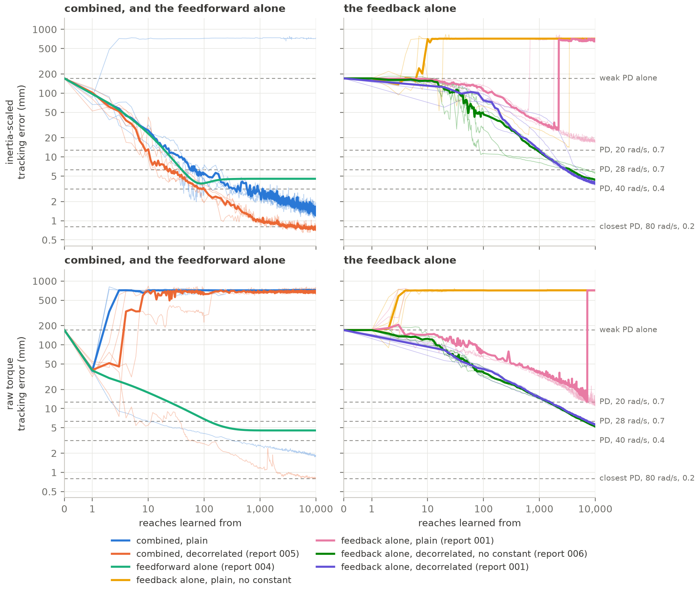
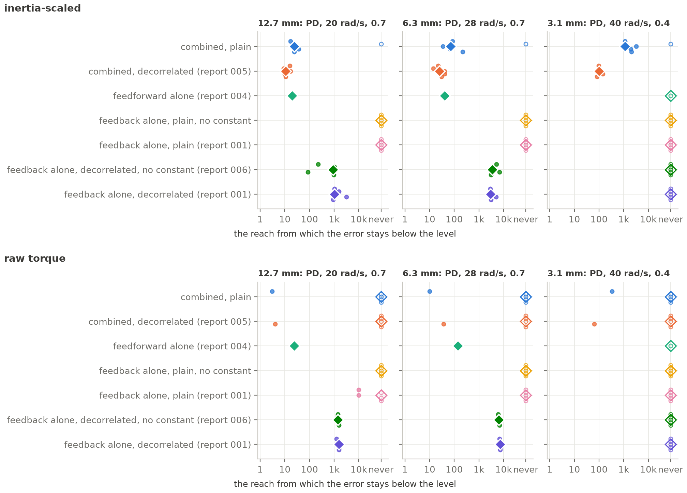
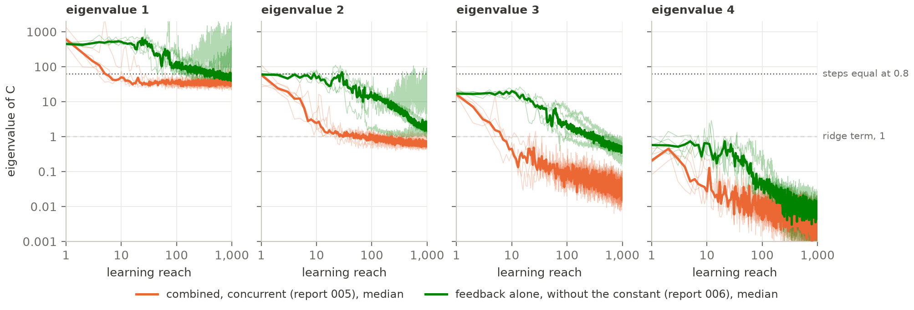

# 007 Plain rule

**Summary.** Report 006 found that the combined controller of report 005 learned
about 100 times faster than the feedback alone. Every feedback there learned by the
decorrelated rule. This report repeats the comparison with the plain rule, which
skips the decorrelation. Inertia-scaled, the plain combined controller still beat
the plain feedback alone by far. It passed the PDs' errors of 12.7, 6.3, and
3.1 mm in 24, 72, and 1,140 reaches, medians over 5 seeds. No seed of the plain
feedback alone passed any of them in 10,000 reaches. But one of its 5 seeds ran
away at the second reach, so the question's criterion, every seed passing before
any seed of the feedback alone, is not met. Against the decorrelated combined
controller, the plain one was slower at every level, about 2, 3, and 12 times. It
ended at 1.2 to 1.6 mm, against 0.7 to 0.8 mm. Retraining the decorrelated runs to
record the matrix `C` that the rule divides by showed why. After the first 10
reaches, the median of its largest eigenvalue stays near 30 to 50. Along that
direction, the decorrelated rule steps about 40 times less far than the plain rule
would at the same learning rate. That direction limits the plain rule's learning
rate to about 0.8, not the decorrelated rule's 50.

- **The feedforward still makes the plain feedback useful.** The plain feedback
  alone ran away on every seed at arm A's setting. At report 001's own setting, 3
  of 5 seeds ran away and 2 ended at 17 to 18 mm, never passing 12.7 mm. Combined
  with the feedforward, 4 of 5 seeds passed all three levels and ended at 1.2 to
  1.6 mm. Neither part alone passes 3.1 mm.
- **The plain rule is slower than the decorrelated one in the combined
  controller.** The plain combined controller passed 3.1 mm after 1,140 to 3,240
  reaches by seed, and the decorrelated one after 83 to 140. Early on, it was also
  slower than the feedforward alone (24 and 72 reaches against 20 and 40) and only
  pulled ahead of it after 200 reaches.
- **Prediction P2 is falsified.** The plain rule's tuned learning rate is 0.8 with
  5.7 rad/s^2, after 5 rounds of tuning, not about 50. At 1.1, and at 8 rad/s^2
  from 0.3 up, every setting ran away within 5 reaches.
- **The decorrelation does not fade.** In the combined controller, three of the
  four directions of `C` fall below the ridge term of 1 within 5 to 36 reaches, as
  predicted, but the largest stays at 30 to 50 up to reach 1,000. Along it, the
  decorrelated rule keeps dividing its step by 30 to 50. At reach 1 it divides by
  about 600, while the plain rule at 0.8 steps 10 times as far.
- **Raw torque: no steady combined arm, with either rule.** The plain combined
  controller held on 1 of 5 seeds, the same count as the decorrelated one in
  report 005.

**Addendum, 2026-11-12.** [Section 6](#6-addendum-2026-11-12-the-staged-schedule-with-the-plain-rule)
adds the staged schedule with the plain rule, inertia-scaled. It passed 3.1 mm
after a median of 140 reaches, against arm A's 1,140 and the decorrelated staged
controller's 120. It ended at 1.2 mm on 4 of 5 seeds.

## 1. Question

Within RQ1 of the [project README](../../README.md#research-questions), report
[006](../006-learning-speed/README.md) asked how many reaches the combined
controller of report [005](../005-feedback-without-constant/README.md) needs to
track as closely as a stiffer PD. Inertia-scaled, it passed the PDs of 20, 28, and
40 rad/s (12.7, 6.3, and 3.1 mm) after 11, 25, and 99 reaches. The feedback alone
needed 920 and 2,820 reaches for the first two, and never passed the third.

Every feedback there learned by burms2015's decorrelated rule. Each reach sums an
eligibility `E`, the feedback's input times its exploration noise, over the
reach's 200 control periods. The decorrelated rule changes the weights by
`eta (R - R_avg) inv(C + I) E`, where `C` sums the input times its transpose over
the reach and 1 is rclib's ridge term. The plain node-perturbation rule changes
them by `eta (R - R_avg) E`. Report [001](../001-feedback-from-scratch/README.md)
tuned both for the feedback alone. The plain rule learned more slowly and ran away
on 2 or 3 of 5 seeds.

The question: does the combined controller's speed depend on the decorrelated
rule? The feedback's inputs are the joints' errors, so `C` shrinks as the
feedforward cuts the error. The experiment's README argued that the ridge term
would then dominate `C`, making the decorrelated update nearly the plain one, so
the plain rule might serve the combined controller where it failed alone. Three
questions:

1. **Q1.** Does the combined controller learn faster than the feedback alone with
   the plain rule too?
2. **Q2.** Within the combined controller, how does the plain rule compare with the
   decorrelated one: in reaches to each level, final error, run-aways, exploration,
   and tuning cost?
3. **Q3.** On the learning reaches themselves, does `C` fall below the ridge term
   within tens of reaches in the combined controller, and much later in the
   feedback alone?

Four predictions were written before the runs:

- **P1.** The plain combined controller passes 12.7 and 6.3 mm about as soon as the
  decorrelated one.
- **P2.** Its tuned learning rate is far above report 001's plain one, 0.15 with
  4 rad/s^2, and nearer the decorrelated combined controller's 50 with 8 rad/s^2.
- **P3.** Where it fails, it runs away within the first tens of reaches.
- **P4.** In the combined controller, `C` has fallen below 1 in all but one or two
  of its four directions within about 100 reaches; in the feedback alone, only
  after about 1,000.

## 2. Setup

The [experiment's README](../../experiments/plain_rule/README.md) holds the
configurations and the protocol, which was fixed before the runs.

Everything shared is as in reports 001 to 006: the two-link arm in the horizontal
plane, the one reach of 1 s with 1 s of holding, the weak PD (5 rad/s, damping
ratio 0.7), the reward, and the final runs' seeds, 1 to 5, which no tuning saw.
Every arm is run with raw torque and inertia-scaled.

Seven arms, three of them new:

| Arm | Source | Rule | What it is | Learning rate, amplitude: raw torque | inertia-scaled |
| --- | --- | --- | --- | --- | --- |
| **A.** combined, plain | new | plain | report 005's combined controller, the feedback tuned again | 32, 0.1 N m | 0.8, 5.7 rad/s^2 |
| combined, decorrelated | report 005 | decorrelated | the feedforward and the feedback both learn from every reach | 250, 0.32 N m | 50, 8 rad/s^2 |
| feedforward alone | report 004 | | the feedforward at the same setting, without a feedback; no noise, so one training | | |
| **B.** feedback alone, plain, no constant | new | plain | arm A without its feedforward | 32, 0.1 N m | 0.8, 5.7 rad/s^2 |
| **C.** feedback alone, plain | report 001, continued | plain | report 001's final runs of the plain rule, with the constant, from 3,000 to 10,000 reaches | 0.25, 0.8 N m | 0.15, 4 rad/s^2 |
| feedback alone, decorrelated, no constant | report 006 | decorrelated | report 001's feedback without its constant | 2.5, 3.2 N m | 50, 8 rad/s^2 |
| feedback alone, decorrelated | report 001 | decorrelated | report 001's feedback, with the constant, 10,000 reaches | 2.5, 3.2 N m | 50, 8 rad/s^2 |

- **Each new arm changes one thing.** Arm A is report 005's controller with the
  plain rule, its feedforward and every other setting kept; only the feedback's
  learning rate and amplitude were tuned again. Arm B is arm A without its
  feedforward, the same feedback on the same seeds, so the same exploration noise.
  Arm C is report 001's plain runs continued. A test checks each configuration
  against the one it changes.
- **The amplitude** is the standard deviation of the Gaussian exploration noise,
  drawn every 10 ms on each joint's output. Inertia-scaled, it is in rad/s^2 and
  multiplied by each joint's inertia, 0.235 and 0.022 kg m^2, into torque.
- **The evaluation**: a noise-free reach after every reach up to 100, and after
  every 20th from then on. Report 001's runs were evaluated after every 20th reach
  only. The evaluations change no learning state.

The protocol:

1. **Tuning arm A**, on seed 0, by hand, in rounds of grids of learning rates by
   amplitudes, for its error at 1,000 reaches. While the closest setting lay on a
   grid's edge, the next round went past it. Round 1 spanned report 001's plain
   setting up to the decorrelated combined controller's.
2. **The final runs**, on seeds 1 to 5, for 10,000 reaches: arms A, B, and C.
3. **The mechanism check**, inertia-scaled. Report 005's combined controller and
   report 006's feedback alone without the constant, both decorrelated, were
   trained again for their first 1,000 reaches on seeds 1 to 5, recording `C` of
   each learning reach. A new runner, `record_decorrelation.py`, wraps the
   training's functions from outside, so neither rclib nor the package changes.
4. **The comparison**, for each feedback scale, as report 006's: the noise-free
   tracking error over the reaches, the reaches to each level, the seeds that run
   away, the exploration in torque, and the tuning's reaches.

The inertia-scaled runs answer the questions. Q1 is answered yes if arm A passes
each level in fewer reaches than arms B and C, and the seeds' ranges do not
overlap. For Q2, the two combined controllers differ at a level only where their
seeds' ranges do not overlap.

### Reproducing the results

This report's runs are in [`results/`](results). Each has its configuration
(`config.toml`), its run record (`run.toml`), and its outputs. The report also
reads report 001's copies of its long runs and of the PD grid, report 004's of the
feedforward alone, report 005's of its final runs, and report 006's of the
feedback alone without the constant.

```bash
uv run python experiments/learn_combined.py experiments/plain_rule/<configuration>.toml --workers <n>
uv run python experiments/learn_feedback.py experiments/plain_rule/<configuration>.toml --workers <n>
uv run python experiments/record_decorrelation.py experiments/plain_rule/decorrelation_inertia.toml --workers 10
uv run python experiments/compare_learning.py experiments/plain_rule/compare_<scale>.toml
uv run python reports/007-plain-rule/make_tables.py
uv run python reports/007-plain-rule/make_figures.py
```

| Runs | Commit |
| --- | --- |
| tuning, round 1: `tune_combined_<scale>` | `9ff8614` |
| tuning, round 2: `tune_combined_<scale>_round2` | `a8b4bab` |
| tuning, round 3: `tune_combined_inertia_round3` | `d743b27` |
| the mechanism check: `decorrelation_inertia` | `d82b23f` |
| tuning, round 4: `tune_combined_inertia_round4` | `5edb828` |
| tuning, round 5: `tune_combined_inertia_round5` | `47b4a8d` |
| `final_combined_<scale>`, `final_feedback_no_constant_<scale>`, `long_plain_<scale>` | `0e537c4` |
| `compare_raw`, `compare_inertia` | `87f5e1d` |

- **The library.** These runs use rclib v0.4.0 (`8532a93`), as report 006's.
- **Run records.** Every run records no uncommitted changes. The number of worker
  processes does not change a result.
- **Arm C reproduces report 001.** Its first 3,000 reaches equal report 001's final
  runs of the plain rule bit for bit, on every seed of both scales: the errors of
  the learning reaches, and the noise-free evaluations at report 001's points.
- **The mechanism check reproduces reports 005 and 006.** All 10 trainings
  reproduce their stored errors bit for bit for 1,000 reaches. Every change of the
  weights is `inv(C + I) E` times one number, to a relative residual of 5e-11 at
  most, so the `C` recorded is the one the rule used.
- **[`make_tables.py`](make_tables.py)** prints the tables of Section 3, and
  **[`make_figures.py`](make_figures.py)** draws its figures, from these copies and
  those of reports 001, 004, 005, and 006.
- **Run times.** The 30 final trainings ran together, 6 runs of 5 processes, in
  117 minutes: 0.54 to 0.70 s per reach with its evaluation.

## 3. Results

### 3.1 Tuning

The closest setting of each round, on seed 0, at 1,000 reaches. Each run's
`learning.png` draws all its settings over the reaches, and `make_tables.py` prints
every cell.

| Run | Scale | Amplitudes | Learning rates | Improved / worse / diverged | Closest | Error |
| --- | --- | --- | --- | --- | --- | ---: |
| [`tune_combined_inertia`](results/20261111-233733-tune_combined_inertia/learning.png) | inertia-scaled | 2, 4, 8, 16 rad/s^2 | 0.15 to 50 | 6 / 18 / 0 | 8 rad/s^2, 0.15 | 2.88 mm |
| [`tune_combined_inertia_round2`](results/20261112-000217-tune_combined_inertia_round2/learning.png) | inertia-scaled | 5.7, 8, 11, 16 rad/s^2 | 0.035 to 0.15 | 19 / 1 / 0 | 11 rad/s^2, 0.15 | 2.81 mm |
| [`tune_combined_inertia_round3`](results/20261112-001938-tune_combined_inertia_round3/learning.png) | inertia-scaled | 4, 5.7, 8, 11 rad/s^2 | 0.2, 0.3, 0.4 | 7 / 5 / 0 | 5.7 rad/s^2, 0.4 | 2.69 mm |
| [`tune_combined_inertia_round4`](results/20261112-002919-tune_combined_inertia_round4/learning.png) | inertia-scaled | 4, 5.7 rad/s^2 | 0.5, 0.6, 0.8, 1.1 | 4 / 4 / 0 | **5.7 rad/s^2, 0.8** | 2.37 mm |
| [`tune_combined_inertia_round5`](results/20261112-075033-tune_combined_inertia_round5/learning.png) | inertia-scaled | 8 rad/s^2 | 0.6, 0.8, 1.1 | 0 / 3 / 0 | none | |
| [`tune_combined_raw`](results/20261111-233733-tune_combined_raw/learning.png) | raw torque | 0.2, 0.4, 0.8, 1.6 N m | 0.25 to 250 | 7 / 21 / 0 | 0.2 N m, 8 | 2.74 mm |
| [`tune_combined_raw_round2`](results/20261112-000217-tune_combined_raw_round2/learning.png) | raw torque | 0.07, 0.1, 0.14, 0.2 N m | 4 to 64 | 13 / 6 / 1 | **0.1 N m, 32** | 2.40 mm |

The tuned settings are in bold.

| Scale | Rounds | Trainings of 1,000 reaches | Reaches |
| --- | ---: | ---: | ---: |
| inertia-scaled | 5 | 67 | 67,000 |
| raw torque | 2 | 48 | 48,000 |

- **Run-aways bound the search on every side.** Inertia-scaled, 31 of 67 settings
  ran away, and every one of them passed 340 mm, twice the weak PD's error,
  within 5 reaches. Every setting with a learning rate of 5 or more ran away, and
  every setting at 8 rad/s^2 or more with a learning rate of 0.3 or more. With raw
  torque, 28 of 48 ran away, one of them to a non-finite error: 24 within 10
  reaches and 4 between reaches 400 and 920.
- **The tuned setting has run-away neighbours.** 0.8 with 5.7 rad/s^2 held on seed
  0, but 0.5 and 0.6 with 5.7 rad/s^2 ran away. Whether a setting runs away on one
  seed is not monotonic in the learning rate, so the closest setting on seed 0 is
  partly luck. Raw torque's 32 with 0.1 N m has two run-away neighbours, 64 with
  0.1 N m and 32 with 0.14 N m.
- **The tuning took 5 rounds, not 2 or 3.** The protocol's rule, going past an edge
  while the closest lay on it, ran until round 5 found every new setting running
  away.

### 3.2 The final runs

Every arm's noise-free tracking error over the reaches: each seed thin, the medians
thick (a run-away counting as it is), and the PDs dashed. The combined controllers
and the feedforward alone are on the left, the feedback alone on the right. The
reaches are on a logarithmic axis.



The same runs, a panel per arm:
[inertia-scaled](results/20261112-095433-compare_inertia/learning.png),
[raw torque](results/20261112-095434-compare_raw/learning.png).

Medians over the seeds, inertia-scaled:

| Learner | Seeds improved | 10 reaches | 30 reaches | 100 reaches | 300 reaches | 1,000 reaches | 3,000 reaches | 10,000 reaches |
| --- | ---: | ---: | ---: | ---: | ---: | ---: | ---: | ---: |
| combined, plain | 4 of 5 | 26.0 mm | 11.1 mm | 5.5 mm | 3.3 mm | 2.6 mm | 2.0 mm | 1.4 mm |
| combined, decorrelated (report 005) | 5 of 5 | 13.1 mm | 5.9 mm | 3.1 mm | 1.7 mm | 1.0 mm | 0.8 mm | 0.7 mm |
| feedforward alone (report 004) | 1 of 1 | 23.2 mm | 8.3 mm | 3.9 mm | 4.5 mm | 4.5 mm | 4.5 mm | 4.5 mm |
| feedback alone, plain, no constant | 0 of 5 | 701.4 mm | 711.6 mm | 714.1 mm | 714.0 mm | 714.0 mm | 714.0 mm | 713.9 mm |
| feedback alone, plain (report 001) | 2 of 5 | 165.8 mm | 140.9 mm | 110.3 mm | 65.0 mm | 34.6 mm | 672.0 mm | 652.5 mm |
| feedback alone, decorrelated, no constant (report 006) | 5 of 5 | 155.2 mm | 103.8 mm | 46.2 mm | 27.5 mm | 11.9 mm | 6.6 mm | 4.4 mm |
| feedback alone, decorrelated (report 001) | 5 of 5 | | | 76.3 mm | 29.7 mm | 12.8 mm | 6.3 mm | 3.8 mm |

Raw torque:

| Learner | Seeds improved | 10 reaches | 30 reaches | 100 reaches | 300 reaches | 1,000 reaches | 3,000 reaches | 10,000 reaches |
| --- | ---: | ---: | ---: | ---: | ---: | ---: | ---: | ---: |
| combined, plain | 1 of 5 | 714.4 mm | 714.4 mm | 714.4 mm | 714.5 mm | 713.6 mm | 718.8 mm | 719.4 mm |
| combined, decorrelated (report 005) | 1 of 5 | 696.4 mm | 558.7 mm | 622.3 mm | 698.0 mm | 684.1 mm | 683.8 mm | 670.1 mm |
| feedforward alone (report 004) | 1 of 1 | 17.8 mm | 11.5 mm | 6.8 mm | 4.9 mm | 4.5 mm | 4.5 mm | 4.5 mm |
| feedback alone, plain, no constant | 0 of 5 | 714.1 mm | 714.2 mm | 714.2 mm | 711.6 mm | 711.6 mm | 714.2 mm | 714.2 mm |
| feedback alone, plain (report 001) | 2 of 5 | 146.6 mm | 103.1 mm | 77.8 mm | 52.7 mm | 38.3 mm | 24.2 mm | 714.2 mm |
| feedback alone, decorrelated, no constant (report 006) | 5 of 5 | 124.1 mm | 66.2 mm | 36.5 mm | 24.6 mm | 14.8 mm | 9.0 mm | 5.2 mm |
| feedback alone, decorrelated (report 001) | 5 of 5 | | | 41.7 mm | 25.9 mm | 15.1 mm | 9.1 mm | 5.6 mm |

Report 001's runs were not evaluated at 10 and 30 reaches.

- **The plain combined controller, seed by seed.** Inertia-scaled, seeds 1, 2, 3,
  and 5 reached 2.0 to 2.6 mm at 1,000 reaches and 1.2 to 1.6 mm at 10,000. Seed 4
  passed 340 mm at the second reach and stayed near 720 mm. With raw torque, only
  seed 5 held, to 1.8 mm; the other four passed 340 mm at the second or third
  reach.
- **The plain feedback alone, at arm A's setting, ran away on every seed.**
  Inertia-scaled, seeds 1 to 4 passed 340 mm between reaches 4 and 19. Seed 5
  reached 14.0 mm at reach 3,400, then ran away by reach 3,420. With raw torque,
  every seed passed 340 mm by reach 4.
- **The plain feedback alone, at report 001's setting, ran away late.**
  Inertia-scaled, seeds 1 and 2 ended at 18.3 and 16.9 mm. Seeds 3, 4, and 5 had
  reached 51, 25, and 26 mm, then ran away between reaches 680 and 2,220, as in
  report 001. With raw torque, seeds 3 and 5 ended at 11.6 and 11.8 mm. Seed 1,
  at 24.2 mm after 3,000 reaches in report 001, reached 12.1 mm at reach 7,040,
  then ran away by reach 7,180: a run-away that report 001's 3,000 reaches did not
  see.

### 3.3 The reaches to each level

The first reach from which the error stays below a PD's for the rest of the
training: a dot per seed, a diamond for the median over the seeds, and hollow
marks for never.



Inertia-scaled, the median's reach, and in parentheses the seeds' range:

| Learner | Reaches run | PD, 20 rad/s, 0.7 (12.7 mm) | PD, 28 rad/s, 0.7 (6.3 mm) | PD, 40 rad/s, 0.4 (3.1 mm) |
| --- | ---: | ---: | ---: | ---: |
| combined, plain | 10,000 | 24 (17 to 36; 1 never) | 72 (35 to 220; 1 never) | 1,140 (1,140 to 3,240; 1 never) |
| combined, decorrelated (report 005) | 10,000 | 11 (9 to 17) | 25 (14 to 41) | 99 (83 to 140) |
| feedforward alone (report 004) | 10,000 | 20 | 40 | never |
| feedback alone, plain, no constant | 10,000 | never (no seed) | never (no seed) | never (no seed) |
| feedback alone, plain (report 001) | 10,000 | never (no seed) | never (no seed) | never (no seed) |
| feedback alone, decorrelated, no constant (report 006) | 10,000 | 920 (86 to 1,040) | 3,540 (3,120 to 6,820) | never (no seed) |
| feedback alone, decorrelated (report 001) | 10,000 | 1,020 (900 to 3,180) | 3,020 (2,900 to 4,900) | never (no seed) |

Raw torque:

| Learner | Reaches run | PD, 20 rad/s, 0.7 (12.7 mm) | PD, 28 rad/s, 0.7 (6.3 mm) | PD, 40 rad/s, 0.4 (3.1 mm) |
| --- | ---: | ---: | ---: | ---: |
| combined, plain | 10,000 | never (3; 4 never) | never (10; 4 never) | never (340; 4 never) |
| combined, decorrelated (report 005) | 10,000 | never (4; 4 never) | never (37; 4 never) | never (64; 4 never) |
| feedforward alone (report 004) | 10,000 | 24 | 140 | never |
| feedback alone, plain, no constant | 10,000 | never (no seed) | never (no seed) | never (no seed) |
| feedback alone, plain (report 001) | 10,000 | never (9,780 to 9,940; 3 never) | never (no seed) | never (no seed) |
| feedback alone, decorrelated, no constant (report 006) | 10,000 | 1,420 (1,340 to 1,560) | 6,480 (5,960 to 6,740) | never (no seed) |
| feedback alone, decorrelated (report 001) | 10,000 | 1,540 (1,260 to 1,600) | 7,280 (6,920 to 7,640) | never (no seed) |

### 3.4 Q1: the plain combined controller against the plain feedback alone

Inertia-scaled, against the faster of arms B and C, by the medians, at 2 s per
reach:

| Learner | 12.7 mm | 6.3 mm | 3.1 mm |
| --- | --- | --- | --- |
| the faster plain feedback alone | not in 10,000 | not in 10,000 | not in 10,000 |
| combined, plain | 24 reaches, 0.8 min; more than 417 times fewer; seeds overlap | 72 reaches, 2.4 min; more than 139 times fewer; seeds overlap | 1,140 reaches, 38.0 min; more than 9 times fewer; seeds overlap |

The seeds' ranges overlap only through arm A's seed 4, which ran away at the second
reach and never passed a level: no seed of arm B or C passed any level in 10,000
reaches. With raw torque, the plain combined controller's median never passed a
level, as 4 of 5 seeds ran away.

### 3.5 Q2: the two rules in the combined controller

Inertia-scaled, seed by seed, 1 to 5. Apart: every seed of one rule before, or
closer than, every seed of the other; a seed that never passes counts as after
every reach.

| Measure | Plain | Decorrelated | Apart |
| --- | --- | --- | --- |
| reach to 12.7 mm | 24, 36, 20, never, 17 | 11, 10, 17, 9, 16 | overlap |
| reach to 6.3 mm | 220, 68, 35, never, 84 | 30, 40, 41, 14, 22 | overlap |
| reach to 3.1 mm | 2,040, 1,940, 3,240, never, 1,140 | 83, 140, 120, 99, 98 | decorrelated before |
| error at 100 reaches | 7.53, 4.28, 4.47, 723.34, 5.52 mm | 1.92, 3.68, 3.38, 2.98, 3.12 mm | decorrelated closer |
| error at 1,000 reaches | 2.00, 2.07, 2.55, 724.34, 2.57 mm | 0.86, 0.97, 1.02, 0.97, 1.02 mm | decorrelated closer |
| error at 10,000 reaches | 1.63, 1.37, 1.39, 735.01, 1.23 mm | 0.69, 0.73, 0.71, 0.77, 0.73 mm | decorrelated closer |

The other measures of Q2:

| Measure | Plain | Decorrelated |
| --- | --- | --- |
| run-aways, inertia-scaled | 1 of 5 (seed 4, at reach 2) | 0 of 5 |
| run-aways, raw torque | 4 of 5 (seeds 1 to 4, by reach 3) | 4 of 5 (seeds 1, 3, 4, 5) |
| exploration, inertia-scaled, joint 1 / joint 2 | 5.7 rad/s^2: 1.34 / 0.13 N m | 8 rad/s^2: 1.88 / 0.18 N m |
| exploration, raw torque | 0.10 / 0.10 N m | 0.32 / 0.32 N m |
| tuning, inertia-scaled, trainings of 1,000 reaches | 67, of the feedback's learning rate and amplitude | 31 in report 004, after report 003's: 16 of the feedforward's forgetting, 15 of the feedback's setting |

Report 004's tuning of the decorrelated feedback in the combined controller settled
on the setting that report 001 had found for the decorrelated feedback alone, 50
with 8 rad/s^2, in 36 trainings of 1,000 reaches.

- **At the first two levels, the ranges overlap, but every median favours the
  decorrelated rule.** The plain combined controller's seeds passed 12.7 mm at 17
  to 36 reaches, the decorrelated one's at 9 to 17; they share only reach 17. At
  6.3 mm, 35 to 220 against 14 to 41.
- **At 3.1 mm and at every budget from 100 reaches on, the two are apart.** The
  decorrelated rule's slowest seed passed 3.1 mm at reach 140, the plain rule's
  fastest at 1,140. At 10,000 reaches, the plain rule's closest seed is at 1.23 mm,
  the decorrelated rule's farthest at 0.77 mm.

### 3.6 While learning, and the exploration

The tracking error of the reaches the controllers learn from, with the exploration
noise: the median over each window of reaches of each seed, then the median over
the seeds. Inertia-scaled:

| Learner | 1 to 10 | 11 to 100 | 101 to 1,000 | 1,001 to 3,000 | 3,001 to 10,000 |
| --- | ---: | ---: | ---: | ---: | ---: |
| combined, plain | 45.9 mm | 18.0 mm | 12.1 mm | 9.0 mm | 6.5 mm |
| combined, decorrelated (report 005) | 43.2 mm | 9.5 mm | 5.1 mm | 3.5 mm | 2.6 mm |
| feedforward alone (report 004) | 41.5 mm | 4.7 mm | 4.6 mm | 4.6 mm | 4.6 mm |
| feedback alone, plain, no constant | 173.1 mm | 714.0 mm | 714.0 mm | 714.0 mm | 714.0 mm |
| feedback alone, plain (report 001) | 170.3 mm | 133.0 mm | 50.1 mm | 40.0 mm | 681.6 mm |
| feedback alone, decorrelated, no constant (report 006) | 161.4 mm | 62.2 mm | 18.9 mm | 9.1 mm | 5.9 mm |
| feedback alone, decorrelated (report 001) | 172.1 mm | 102.2 mm | 19.8 mm | 9.1 mm | 5.5 mm |

`make_tables.py` prints the same for raw torque, where the run-aways dominate the
medians, and every arm's exploration in torque.

- **The plain combined controller's noisy reaches miss by twice as much.** From
  reach 11 on, 18.0 to 6.5 mm, against the decorrelated one's 9.5 to 2.6 mm, with
  less exploration noise: 1.34 N m on joint 1 against 1.88 N m.
- **Early on, the plain feedback slows the feedforward down.** Over reaches 11 to
  100, the feedforward alone's reaches, which carry no noise, missed by 4.7 mm, and
  the plain combined controller's noisy ones by 18.0 mm. Its noise-free median stayed below
  the feedforward alone's only from reach 200.

### 3.7 Q3: the mechanism check

The eigenvalues of `C` over the first 1,000 learning reaches of the two
decorrelated arms trained again, each seed thin and the median thick. The dashed
line is the ridge term, 1. The dotted line, at 61.5, is where the decorrelated
rule's step, `50 / (eigenvalue + 1)` times `E`'s component along that direction,
equals the plain rule's at arm A's 0.8. Above it, the plain rule at 0.8 steps
further than the decorrelated rule; below it, less far.



Medians over the seeds, and in parentheses the decorrelated rule's step along that
direction over the plain rule's at 0.8:

| Arm | Reach | Eigenvalue 1 | Eigenvalue 2 | Eigenvalue 3 | Eigenvalue 4 |
| --- | ---: | ---: | ---: | ---: | ---: |
| combined (report 005) | 1 | 609 (0.1) | 58.4 (1.1) | 16.1 (3.7) | 0.208 (52) |
| combined (report 005) | 2 | 247 (0.25) | 24.1 (2.5) | 7.1 (7.7) | 0.446 (43) |
| combined (report 005) | 5 | 64 (0.96) | 12.2 (4.7) | 1.53 (25) | 0.0519 (59) |
| combined (report 005) | 10 | 49.8 (1.2) | 2.43 (18) | 0.446 (43) | 0.027 (61) |
| combined (report 005) | 100 | 38 (1.6) | 1.1 (30) | 0.0709 (58) | 0.0176 (61) |
| combined (report 005) | 1,000 | 40 (1.5) | 0.686 (37) | 0.0189 (61) | 0.0034 (62) |
| feedback alone, no constant (report 006) | 1 | 449 (0.14) | 60.1 (1) | 17.1 (3.5) | 0.573 (40) |
| feedback alone, no constant (report 006) | 10 | 516 (0.12) | 46.6 (1.3) | 19.9 (3) | 0.639 (38) |
| feedback alone, no constant (report 006) | 30 | 377 (0.17) | 48.6 (1.3) | 7.39 (7.5) | 0.271 (49) |
| feedback alone, no constant (report 006) | 100 | 106 (0.58) | 13.7 (4.3) | 1.8 (22) | 0.0409 (60) |
| feedback alone, no constant (report 006) | 1,000 | 46.5 (1.3) | 1.93 (21) | 0.449 (43) | 0.00546 (62) |

The reach from which, on each seed, at most two, and at most one, of the four
directions stay above the ridge term for the rest of the 1,000 reaches:

| Arm | At most two above | At most one above | The largest above at every reach |
| --- | --- | --- | --- |
| combined (report 005) | 36, 7, 28, 5, 13 | 655, 1,000, 125, 515, 43 | every seed |
| feedback alone, no constant (report 006) | 683, 906, 390, 260, 96 | never on any seed | every seed |

- **Three directions fall below the ridge term, the largest never does.** In the
  combined controller, eigenvalue 4 was below 1 throughout, eigenvalue 3 from
  about reach 6, and eigenvalue 2 near 1 from reach 30, 0.69 at reach 1,000. The largest fell from
  about 600 to 50 within 10 reaches and stayed at 30 to 50. In the feedback alone,
  the largest stayed near 450 to 520 for 10 reaches and fell to 46 by reach 1,000;
  on seed 2 it stayed near 350 after reach 300.
- **The decorrelated rule is not nearly the plain one at the same learning rate.**
  In the combined controller, from reach 30 on, `C + I` is within a factor of 2
  of `I` in the three small directions, and the decorrelated rule steps there
  nearly as the plain rule would at 50: 30 to 62 times arm A's 0.8. Along the
  largest, it divides by the eigenvalue: at reach 1, its step is a tenth of the
  plain rule's at 0.8; from reach 10 on, 1.2 to 1.9 times it.
- **In the feedback alone, the plain rule at 0.8 steps 6 to 8 times as far as the
  decorrelated rule along the largest direction for the first 30 reaches.** Arm B,
  at 0.8, ran away between reaches 4 and 19 on 4 of 5 seeds.

`C` here is recorded on the decorrelated rule's own learning reaches. On the plain
rule's, the errors, and so `C`, differ, and arm A explores with 5.7 rad/s^2, not 8.

## 4. Observations

- **Q1: yes by every median, not by the criterion.** Inertia-scaled, the plain
  combined controller passed each level in 24, 72, and 1,140 reaches, and no seed
  of the plain feedback alone, at either setting, passed any level in 10,000. But
  the criterion asks every seed of arm A to pass before any seed of arms B and C,
  and arm A's seed 4 ran away at reach 2. Arm B, the matched ablation, ran away on
  every seed: without the feedforward, arm A's feedback setting does not hold at
  all.
- **Q2: the decorrelated rule is faster and closer.** About twice and three times
  faster at 12.7 and 6.3 mm by the medians, with overlapping seeds; twelve times
  faster at 3.1 mm, with every seed apart; and about half the final error, apart.
  It ran away on no inertia-scaled seed against one, and explores a little more.
  Its feedback setting is the decorrelated feedback alone's, which report 004's 15
  trainings came back to; the plain rule's took 67 trainings and 5 rounds.
- **Q3: yes for three directions, no for the largest.** `C` falls below the ridge
  term in all but one or two directions within 5 to 36 reaches in the combined
  controller, and after 96 to 906 in the feedback alone. The largest direction
  stays above it in both, at about 40 in the combined controller.
- **A reading of why, from the mechanism check.** The plain rule's step along a
  direction of `C` is `eta`, the decorrelated rule's `50 / (eigenvalue + 1)`. At
  reach 1, before the feedforward has learned, the largest eigenvalue is about 600
  in both arms, and the decorrelated rule's step along it is near 0.1. In the
  feedback alone it stays there for 30 reaches. Report 001's plain feedback, tuned
  alone, settled at 0.15 with 4 rad/s^2, near that step, and arm B, at 0.8, ran away within 19
  reaches. In the combined controller, the feedforward cuts the largest eigenvalue
  to about 40 within 10 reaches, raising the decorrelated rule's step to about 1.2.
  Arm A's tuned 0.8 sits between the two: its step is 10 times the decorrelated
  rule's along the largest direction at reach 1, the reach after which seed 4 ran
  away, and 30 to 62 times smaller in the three small directions from reach 30 on,
  which may be why it is slower later. The decorrelated rule adapts its step to `C`
  reach by reach; one plain learning rate cannot. This is untested: `C` was
  recorded on the decorrelated runs only.
- **The predictions.** P1 is falsified: the plain combined controller took 24 and
  72 reaches against 11 and 25, and more than the feedforward alone's 20 and 40.
  P2 is falsified: the tuned learning rate is 0.8, not near 50. P3 held: arm A's
  run-aways passed 340 mm at reach 2 or 3. P4 held for the small directions,
  sooner than predicted in the combined controller, but never for the largest.
- **The experiment's motivation was half right.** Its README argued that the ridge
  term would dominate `C`, making the decorrelated update nearly the plain one. It
  does in three of four directions. In the fourth, the largest, `C` stays about 40
  times the ridge term, and that direction limits the plain rule's learning rate.
  The README's argument used noise-free reaches under fixed PDs, without the
  exploration noise that the learning reaches carry.
- **Raw torque remains unfit, with either rule.** Both combined controllers held on
  1 of 5 seeds, different ones. The plain rule's run-aways came by reach 3.

What is not claimed:

- **That the plain rule is slower in general.** Arm A was tuned on one seed, at a
  setting with run-away neighbours, and the decorrelated rule's setting was tuned
  in earlier reports. A schedule of the learning rate, small at first and larger
  once the feedforward has learned, might close the gap; it was not tried.
- **That the reading above explains the speed.** The step ratios come from `C` of
  the decorrelated runs. Whether the plain rule's run-aways and slowness follow
  the largest eigenvalue of its own `C` was not measured.
- **Anything beyond one reach, the simulated arm, or raw torque.** As in report
  006: one reach was learned, the arm has no sensor noise, delay, friction, or
  torque limit, and no raw-torque combined arm was steady.

## 5. Next steps

1. **Record `C` on the plain rule's runs.** `record_decorrelation.py` refuses a
   run without the decorrelation, as it checks the rule's update against
   `inv(C + I) E`. A variant that checks against `E` would give arm A's and arm B's
   own eigenvalues, and test whether the plain rule's run-aways follow the largest.
2. **A plain rule with a schedule of its learning rate**, small while the
   feedforward learns and larger after: a direct test of the reading above.
3. **A tuning that judges robustness**, reports 005's and 006's next step: several
   tuning seeds and a margin from settings that run away. Arm A's tuned setting had
   run-away neighbours and lost 1 of 5 seeds.
4. **Report 006's other next steps** stand: smaller exploration and its cost in
   speed, the tuning's own cost, and several reaches.

## 6. Addendum, 2026-11-12: the staged schedule with the plain rule

Report 006 ran the staged schedule with the decorrelated rule only, and arm A runs
the plain rule on the concurrent schedule only. To compare both rules on both
schedules, `plain_rule` adds arm D, inertia-scaled only. Arm D is arm A on the
staged schedule: the feedforward learns the first 100 reaches alone and is then
frozen, and the feedback learns from the rest. Its learning rate and amplitude
were tuned as arm A's were (the addendum of `experiments/plain_rule/README.md`).
Raw torque was not run. `make_tables.py` prints the tables below from copies of
the four runs under `results/`.

### 6.1 Tuning

Three rounds on seed 0 ran 53 trainings, 53,000 trials. The closest at 1,000
trials is a learning rate of 2.5 with 5.7 rad/s^2, 1.62 mm, inside the grids:
arm A's amplitude, at about 3 times arm A's learning rate of 0.8. Round 1's
closest, 5 with 4 rad/s^2, lay on its grid's smallest amplitude, and round 2's,
2.5 with 5.7 rad/s^2, in its corner. At 16 and 32 rad/s^2 every setting ran away,
and at 8 rad/s^2 every learning rate from 1.25 up. Of round 1's 18 run-aways, 14
were past 340 mm at trial 120, the first evaluation after the feedback joins. In
every setting, the first 100 trials are the feedforward alone's, bit for bit, and
every setting run again in a later round repeated its run bit for bit.

### 6.2 The final runs

Medians over the seeds; a run-away's error counts as it is.

| Learner | Seeds improved | 10 reaches | 30 reaches | 100 reaches | 300 reaches | 1,000 reaches | 3,000 reaches | 10,000 reaches |
| --- | ---: | ---: | ---: | ---: | ---: | ---: | ---: | ---: |
| combined, concurrent, plain (arm A) | 4 of 5 | 26.0 mm | 11.1 mm | 5.5 mm | 3.3 mm | 2.6 mm | 2.0 mm | 1.4 mm |
| combined, concurrent, decorrelated (report 005) | 5 of 5 | 13.1 mm | 5.9 mm | 3.1 mm | 1.7 mm | 1.0 mm | 0.8 mm | 0.7 mm |
| combined, staged, plain (arm D) | 4 of 5 | 23.2 mm | 8.3 mm | 3.9 mm | 2.2 mm | 1.6 mm | 1.4 mm | 1.2 mm |
| combined, staged, decorrelated (report 006) | 3 of 5 | 23.2 mm | 8.3 mm | 3.9 mm | 0.8 mm | 0.7 mm | 0.7 mm | 0.6 mm |

The first reach from which the median over the seeds stays closer than the PD, and
that reach of each seed:

| Learner | PD, 20 rad/s, 0.7 (12.7 mm) | PD, 28 rad/s, 0.7 (6.3 mm) | PD, 40 rad/s, 0.4 (3.1 mm) |
| --- | ---: | ---: | ---: |
| combined, concurrent, plain (arm A) | 24 (17 to 36; 1 never) | 72 (35 to 220; 1 never) | 1,140 (1,140 to 3,240; 1 never) |
| combined, concurrent, decorrelated (report 005) | 11 (9 to 17) | 25 (14 to 41) | 99 (83 to 140) |
| combined, staged, plain (arm D) | 20 (20; 1 never) | 40 (40; 1 never) | 140 (140 to 160; 1 never) |
| combined, staged, decorrelated (report 006) | 20 (20; 2 never) | 40 (40; 2 never) | 120 (120; 2 never) |

Arm D improved on 4 of 5 seeds, to 1.60 to 1.70 mm at 1,000 reaches and 1.20 to
1.22 mm at 10,000. Seed 4 reached 1.21 mm, then ran away late, past 340 mm by
reach 8,280. As its first 100 reaches are the feedforward alone's, it passed 12.7
and 6.3 mm after 20 and 40 reaches, as the decorrelated staged controller did.

### 6.3 Rule against rule, and schedule against schedule

Seed by seed, by the criterion of Section 3.5: two arms are apart only if every
seed of one passes before, or ends closer than, every seed of the other, a seed
that never passes counting as after every reach.

- **The staged schedule, plain against decorrelated.** The two share their first
  100 reaches. After the handover, the plain rule passed 3.1 mm after 140 to 160
  reaches on its 4 seeds that held, and the decorrelated rule after 120 on its 3.
  The decorrelated rule's 3 ended closer, at 0.52 to 0.59 mm, against 1.20 to
  1.22 mm. By the criterion they overlap at every level and budget, as each lost
  seeds: the plain rule seed 4, at reach 8,280; the decorrelated rule seeds 2 and
  5, within 20 reaches of the handover.
- **The plain rule, concurrent against staged.** Seed 4 never stays below 3.1 mm
  on either schedule: it ran away at reach 2 concurrent and at reach 8,280 staged.
  On the other four, the staged schedule passed 3.1 mm after 140 to 160 reaches,
  the concurrent one after 1,140 to 3,240, and 6.3 mm after 40 against 35 to 220.
  At 100 and 1,000 reaches, every staged seed was closer than every concurrent
  one: 3.87 mm against 4.28 to 7.53 mm and seed 4's run-away, and 1.60 to 1.70 mm
  against 2.00 to 2.57 mm and the run-away. At 10,000 they overlap: the four that
  held ended at 1.20 to 1.22 mm staged and 1.23 to 1.63 mm concurrent.
- **The decorrelated rule, concurrent against staged**, report 006's comparison:
  the concurrent schedule passed 12.7 mm first on every seed, after 9 to 17
  reaches against 20. At 6.3 and 3.1 mm they overlap: at 3.1 mm, 83 to 140
  reaches against 120 on 3 seeds. The staged schedule's 3 seeds ended closer, at 0.52 to 0.59 mm
  against 0.69 to 0.77 mm, but it lost 2 seeds.

### 6.4 What this changes, and what is not claimed

- **The staged schedule takes away most of the plain rule's slowness.** At
  3.1 mm, its median of 140 reaches is 8 times fewer than arm A's 1,140, and 20
  more than the decorrelated staged controller's 120. Its feedback joins when the
  feedforward has brought the error to 3.9 mm. Its tuned learning rate is about 3
  times arm A's. Whether the smaller errors at the handover are why it tolerates
  the larger rate was not measured: `C` was not recorded on these runs.
- **It does not close the gap in final error.** With the plain rule, the seeds
  that held ended at 1.2 to 1.6 mm on both schedules. With the decorrelated rule,
  they ended at 0.5 to 0.8 mm on both.
- **Run-aways remain.** The plain rule lost 1 of 5 seeds on each schedule. On the
  staged one it ran away late, at reach 8,280, after holding near 1.2 mm. Whether
  more seeds would run away after 10,000 reaches is not known.
- **Not claimed**, as in Section 4: anything about raw torque, which was not run
  for arm D; a speed that counts the tuning's 53,000 trials on seed 0; and a
  setting that is robust, as it was tuned on one seed.

